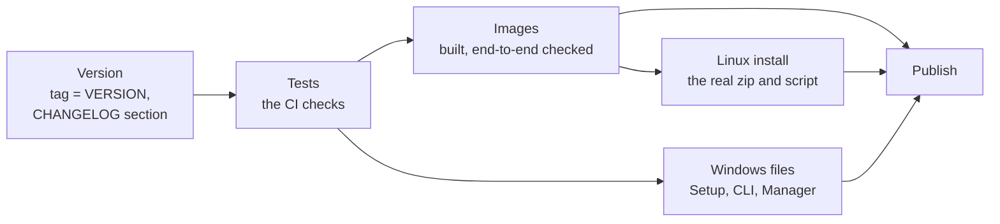

# Contributing to NetRollout

My grandfather used to say: *don't look a gift horse in the mouth*. Open source turns that around. Here you are invited to look in the horse's mouth: the whole source is open. Just don't complain about the cavities. Bring a filling.

In practice, every kind of help is welcome. A clear bug report helps, and a fix helps even more. A note that NetRollout works on your devices helps the next engineer decide whether to trust it.

NetRollout has one maintainer, and testing is best effort: not every path or environment is covered. Please keep that in mind when you report something, and be patient waiting for an answer.

This guide is for people who want to report, change or build NetRollout. If you only want to install and run it, start with the [README](README.md) and the [installation guide](docs/install.md).

## Contents

- [Ways to contribute](#ways-to-contribute)
- [Before you start](#before-you-start)
- [Development setup](#development-setup)
- [Project layout](#project-layout)
- [Running the tests](#running-the-tests)
- [Code style](#code-style)
- [Tests: the rules](#tests-the-rules)
- [Dependencies](#dependencies)
- [Database migrations](#database-migrations)
- [Commits and pull requests](#commits-and-pull-requests)
- [Building things locally](#building-things-locally)
- [Releasing (maintainers)](#releasing-maintainers)
- [Code of conduct](#code-of-conduct)
- [License of contributions](#license-of-contributions)

## Ways to contribute

Every issue goes through a form on the [issue page](https://github.com/itamar14-byte/NetRollout/issues/new/choose):

| Form | Use it for |
|---|---|
| **Bug report** | Something doesn't work as it should. Give the version (the footer of every page, `netrollout status`, or `netrollout-cli --version`), what you did, what you expected and what happened. Rollout logs are safe to attach: passwords, secrets and SNMP communities are replaced with `<redacted>`. The commands as typed and config snapshots are not redacted, so check those before you post them. |
| **Feature request** | An idea: a new platform, a missing option, a better way to do something. Describe the task you're trying to do; that matters more than how. |
| **Platform confirmation** | NetRollout worked on a real device of one of the 12 platforms. Confirmations move a platform from "not yet confirmed" to "tested on real devices". If it didn't work, use the bug report form. |
| **Something else** | Questions, documentation mistakes, anything the other forms don't cover. |

> [!IMPORTANT]
> Don't report a security vulnerability in a public issue. See [SECURITY.md](SECURITY.md).

## Before you start

- **For anything bigger than a small fix, open an issue first** and describe what you plan to do. It saves you from writing something that doesn't fit the design or is already being worked on.
- Small fixes (a typo, an obvious bug with a test) can go straight to a pull request.
- There is one maintainer. Reviews and answers are best effort.

## Development setup

You need:

- **Python 3.12** (the version the image uses).
- **Docker** (Docker Desktop on Windows). The dev stack runs Postgres, Redis, nginx and the monitoring services in containers; the app itself runs on your machine.
- **Git**. On Windows, the commands below work in Git Bash or PowerShell unless noted.

Everything runs **from the repository root**: `src` is a package and every import is `src.*`.

```bash
python -m venv .venv
# Windows: .venv\Scripts\activate    Linux/macOS: source .venv/bin/activate
pip install -r requirements-dev.txt
```

Create the dev settings once:

```bash
python -m src.setup init --dev
```

This writes three things, all gitignored:

- `.env`: the dev stack's generated passwords, and the compose files to use.
- `config/runtime.env`: points the app on your machine at the dev stack (`127.0.0.1`).
- `certs/`: a self-signed certificate for `localhost` and `127.0.0.1`.

It refuses to run when `.env` or `config/runtime.env` already exists; remove them to start over.

Start the dev stack and the app:

```bash
docker compose up -d          # the dev stack (compose project netrollout-dev)
python -m src.webapp          # the app, on port 8080
```

The first `docker compose up -d` builds NetRollout's images from the repository, so it takes a few minutes. After you change an image's source (`Dockerfile`, `deploy/`), run `docker compose up -d --build`. `docker compose ps` shows the services' health; `docker compose down` stops them (the data stays in the volumes).

Open **https://localhost:8443**. nginx forwards to the app on port 8080; port 8081 redirects to HTTPS. The dev stack uses 8443 and 8081 instead of 443 and 80 so that it can run beside an installed NetRollout on the same computer.

- Sign in as `admin` / `admin`. You are asked to choose a new password at once.
- Grafana is at **https://localhost:8443/grafana/** (signed-in admins only).
- Every app start runs the database migrations, creates the factory `admin` account if it's missing, and signs everyone out.

## Project layout

| Path | What it holds |
|---|---|
| `src/` | The app and the CLI. `src/rollout/` is the engine, shared by both and free of the web stack. `src/webapp/` is the Flask app (one blueprint per page). |
| `templates/` | The web pages (Jinja2). |
| `tests/` | `unit/` (hermetic), `integration/` (by page, real Postgres and Redis), `e2e/` (a whole install). |
| `deploy/` | What runs in or beside the containers: the nginx image, Postgres' first-start script, Grafana's setup and dashboards, the monitoring configs. |
| `packaging/` | How NetRollout is built and installed: `windows/` (the management script, NetRollout Setup, NetRollout Manager), `linux/` (`install.sh`, `netrollout.sh`), `build_release.py`, the CLI's PyInstaller spec. |
| Root | `Dockerfile`, the compose files, `pyproject.toml` (mypy and pytest settings), `requirements*`, `VERSION`. |

The full design (containers, flows, every package and the object model) is in [docs/architecture.md](docs/architecture.md). Read it before a larger change.

## Running the tests

```bash
pytest                    # everything that can run here
pytest tests/unit         # hermetic: no services needed
python -m mypy            # the type gate
```

**Unit tests** need nothing but the dev dependencies.

**Integration tests** use the dev stack's Postgres and Redis:

- Postgres: a `rollout_test` database, created fresh for each run on the dev stack's Postgres, with its superuser password from `.env`.
- Redis: database 15 of the server in `config/runtime.env`. A run also uses the database two below its own for the Redis-switch test.
- The LDAP tests start and remove a temporary OpenLDAP container, so they need Docker.

When a service is down, its tests are skipped with the reason (`pytest -ra` lists them). If around 150 tests skip right after you start Docker, Postgres wasn't ready yet: run again.

To use other services, set:

| Variable | Meaning |
|---|---|
| `TEST_PG_ADMIN_URL` | A Postgres URL whose user may create and drop databases. |
| `TEST_PG_DBNAME` | The test database's name (default `rollout_test`). |
| `TEST_REDIS_URL` | A Redis server and database. The app's own database is refused. |

Two runs side by side need their own `TEST_PG_DBNAME` and Redis databases that don't overlap (for example `/15` and `/11`).

**End-to-end tests** (`tests/e2e/`) install NetRollout from the release files into a scratch folder (compose project `nre2e`, ports 18443 and 18080) and check it from outside. They never touch the dev stack or an installation. They are skipped unless `NETROLLOUT_E2E=1`:

```bash
docker build -t itamarweinstein/netrollout:e2e-local .
docker build -t itamarweinstein/netrollout-nginx:e2e-local deploy/nginx
NETROLLOUT_E2E=1 python -m pytest tests/e2e     # PowerShell: $env:NETROLLOUT_E2E = "1"; python -m pytest tests/e2e
```

| Variable | Meaning |
|---|---|
| `NETROLLOUT_E2E_TAG` | The image tag to install (default `e2e-local`). |
| `NETROLLOUT_E2E_BUILD=1` | Build both images first. Otherwise a missing image fails the run. |
| `NETROLLOUT_E2E_DIR` | The scratch folder: new, empty, or an earlier run's. Default: a temporary one. |
| `NETROLLOUT_E2E_KEEP=1` | Leave the containers and the folder. Clean up later with `docker compose -p nre2e down -v` from that folder. |

## Code style

**Python**

- Indent with **tabs**.
- **Type hints everywhere** in `src/`, `packaging/build_release.py` and `deploy/grafana/setup.py`. `python -m mypy` must pass (`disallow_untyped_defs` is on). Tests aren't typed.
- **Docstrings in reST** on non-trivial functions: `:param:`, `:returns:`, `:raises:`. Comments only where the logic needs explaining.
- **Imports**, as in `src/jobs.py` or `src/cli.py`:
  - All at the top, after the module docstring. `from __future__` first.
  - Then three groups separated by a blank line: standard library, third-party, the project (`src` / `tests`).
  - In each group, plain `import x` before `from x import ...`, sorted by module. No comment headers.
  - No imports inside functions. The one exception is `src/db/alembic/env.py`.
  - No import cycles: every module imports on its own.
  - The CLI must not load the web stack. `src/rollout/` imports the database models and Redis for type checking only; `tests/unit/test_cli.py` guards this.

**The object model**, in short (details and the class diagrams in [docs/architecture.md](docs/architecture.md)):

- A class only for a real thing with state and behaviour. A rule without state stays a function.
- An abstract base class when the project owns the whole family and the base shares code. A `Protocol` when the implementer is foreign or a test fake (Netmiko, redis-py). A `Callable` for a one-call contract.
- An enum when a closed set of values is spelled twice or crosses a boundary (Redis, a file, the database, JSON, a script). Its values never change.
- `isinstance` only to validate external data, never to choose behaviour.
- One file, one concern.
- Domain services (`InventoryView`, `JobResults`, `Accounts`, `SecurityProfiles`) work in the caller's database session and **raise** on a refused change. The route catches outside its session block, so a refused change rolls back instead of committing half.

**Frontend** (`templates/`)

- Permanently dark theme, no toggle. Use the shared classes (`nr-card`, `nr-badge`, `nr-help`, ... in `_classes_css.html`) instead of repeating inline styles.
- Shared pieces live in includes (`_footer.html`, `_flash.html`, `_idle_timeout.html`, ...). Change them once, not per page.
- **Data into HTML from scripts:** anything a person can influence (labels, names, hostnames, commands, device output, error messages) goes through `nrEscape(value)`, or better `textContent` / `createElement`, before `innerHTML`. Jinja values inside `<script>` use `|tojson`.
- **CSRF in scripts:** send the page's `CSRF_TOKEN` as the `X-CSRFToken` header. Never declare a second `CSRF_TOKEN` in a page.
- **Background requests:** a page that polls or reloads by itself marks those requests (`X-NR-Background: 1`, or `?_bg=1` on an automatic reload). Otherwise they keep an idle session alive.
- Per-page CSS and JS stay inline in the page's `extra_style` / `extra_script` blocks; there is no build pipeline.

## Tests: the rules

- **A new test must fail without the change it covers.** Check it before you open the pull request.
- **Never loosen an assertion to make it pass** (an exact value turned into "somewhere in" or "truthy").
- **Never edit an expectation to match what the code now does** unless the behaviour change is intended and agreed in the issue or pull request.
- **No `skip` or `xfail` to get a green run.**
- **A changed test states its reason in the commit message:** an agreed behaviour change, a wrong fixture or expectation (proven against the source or the vendor's documentation), or a rename.
- A failing test is a finding first: fix the code, or report it.
- Known bugs are recorded as strict expected failures: `@pytest.mark.xfail(strict=True, reason="...")`. When the bug is fixed, the test passes, the strict xfail fails the run, and you remove the marker.

## Dependencies

- `requirements.in` lists what NetRollout needs, with `~=` ranges. Edit this file.
- `requirements.txt` holds the exact pins, compiled by pip-tools. The image and CI install it. Don't edit it by hand.
- `requirements-dev.txt` adds pytest, mypy, coverage, PyInstaller and pip-tools on top.
- Dependabot opens pull requests that update both files together.

After changing `requirements.in`, compile on Linux: pip-compile resolves for the platform it runs on, and on Windows it would add Windows-only packages. Use a container:

```bash
# Linux / macOS
docker run --rm -v "$(pwd):/work" -w /work python:3.12-slim sh -c \
  "pip install -q --root-user-action=ignore pip-tools && pip-compile --quiet --strip-extras --no-emit-index-url requirements.in -o requirements.txt"

# Windows, Git Bash
MSYS_NO_PATHCONV=1 docker run --rm -v "$(pwd -W):/work" -w /work python:3.12-slim sh -c \
  "pip install -q --root-user-action=ignore pip-tools && pip-compile --quiet --strip-extras --no-emit-index-url requirements.in -o requirements.txt"
```

## Database migrations

The app applies migrations itself at every start; there is no separate step. To add one after changing the models in `src/db/tables.py`:

```bash
cd src/db
alembic revision --autogenerate -m "what changed"
```

Review the generated file before you commit it. The Alembic command reads `DATABASE_URL`, else the `PG_*` variables.

- History starts at the `v1_0_0_baseline` revision. **Released migrations are never edited or squashed**: every schema change is a new revision.
- CI runs `alembic upgrade head`, `alembic check` and `alembic downgrade base`. A model change without its migration fails the run.

## Commits and pull requests

1. Fork the repository and branch from `master`. Keep branches short-lived and focused on one change.
2. Write commit messages that say **what** changed and **why**: a short summary line, then the reasons if they aren't obvious. Each commit should stand on its own.
3. Add an entry to [CHANGELOG.md](CHANGELOG.md) under **Unreleased** for anything a user would notice.
4. Update the documentation when behaviour, a command or a setting changes.
5. Open the pull request and fill in the template.

CI runs on every push and pull request. These checks are **required** before a merge:

| Check | What it runs |
|---|---|
| Tests (Linux) | mypy, the migrations against the models, unit and integration tests on real Postgres and Redis. |
| Shell scripts (ShellCheck) | ShellCheck on the Linux and container scripts. |
| Windows (unit tests, PSScriptAnalyzer, the Manager's build) | The unit tests on Windows, PSScriptAnalyzer on the PowerShell scripts, and a build of NetRollout Manager. |

"End-to-end (informative)" also runs, but it never fails the run and isn't required.

The maintainer reviews the pull request and merges it by rebasing it onto `master` (a fast-forward), so the history stays linear and your commits keep their messages and authorship. Keep each commit meaningful on its own: what changed and why.

## Building things locally

**The Docker images**

```bash
docker build -t netrollout .                              # the app; its version is the VERSION file
docker build --build-arg VERSION=1.0.0 -t netrollout .    # a release build: fails unless it equals VERSION
docker build -t netrollout-nginx deploy/nginx             # nginx
```

**The standalone CLI** (`netrollout-cli.exe`), from the repository root in the dev virtual environment:

```bash
pyinstaller --clean --noconfirm packaging/netrollout-cli.spec
```

The result is `dist/netrollout-cli.exe`. The executable is unsigned, so Windows Defender or SmartScreen may warn about it.

**NetRollout Setup** (Windows). Build NetRollout Manager first with Windows' own C# compiler, then compile the installer with Inno Setup 6 (a local install, or its container):

```powershell
powershell -NoProfile -ExecutionPolicy Bypass -File packaging\windows\manager\build.ps1
docker run --rm -v "<repo>:/work" amake/innosetup packaging/windows/installer/netrollout.iss
```

Replace `<repo>` with the repository's full path. The result is `dist\NetRollout-Setup-<version>.exe`.

**All release files at once**:

```bash
python packaging/build_release.py --version <VERSION> [--linux | --windows] [--feed-base URL] [--notes FILE]
```

This writes `dist/release-<version>/`: the Linux zip, and on Windows NetRollout Setup and the CLI, plus `SHA256SUMS`. With `--feed-base`, it also writes a `release-feed.json` in the format of GitHub's release API, which you can use to test updates from a mirror. The version must equal the `VERSION` file. It doesn't build or push the images.

## Releasing (maintainers)

### Versioning

NetRollout uses [semantic versioning](https://semver.org/), written as [PEP 440](https://peps.python.org/pep-0440/) versions:

| Change | Example | Contains |
|---|---|---|
| Patch | 1.0.0 → 1.0.1 | Fixes only. Safe to update. |
| Minor | 1.0.x → 1.1.0 | New features, backwards compatible. |
| Major | 1.x → 2.0.0 | Breaking changes. |

Pre-releases carry a PEP 440 suffix and sort before their release: `1.0.0rc1` < `1.0.0rc2` < `1.0.0`.

Each major release has a **codename** from a networking alphabet, one letter per major. Minors and patches carry their major's name. 1.x is **Anycast**. The next major's name is added to `CODENAMES` in `src/runtime.py` when that major is planned; the footer shows it.

**Update channels** follow the installed version:

- A stable release installed (for example 1.0.0) sees only stable releases.
- A pre-release installed (for example 1.0.0rc1) sees pre-releases too, and moves on to the final release when it comes out.

### Making a release

1. **The bump commit**, on `master`:
   - Set `VERSION` to the new version, without a `v` (for example `1.0.1`).
   - In `CHANGELOG.md`, turn the **Unreleased** section into the new version's section and start a new empty **Unreleased** above it. The heading must begin with `## ` followed by the version, `v<version>` or `[<version>]` (for example `## [1.0.1] - 2026-11-02`). The release is refused without it. That section becomes the release notes on the GitHub release page and in NetRollout Manager's Update window.
2. **Dry run (usually automatic):** a push or pull request that changes the release machinery (`.github/workflows/release.yml`, `packaging/`, `Dockerfile`, `deploy/`, the install's compose files, `requirements.txt`) runs the release workflow by itself, without publishing - so a broken pipeline shows on the change that broke it. To run it by hand anyway: Actions → Release → *Run workflow*. Only a pushed version tag publishes.
3. **Tag and push the tag:**

   ```bash
   git tag v1.0.1
   git push origin v1.0.1
   ```

The tag must be `v` followed by exactly the `VERSION` file's contents. The Release workflow (`.github/workflows/release.yml`) then runs:



1. **Version:** the tag must equal `VERSION`, and `CHANGELOG.md` must have that version's section. Decides whether this is a pre-release.
2. **Tests:** the same checks as CI (without the informative end-to-end job).
3. **Images:** both images built and tagged with the version (the app image also has it stamped in), then the end-to-end tests run against those exact images.
4. **Linux install:** the Linux zip is built and installed unattended with those images; NetRollout must answer healthy with this version.
5. **Windows files:** NetRollout Manager, NetRollout Setup and the CLI are built; the CLI must report this version.
6. **Publish**, only after everything above passed, in three steps:
   - A **draft** GitHub release is created with the release files, their `SHA256SUMS` and the CHANGELOG section as its notes (a pre-release is marked as one). A draft is invisible to users.
   - Both images are pushed to Docker Hub (`itamarweinstein/netrollout`, `itamarweinstein/netrollout-nginx`) with the version tag. A final release also moves `latest`; a pre-release never does.
   - The draft is published.

A failure before the Publish job publishes nothing. A failure inside it (Docker Hub or GitHub unavailable, an expired token) leaves at most a draft and pushed images: run the failed job again. It replaces the draft and pushes the same images again; a release that is already published is never overwritten.

## Code of conduct

Everyone taking part is expected to follow the [Code of Conduct](CODE_OF_CONDUCT.md).

## License of contributions

NetRollout is licensed under the [GNU Affero General Public License v3.0](LICENSE). By contributing, you agree that your contribution is licensed under the same license (inbound = outbound). Only contribute work you have the right to license this way.

As the license says (sections 15 to 17), NetRollout comes "as is", without warranty, to the extent permitted by law.
