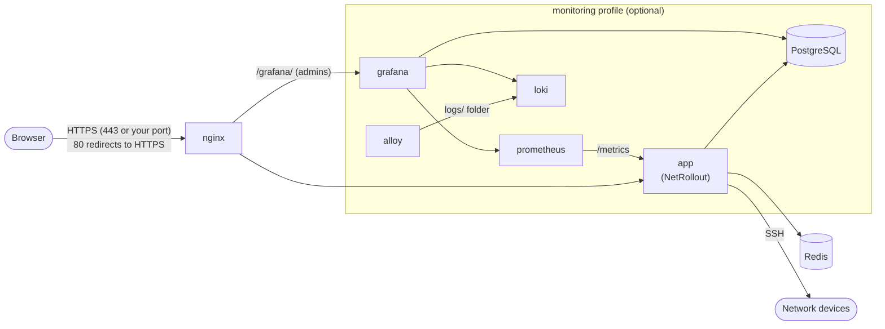
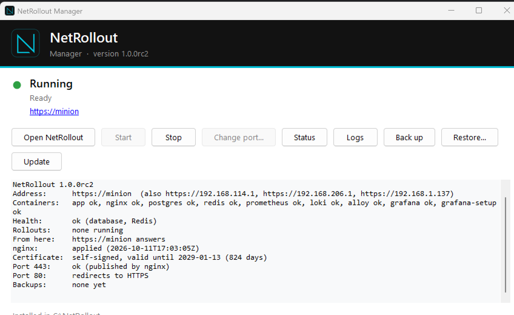

# NetRollout admin guide

This guide is for whoever runs a NetRollout installation day to day: starting and stopping it, upgrading it, backing it up, and managing users, settings, certificates, monitoring and the database. It assumes NetRollout is already installed. To install it, see the [installation guide](install.md). For using NetRollout to configure devices, see the [user guide](user-guide.md).

## Contents

- [The moving parts](#the-moving-parts)
- [NetRollout Manager (Windows)](#netrollout-manager-windows)
- [The command line](#the-command-line)
- [Manager and command line side by side](#manager-and-command-line-side-by-side)
- [Administration](#administration)
- [Upgrading NetRollout](#upgrading-netrollout)
- [Backups](#backups)
- [Restoring a backup](#restoring-a-backup)
- [The HTTPS port](#the-https-port)
- [Hostname and certificates](#hostname-and-certificates)
- [Users and sign-in](#users-and-sign-in)
- [System Settings reference](#system-settings-reference)
- [Monitoring with Grafana](#monitoring-with-grafana)
- [Moving the database](#moving-the-database)
- [Switching Redis](#switching-redis)
- [Restart, stop and maintenance](#restart-stop-and-maintenance)
- [Retention](#retention)
- [Logs](#logs)
- [The audit log](#the-audit-log)
- [Troubleshooting](#troubleshooting)

## The moving parts

NetRollout runs as a set of Docker containers, managed with Docker Compose under the project name `netrollout`. Only nginx publishes ports on the host.



| Container | What it does |
|---|---|
| `nginx` | Serves NetRollout over HTTPS on your port, redirects port 80 to HTTPS (when port 80 was free at install), and serves Grafana at `/grafana/` to admins. |
| `app` | NetRollout itself: the web app and the rollout engine. |
| `postgres` | PostgreSQL 17: users, inventory, credentials (encrypted), results, settings and the audit log. |
| `redis` | Sessions, the rollout queue and the live state of running rollouts. Nothing in it needs a backup. |
| `prometheus`, `loki`, `alloy`, `grafana`, `grafana-setup` | Monitoring, when it's turned on. See [Monitoring with Grafana](#monitoring-with-grafana). |

### Where the data lives

Everything that belongs to an installation is in its install folder (`C:\NetRollout` by default on Windows; the folder you unpacked into on Linux) and in Docker volumes:

| Location | What's in it |
|---|---|
| `.env` | Every secret of the installation: the database, Redis and Grafana passwords, the session key, and **the encryption key for stored device credentials**. Hidden on Windows; readable by root only on Linux. Don't edit it: settings live in System Settings and the scripts keep the rest up to date. |
| `config/` | Files the app writes: `runtime.env` (only after a database move or Redis switch), `nginx/site.env` (hostname and port for nginx), port-change state. |
| `certs/` | The TLS certificate and key nginx serves. |
| `logs/` | Rollout logs, and on Windows the install, upgrade and port helper logs. |
| `backups/` | Backups, scheduled and manual. |
| Docker volumes `netrollout_postgres`, `netrollout_redis`, `netrollout_grafana`, `netrollout_prometheus`, `netrollout_loki`, `netrollout_alloy` | The database, Redis, and the monitoring data. |

The install folder is locked down: on Windows only Administrators, SYSTEM and the account that installed NetRollout can open it; on Linux `.env` is root's and the other folders belong to the app container's user. Both are set again at every start.

> [!IMPORTANT]
> `.env` and every backup hold the encryption key. Anyone with either can decrypt the stored device credentials. Keep them as safe as the server itself.

## NetRollout Manager (Windows)

NetRollout Manager is the Windows app for running NetRollout. Open it from the Start Menu, the desktop shortcut, the tray, or **Win+R** → `netrollout`.



### The status light

The Manager checks NetRollout's health every 15 seconds.

| Light | State | Typical message below it |
|---|---|---|
| Green | **Running** | `Ready`, or `2 rollouts running` |
| Amber | **Needs attention** | `The database or Redis isn't reachable - see Status`; `Answers with an error (502) - see Status`; `The upgrade to 1.0.1 didn't finish - click Finish upgrade`; or `Port 443 is taken by <program>. Close it and click Start - or click Change port... to use another port for NetRollout.` |
| Red | **Stopped** | `Not running`, or `Not installed here - run NetRollout Setup` |
| Grey | **Checking...** | |

The address under the message opens NetRollout in your browser.

### The buttons

| Button | What it does |
|---|---|
| **Open NetRollout** | Opens NetRollout in your browser. |
| **Start** | Starts NetRollout (`netrollout start`). Greyed while it's already running. If an upgrade didn't finish, the button reads **Finish upgrade** and finishes it first. |
| **Stop** | Stops NetRollout (`netrollout stop`). Greyed while it's stopped. If rollouts are running, it lists them and asks: **Wait for them** (up to 10 minutes; new rollouts are paused meanwhile), **Cancel all now** (devices not reached yet are skipped; a device being configured finishes), or **Don't stop**. |
| **Change port...** | Moves NetRollout to another HTTPS port. Enabled only while another program holds NetRollout's port. Otherwise, change the port in System Settings → HTTPS port (hover over the greyed button to see this). See [The HTTPS port](#the-https-port). |
| **Status** | Checks everything and says what to do about any problem (`netrollout status`). |
| **Logs** | Shows the app's recent log lines. |
| **Back up** | Makes a backup now (`netrollout backup`). |
| **Restore...** | Picks a backup in the `backups` folder, asks for confirmation, and restores it (`netrollout restore`). See [Restoring a backup](#restoring-a-backup). |
| **Upgrade** | Checks for a newer NetRollout and offers to upgrade. See [Upgrading NetRollout](#upgrading-netrollout). |

Hover over a greyed **Start** or **Stop** to see why it's greyed. The panel below the buttons shows the output of each action. Only one action runs at a time.

### The tray

The Manager keeps an icon in the notification area, with the status light as a dot. Click it to open the window. Its menu has **Open NetRollout**, **Show NetRollout Manager**, **Start**, **Stop**, **Check for upgrades**, **Check for upgrades daily**, **Uninstall NetRollout...** and **Exit**.

If you ticked "tray at sign-in" during Setup, the Manager starts hidden in the tray when you sign in to Windows (`NetRollout Manager.exe --tray`). Starting the Manager again brings the running one's window forward; there is one Manager per install folder.

### Upgrade checks and their settings

The Manager checks for a newer version a minute after it starts and then once a day, and announces one in the tray once a day. Turn this off with **Check for upgrades daily** in the tray menu or the upgrade window.

Its settings are in the registry, under `HKEY_CURRENT_USER\Software\NetRollout\Manager`:

| Value | Type | Meaning |
|---|---|---|
| `DailyCheck` | DWORD | `1` checks daily (the default), `0` doesn't. |
| `UpgradeFeed` | String | Where to look for releases instead of GitHub: an `http(s)` URL or a file path, holding release JSON in the same format as GitHub's releases API (one release, or a list). The download links in it may be `http(s)` or `file`. Use it for an internal mirror. |
| `Announced` | String | The last version announced in the tray. Written by the Manager. |

### The port helper

The same program also runs headless as the port helper (`NetRollout Manager.exe --helper`), started at Windows sign-in, at the end of Setup and by `netrollout start`. It applies an HTTPS port saved in System Settings. It never shows a window; it writes to `logs\port-helper.log`. See [The HTTPS port](#the-https-port).

## The command line

### Windows: `netrollout`

On Windows, `bin\netrollout.bat` in the install folder runs `bin\manage.ps1`. If you ticked "add to PATH" in Setup, `netrollout` works in any new terminal; otherwise run `C:\NetRollout\bin\netrollout.bat`. Run `netrollout help` for the list.

| Command | What it does |
|---|---|
| `netrollout start` | Starts NetRollout and opens it in the browser. Checks Docker and the ports first; if another program holds the HTTPS port, it names it and starts nothing. If NetRollout is already running and healthy, it says so. If an upgrade didn't finish, it finishes it first. Also repairs a half-started installation. |
| `netrollout stop` | Stops NetRollout. Running rollouts finish first (up to 10 minutes). If rollouts are running, it lists them and asks: **[W]ait**, **[C]ancel them all now**, or **[D]on't stop**. |
| `netrollout status` | Checks the containers, the address, the HTTPS port and the backups, and says what to do about anything wrong. Exit code 0 when all is well. |
| `netrollout open` | Opens NetRollout in the browser. |
| `netrollout logs [service]` | The last 100 log lines of a container: `app` (the default), `nginx`, `postgres`, `redis`, `grafana`, `grafana-setup`, `prometheus`, `loki`, `alloy`. |
| `netrollout backup` | Makes a backup now, into `backups\`. |
| `netrollout restore <file>` | Restores a backup, after asking. Add `-NoSafetyBackup` to skip the backup of the current state. See [Restoring a backup](#restoring-a-backup). |
| `netrollout apply` | Applies an HTTPS port saved in System Settings. The port helper does this by itself; run it by hand only if the helper isn't running. |
| `netrollout port <N>` | Moves NetRollout to port N, when its current port is taken by another program and you can't reach System Settings. Asks first. |
| `netrollout rollouts` | Lists the rollouts running or queued, with their owners. `-Json` prints one line of JSON. |
| `netrollout stop-now` | Makes a stop that is under way, or one in the next 15 minutes, cancel the running rollouts at once instead of waiting for them. |
| `netrollout port-check` | Says whether NetRollout's nginx holds its HTTPS port, and if not, which program does. `-Json` prints JSON. |
| `netrollout reset-admin` | When no administrator can sign in: enables the factory `admin`, turns its two-factor sign-in off, clears its failed sign-ins and lock, and signs it out everywhere. Asks first. Add `-NewPassword` to also get a temporary password, shown once, that must be changed at the next sign-in. See [The factory admin account](#the-factory-admin-account). |

Add `-NoBrowser` to `start` to skip opening the browser.

Installing, upgrading and uninstalling are done by NetRollout Setup and by Windows' **Settings → Apps**, not by these commands. The script has further commands that Setup and the Manager run; they aren't meant to be run by hand.

### Linux: `netrollout.sh`

On Linux, run the script from the install folder as root:

```bash
sudo ./bin/netrollout.sh <command> [options]
```

Run it with no command for a numbered menu:

```text
  1  Open (the address)
  2  Status
  3  Start
  4  Stop
  5  Logs
  6  Back up
  7  Restore a backup
  8  Upgrade
  9  Change the HTTPS port (when its port is taken)
  0  Exit
```

| Command | What it does |
|---|---|
| `start` | Starts NetRollout. As on Windows: checks Docker and the ports, says if it's already running, finishes an unfinished upgrade first. |
| `stop` | Stops NetRollout. Running rollouts finish first; if there are any, it lists them and asks **[W]ait**, **[C]ancel them all now** or **[D]on't stop**. |
| `status` | Checks everything and says what to do about any problem. |
| `open` | Prints the address, and opens the browser on a desktop. |
| `logs [service]` | The last 100 log lines of a container (`app` by default). |
| `backup` | Makes a backup now, into `backups/`. |
| `restore <file>` | Restores a backup, after asking. `--no-safety-backup` skips the backup of the current state. |
| `upgrade` | Upgrades to the newest release. See [Upgrading NetRollout](#upgrading-netrollout). |
| `apply` | Applies an HTTPS port saved in System Settings. A systemd path unit does this by itself; run it by hand on a system without systemd. |
| `port <N>` | Moves NetRollout to port N, when its port is taken. |
| `reset-admin` | When no administrator can sign in: enables the factory `admin`, turns its 2FA off, clears its failed sign-ins and lock, and signs it out everywhere. Asks first. `--new-password` also sets a temporary password, shown once. Not in the menu. |
| `uninstall` | Removes NetRollout. See below. |
| `help` | The list of commands and options. |

Options:

| Option | Applies to | Meaning |
|---|---|---|
| `--yes` | any | Unattended: no questions. With `stop` and `upgrade`, running rollouts are waited for. |
| `--no-browser` | `start` | Don't open the browser. |
| `--no-safety-backup` | `restore` | Don't back up the current state first. |
| `--new-password` | `reset-admin` | Also set a temporary password for `admin`, shown once. |
| `--delete-data`, `--keep-data` | `uninstall` | Delete or keep the data without asking. |
| `--delete-backups` | `uninstall` | With `--delete-data`, delete the backups too. Otherwise they're kept. |
| `--remove-files` | `uninstall` | Remove the scripts and compose files too. |
| `--version X`, `--from <zip>`, `--feed <url\|file>`, `--check` | `upgrade` | See [Upgrading on Linux](#upgrading-on-linux). |

The Linux script has no `rollouts` or `stop-now` command; `stop` and `upgrade` show the rollouts and ask instead.

To uninstall on Windows, or for what an uninstall keeps, see [Uninstalling](install.md#uninstall).

## Manager and command line side by side

Everything NetRollout Manager does runs `manage.ps1` underneath, so each button has a command. Linux has no Manager; its script has the same commands where they apply.

| NetRollout Manager (Windows) | Windows command | Linux command | What it does |
|---|---|---|---|
| **Open NetRollout**, the address link, tray **Open NetRollout** | `netrollout open` | `sudo ./bin/netrollout.sh open` | Opens NetRollout in the browser (Linux: prints the address, and opens a browser on a desktop). |
| **Start**, tray **Start** | `netrollout start` | `sudo ./bin/netrollout.sh start` | Starts NetRollout; finishes an unfinished upgrade first. |
| **Finish upgrade** (the **Start** button while an upgrade is unfinished) | `netrollout start` | `sudo ./bin/netrollout.sh start` | Finishes the upgrade, then starts. |
| **Stop**, tray **Stop** | `netrollout stop` | `sudo ./bin/netrollout.sh stop` | Stops NetRollout; running rollouts finish first, or are cancelled if you choose. |
| **Status** | `netrollout status` | `sudo ./bin/netrollout.sh status` | Checks everything and says what to do. |
| **Logs** | `netrollout logs [service]` | `sudo ./bin/netrollout.sh logs [service]` | Recent log lines. The Manager shows the app's only; the command takes any container. |
| **Back up** | `netrollout backup` | `sudo ./bin/netrollout.sh backup` | Makes a backup now. |
| **Restore...** | `netrollout restore <file>` | `sudo ./bin/netrollout.sh restore <file>` | Restores a backup. The Manager offers a file picker in `backups\` and always backs up the current state first. |
| **Upgrade**, tray **Check for upgrades** | None: run the newer NetRollout Setup | `sudo ./bin/netrollout.sh upgrade` | Upgrades to a newer release. On Windows, the Manager downloads and runs Setup. |
| **Change port...** | `netrollout port <N>` | `sudo ./bin/netrollout.sh port <N>` | Moves NetRollout to another HTTPS port while its own is taken. |
| Status light (port taken) | `netrollout port-check` | None (`status` reports it) | Whether nginx holds the HTTPS port, and if not, who does. |
| The rollouts list shown by **Stop** and **Upgrade** | `netrollout rollouts` | None (`stop` and `upgrade` show it) | The rollouts running or queued. |
| **Cancel all now** in that list | `netrollout stop-now` | None (answer **C** at `stop` or `upgrade`) | Cancels the running rollouts at once during a stop. |
| None: the port helper runs it | `netrollout apply` | `sudo ./bin/netrollout.sh apply` | Applies an HTTPS port saved in System Settings. |
| None (host only) | `netrollout reset-admin` | `sudo ./bin/netrollout.sh reset-admin` | Makes the factory `admin` usable again when no administrator can sign in. |
| Tray **Uninstall NetRollout...** | None: Windows **Settings → Apps** | `sudo ./bin/netrollout.sh uninstall` | Removes NetRollout, keeping or deleting the data. |
| Tray **Check for upgrades daily** | None (registry value `DailyCheck`) | None | The daily upgrade check. |
| None | None | The menu: `sudo ./bin/netrollout.sh` | A numbered menu of the common commands. |

## Administration

Administrators move between the two views with the switch at the top right of every page: **Operations | Administration**. Administration's pages have a violet line under the top bar, so it's always clear which view you're in. Each side of the switch returns to the last page you had open in that view. Operators have only Operations, and no switch. Administration's sidebar has three groups:

| Group | Page | What it shows | What you can do there |
|---|---|---|---|
| Access | **User Management** | Every account: username, full name, email, role, position, member since, status (Active, Inactive, Pending). LDAP accounts and the factory account are marked. The sidebar badge counts access requests waiting. Also the LDAP **Group Rules**. | **Add user**, and for selected users **Approve**, **Enable**, **Disable**, **Promote**, **Demote**, **Terminate Session**, **Reset Password**, **Reset 2FA**, **Delete**. Turn group rules on or off, or delete them. See [Users and sign-in](#users-and-sign-in). |
| Access | **Live Sessions** | Who is signed in now, local and LDAP, with role and how long ago they signed in. | **Kick** one user's sessions, or **Kick All** in the local or the LDAP table (everyone there but you). A kicked user is signed out everywhere. |
| Observability | **Audit Logs** | The audit log, newest first, each entry's detail in one line. | Filter by actor, action, outcome and day; **Export CSV**; click an entry for its full detail; **Copy Row**. See [The audit log](#the-audit-log). |
| Observability | **Analytics** | The organisation's last 30 days: active users, success rate, total jobs, device operations, the most active operators and the most failed devices. | Query the audit log (**Audit Log Query**) and **Export CSV**. |
| Observability | **Monitoring** | Shown only when monitoring is on. Opens Grafana in a new tab. | See [Monitoring with Grafana](#monitoring-with-grafana). |
| System | **Server Management** | **Database Services**: PostgreSQL and Redis, connected or not, bundled or your own server, and where. **TLS Certificate**: the certificate in use. **LDAP / Active Directory**: the directory servers. | Move the database or move it back, switch Redis or switch back, upload a certificate or generate a self-signed one, add and edit LDAP servers and import from them. See [Moving the database](#moving-the-database), [Switching Redis](#switching-redis), [Hostname and certificates](#hostname-and-certificates) and [LDAP / Active Directory](#ldap--active-directory). |
| System | **System Settings** | Cards: **Retention** (with the last nightly clean-up), **Rollouts**, **Access** (hostname, HTTPS port, nginx's last answer and the certificate's check, the read-only internal app port), **Sessions**, **Backups** (the schedule and the list of backups). | Change any setting (**Save changes** / **Discard**, or **reset to default** per setting), **Test access**, **Back up now**, download or delete a backup. See [System Settings reference](#system-settings-reference) and [Backups](#backups). |

Below the groups, **Restart server** restarts NetRollout. See [Restart, stop and maintenance](#restart-stop-and-maintenance). When a changed setting needs a restart, the sidebar says **Restart required** and names it.

## Upgrading NetRollout

Every upgrade follows the same steps:

1. **Check the version.** The installed version decides whether the new one is newer. The same version or an older one is refused, and nothing changes. Downgrades aren't supported.
2. **Back up.** A `before-upgrade` backup is made by the installed version, so you can restore it into that version if you need to go back.
3. **Replace the files** (scripts, compose files, `deploy/`, `VERSION`).
4. **Download the new images** while the old version keeps running.
5. **Update the settings** in `.env` with anything the new version needs.
6. **Restart** on the new version. This takes about a minute. Running rollouts finish first, and everyone signs in again.

### Which releases you're offered

An installation follows the channel of the version it runs:

- A **release** (for example `1.0.0`) is offered only releases. Pre-releases are never offered.
- A **pre-release** (for example `1.0.0rc1`) is offered the newest version including pre-releases. A pre-release installation moves on to the final release when it's published.

Versions compare as Python versions do: `1.0.0.dev0` < `1.0.0rc1` < `1.0.0rc2` < `1.0.0`.

### Upgrading on Windows

Use either:

- **NetRollout Manager → Upgrade** (or **Check for upgrades** in the tray). If a newer version exists, a window shows its release notes, a **View release on GitHub** link and what will happen. Select **Upgrade now**. The Manager downloads the new NetRollout Setup to your temporary folder, checks it against the release's `SHA256SUMS` (a mismatch is deleted), and runs it silently. If rollouts are running, it first asks whether to wait for them or cancel them. The Manager closes during the upgrade and opens again when it's done, showing the last line of `logs\upgrade.log`.
- **Run the newer NetRollout Setup yourself.** It finds the installation and shows "Ready to upgrade" with the two versions. Select **Upgrade**.

The upgrade's log is `logs\upgrade.log` in the install folder.

### Upgrading on Linux

```bash
sudo ./bin/netrollout.sh upgrade [--version X] [--from <zip>] [--feed <url|file>] [--check] [--yes]
```

| Option | Meaning |
|---|---|
| (none) | Upgrade to the newest release on your channel, from GitHub. |
| `--version X` | Upgrade to version X instead of the newest. |
| `--from <zip>` | Upgrade from a `netrollout-<version>-linux.zip` you downloaded, for a server without internet access to GitHub. If a `SHA256SUMS` file sits next to the zip, the zip is checked against it. |
| `--feed <url\|file>` | Look for releases in a mirror's JSON (GitHub's release format: one release or a list) instead of GitHub. A file must be inside the install folder. |
| `--check` | Only say what's available, with its release notes. Nothing changes. |
| `--yes` | Don't ask. |

The script downloads the release zip and `SHA256SUMS`, checks the zip, shows the release notes, asks for confirmation, makes the `before-upgrade` backup, replaces the files and hands over to the new version's script to finish.

The release notes are shown under `What's new in NetRollout <version>:`, up to their first 30 lines, followed by `Full notes: <link>` to the release's page when the release has one. An upgrade `--from` a zip has no notes to show. Upgrading from 1.0.0rc1 shows none either: the installed version shows them, and 1.0.0rc1 didn't yet.

> [!NOTE]
> An upgrade also needs the new version's Docker images, `itamarweinstein/netrollout` and `itamarweinstein/netrollout-nginx`, which it pulls from Docker Hub. A server that can't reach Docker Hub needs them loaded beforehand: see [Upgrading from an internal mirror](#upgrading-from-an-internal-mirror).

### Upgrading from an internal mirror

NetRollout needs the internet only to download releases. In a network without access to GitHub or Docker Hub, you provide both from inside. There are three parts: the release files, a feed that describes them, and the Docker images.

**1. The release files.** On a computer with internet access, download from the release's GitHub page the files your servers use: `NetRollout-Setup-<version>.exe` (Windows), `netrollout-<version>-linux.zip` (Linux), and always `SHA256SUMS`. Put them, unchanged, on an internal web server or a file share. NetRollout checks every download against `SHA256SUMS` and deletes a file that doesn't match.

**2. The feed.** A JSON file that describes the release the way GitHub's API does. The easiest way to make one is to save GitHub's own description and point its download links at your copies:

```bash
curl -s https://api.github.com/repos/itamar14-byte/NetRollout/releases/tags/v<version> -o feed.json
```

Then, in `feed.json`, replace each asset's `browser_download_url` with the address of your copy, for example `https://mirror.corp.local/netrollout/SHA256SUMS` or `file:///srv/mirror/netrollout/SHA256SUMS`. NetRollout reads only these fields; a feed you write by hand needs no others:

```json
{
  "tag_name": "v1.0.0",
  "body": "The release notes, shown in the upgrade window.",
  "html_url": "https://mirror.corp.local/netrollout/",
  "draft": false,
  "assets": [
    {"name": "NetRollout-Setup-1.0.0.exe", "browser_download_url": "https://mirror.corp.local/netrollout/NetRollout-Setup-1.0.0.exe"},
    {"name": "netrollout-1.0.0-linux.zip", "browser_download_url": "https://mirror.corp.local/netrollout/netrollout-1.0.0-linux.zip"},
    {"name": "SHA256SUMS", "browser_download_url": "https://mirror.corp.local/netrollout/SHA256SUMS"}
  ]
}
```

`html_url` is optional (it becomes the **View release on GitHub** link). The file may also hold a list of releases, like GitHub's list of releases: NetRollout then picks the newest on its channel and skips drafts. Put `feed.json` next to the files.

**3. Point NetRollout at the feed.**

- **Windows:** set the `UpgradeFeed` value for the user who runs NetRollout Manager. It takes a URL or a file path:

  ```powershell
  New-Item -Path HKCU:\Software\NetRollout\Manager -Force | Out-Null
  Set-ItemProperty -Path HKCU:\Software\NetRollout\Manager -Name UpgradeFeed -Value "https://mirror.corp.local/netrollout/feed.json"
  ```

  From then on, **Upgrade** and the daily check look there instead of GitHub. Remove the value to go back to GitHub.
- **Linux:** pass the feed to each upgrade. A file must be inside the install folder:

  ```bash
  sudo ./bin/netrollout.sh upgrade --feed https://mirror.corp.local/netrollout/feed.json
  ```

  For a single upgrade without a feed, `upgrade --from <zip>` with `SHA256SUMS` next to the zip does the same.

**4. The Docker images.** Each release names exact image versions. List them from the new release's compose files, with the version set:

```bash
NETROLLOUT_VERSION=<version> docker compose -f compose.yaml -f compose.http.yaml --profile monitoring config --images
```

For 1.0.0rc8 that's `itamarweinstein/netrollout`, `itamarweinstein/netrollout-nginx`, `postgres`, `redis`, and with monitoring `grafana/grafana`, `grafana/loki`, `grafana/alloy` and `prom/prometheus`. Provide them in one of two ways:

- **A registry mirror.** If your organisation runs a pull-through cache for Docker Hub (Harbor, Nexus or Artifactory, for example), add it to Docker's `registry-mirrors` setting (Docker Desktop: **Settings → Docker Engine**; Linux: `/etc/docker/daemon.json`). Docker then fetches every image through it, and nothing else changes.
- **Offline.** On a computer with internet access, pull each image and save them to one file, then load it on the server before the upgrade:

  ```bash
  docker save -o netrollout-images.tar <image> <image> ...   # on the connected computer, after docker pull
  docker load -i netrollout-images.tar                       # on the NetRollout server
  ```

  NetRollout uses an image that is already on the server instead of downloading it.

### An upgrade that didn't finish

If an upgrade stops after its files were replaced (for example the images couldn't be downloaded), NetRollout records it as unfinished and never starts the new version half-upgraded:

- `netrollout status` says the upgrade didn't finish.
- On Windows, the Manager shows **Needs attention** and its **Start** button reads **Finish upgrade**.
- Running `netrollout start` (Windows) or `sudo ./bin/netrollout.sh start` (Linux), or running Setup again, finishes the upgrade. Steps already done, such as the backup, aren't repeated.

Fix the cause the upgrade reported, then finish it.

## Backups

A backup is one zip file in the `backups` folder, named `netrollout-<version>-<YYYYMMDD-HHMMSS>-<kind>.zip`. It holds:

- `manifest.json`: the version, the database migration level and the row counts
- `db/`: every NetRollout table as CSV, from one consistent snapshot
- `grafana.db`: Grafana's database, with your custom dashboards (when monitoring is on)
- `certs/`: the TLS certificate and key
- the rollout logs
- `encryption.key`: the key that decrypts the stored credentials

> [!WARNING]
> A backup is as secret as `.env`: it holds the encryption key and the encrypted credentials. Keep downloaded copies somewhere safe. Keep a copy off the server too, because a backup on the same disk doesn't survive losing that disk.

The backup runs through the app's own database connection, so it works whether NetRollout uses the bundled database or your own server.

### Kinds of backup

| Kind | Made by | Deleted automatically? |
|---|---|---|
| `scheduled` | The schedule in System Settings | Yes: only the newest **Keep** are kept |
| `manual` | **Back up now**, the Manager's **Back up**, `netrollout backup` | No |
| `before-restore` | A restore, of the state it replaces | No |
| `before-upgrade` | An upgrade, of the version it replaces | No |
| `before-move` | A database move, of the data it copies | No |

### The schedule

In **Administration → System Settings → Backups**:

- **Scheduled backup**: **Off**, **Daily** (the default) or **Weekly**.
- **At**: the server's local time, 24-hour (default `02:00`).
- **On**: the day of a weekly backup (default Sunday).
- **Keep**: how many scheduled backups to keep (default 14).

A backup missed while the server was off is made once when it's back. A failed scheduled backup is recorded in the audit log (`backup.failed`), shown on the Backups card and in `netrollout status`, and tried again after an hour.

### Back up now, download, delete

The **Backups** card in System Settings lists the backups with their size and kind. Select **Back up now** to make one. Each backup has a download and a delete button. All of these are recorded in the audit log.

From the server: the Manager's **Back up**, `netrollout backup`, or `sudo ./bin/netrollout.sh backup`. A backup works whether NetRollout is running or stopped.

## Restoring a backup

A restore stops NetRollout, so it's done on the server, not in the web app:

- **Windows**: NetRollout Manager → **Restore...**, or `netrollout restore <file>`
- **Linux**: `sudo ./bin/netrollout.sh restore <file>`, or menu item 7

The file can be in the `backups` folder (give its name) or anywhere else (give its path).

What happens:

1. The backup is checked. A backup from a newer version, or an incomplete one, is refused, and nothing changes.
2. You're asked to confirm. Everything since the backup is replaced.
3. The current state is backed up (`before-restore`), unless you used `-NoSafetyBackup` / `--no-safety-backup`. Use that only when the current state can't be backed up, for example a damaged database.
4. NetRollout stops. Running rollouts finish first.
5. The database is restored in one transaction: if anything fails, it's rolled back and NetRollout starts again as it was.
6. The rollout logs and Grafana's data are put back, and the backup's encryption key is written into `.env`. The backup's certificate is put back only when it serves this installation's hostname; otherwise this installation's own stays, and the restore says so.
7. NetRollout starts. Everyone signs in again.

A backup from an older version is migrated forward when NetRollout starts.

What a restore keeps from this machine:

- `.env`: this installation's own passwords stay. Only the encryption key is taken from the backup.
- `config/`
- The HTTPS port this installation uses.
- Its hostname (System Settings), unless none is set here: then the backup's is taken.
- Its certificate, when the backup's doesn't serve that hostname.

So you can restore a backup from one server onto a fresh installation on another: the new server takes over the data, the credentials and the dashboards, and keeps its own passwords, address and certificate.

## The HTTPS port

Change the port people use in **Administration → System Settings → HTTPS port**. Changing it doesn't cut you off:

1. When you save, NetRollout opens the new port **next to** the current one. NetRollout is unavailable for a few seconds while nginx restarts.
2. The page says, for example, "Port 8443 is open next to port 443" and links to NetRollout on the new port. If your browser can reach it, it goes there by itself.
3. The page served on the new port confirms it. The new port is kept and the old one closes.
4. If the new port isn't confirmed within 120 seconds, for example because a firewall blocks it, NetRollout goes back to the current port. The page says why and offers **Try again**.

The port helper does the Docker part on the server:

- **Windows**: NetRollout Manager in helper mode (see [The port helper](#the-port-helper)). If Docker isn't running, it retries after 15, 60, 120 and 240 seconds, then every 5 minutes. Its log is `logs\port-helper.log`.
- **Linux**: a systemd path unit (`netrollout-port-netrollout.path`) that watches `config/nginx/site.env`. Without systemd, the page says to run `sudo ./bin/netrollout.sh apply` on the server.

**When another program takes the port**, NetRollout can't start and you can't reach System Settings. NetRollout Manager names the program and enables **Change port...**. From the command line, `netrollout port <N>` (Windows) or `sudo ./bin/netrollout.sh port <N>` (Linux) moves NetRollout to port N: it checks the port, asks, saves it in all three places (`.env`, nginx and System Settings) and restarts on it. If NetRollout doesn't answer on the new port within a minute, the old port is put back.

## Hostname and certificates

### The hostname

**Administration → System Settings → Access → Hostname** is the name people use, such as `netrollout.corp.local`. It's a DNS name or an IPv4 address, without `https://`, port or path. Other names that reach the server redirect to it. IP addresses and `localhost` are always served.

Saving the hostname is all or nothing:

1. The certificate must cover the new name. A self-signed certificate is reissued for it. An organisation's certificate is never reissued: if it doesn't cover the new name, the change is refused.
2. nginx is told the new name and must accept it.
3. If anything fails, the setting, nginx and the certificate are all put back, and the page shows why.

After a self-signed certificate is reissued for a new name, it keeps covering the old names for 7 days, so bookmarks keep working while people move over.

The **Access** card shows nginx's last answer (applied or rejected, with nginx's message) and the certificate in use: its names, its expiry, whether it's self-signed, and any problems. **Test access** checks a hostname and port, saved or not.

If NetRollout runs behind your own reverse proxy instead, update that proxy yourself.

### The TLS certificate

**Administration → Server Management → TLS Certificate**:

- **Upload and apply** your organisation's certificate. **Certificate**: PEM, the server's certificate first, then each issuer. **Private key**: PEM, without a password. It's checked first: the key must match, the dates must be valid, and it must cover the saved hostname. A certificate with any problem is refused.
- **Generate self-signed certificate** makes a new one for the saved hostname and the server's IP addresses (ECDSA P-256, valid for 825 days).

Either way, nginx applies the new certificate within seconds, without a restart. If nginx can't use it, the previous certificate stays. Both are recorded in the audit log; the key never is.

Browsers warn about a self-signed certificate. For production, upload one from your organisation's CA.

### Trusted CA certificates

The second part of the **TLS Certificate** card is for NetRollout's own connections to other servers: today, the LDAP servers over LDAPS. NetRollout always verifies a directory server's certificate. It must come from a CA that the server running NetRollout trusts (the operating system's CAs) or from one you add here, and it must name the host configured for the LDAP server.

- **Add to trusted**: a PEM file with one or more certificates, such as your organisation's root and issuing CAs. A lab directory's own self-signed certificate works too. A file with a private key in it, a file that isn't PEM certificates, or an expired certificate is refused. So is a server's own certificate issued by a CA (a common mistake: it can't vouch for anything); the message names the CA to upload instead. A certificate that is already trusted is skipped.
- The list shows each certificate's subject, issuer and expiry, with a warning when it has expired or expires within 30 days. **Remove** stops trusting one.

Changes apply to the next connection, without a restart. They're recorded in the audit log, and backups include them (`certs/trusted-ca.pem`).

## Users and sign-in

### Roles

| Role | Can |
|---|---|
| **Operator** | Use NetRollout: their own inventory, profiles, mappings, properties and rollouts, plus the global devices. See only their own results. |
| **Admin** | Everything an operator can, plus Administration: users, sessions, audit logs, analytics, monitoring, System Settings and Server Management. Create and edit global devices. See and cancel everyone's rollouts and results. |

### The factory admin account

A new installation has one account: `admin` with the password `admin`. At the first sign-in you must choose a new password. Give it a strong password, and give each administrator a personal account.

`admin` is the break-glass account, the way back in when other sign-ins fail:

- **Two-factor sign-in is optional** for it, and off by default. To turn it on, sign in as `admin`, open **My Account** and choose **Set up two-factor sign-in**: scan the QR code and confirm with a code. From then on, its sign-in asks for a code. **Turn off two-factor sign-in** on the same page asks for the password and a current code. Another admin's **Reset 2FA** in User Management also turns it off.
- **Wrong passwords lock it for 15 minutes**, never disable it: after every 5 wrong passwords in a row, the sign-in page says "Too many failed sign-ins. Try again in 15:00.", counting down, and no password is checked until then.
- **You can disable it** in User Management, for example once directory or personal admin accounts exist. NetRollout refuses when that would leave no administrator who can sign in. It can't be deleted or demoted, and its password can't be reset from the web app.

If no administrator can sign in (`admin` disabled, locked, its authenticator lost or its password forgotten), run **`netrollout reset-admin`** on the server (Linux: `sudo ./bin/netrollout.sh reset-admin`). It enables `admin`, turns its two-factor sign-in off, clears its failed sign-ins and lock, and signs it out everywhere. With `-NewPassword` (Linux: `--new-password`) it also prints a temporary password, once, that must be changed at the next sign-in. It is recorded in the audit log as done "on the server". NetRollout Manager has no button for it.

### Local accounts

There are two ways in:

- **Add user** (Administration → **User Management**): the account is approved and active at once, as an operator or an admin. You get a temporary password, shown once, to hand over privately. The user chooses their own at the first sign-in.
- **Request access**: anyone who can reach the sign-in page can ask for an account. It waits for an administrator to **Approve** it. The User Management link in the sidebar shows how many requests are waiting.

**The password rule** for local accounts: at least 8 characters, at least 2 of letters / digits / special characters, ASCII only, and not containing the username.

**Two-factor authentication** (TOTP) is required for every local account except `admin` (optional there, see above). Users enrol with an authenticator app at their first sign-in. After 5 wrong codes in a row, they must give their password again. Wrong codes don't count towards the lockout.

**Account lockout**: after 5 wrong passwords in a row, a local account is locked for 15 minutes (`auth.account_lock_timed`). No password is checked while it lasts. User Management shows a **Locked** badge next to **Active**; its tooltip counts the lock down. **Enable / Unlock** lifts it at once (the button reads **Unlock** when only locked users are ticked). Once the lock has run out, 5 more wrong passwords in a row (10 in all) disable the account (`auth.account_locked`).

What the person sees: "Invalid credentials" for a wrong password, then at the 5th failed sign-in in a row with the same username, **"Too many failed sign-ins. Try again in 15:00."**, counting down to the second (a later try shows the time left; at zero the page says "You can try again now."). That username is then stopped for 15 minutes on the sign-in page, whether an account exists or not: a made-up name gets the same message at the same moment, so the page never reveals which usernames exist. Only the right password on a disabled account gets "User disabled, please check with administrator". To let the user in at once, **Enable** the account: it lifts the lock, the stop on the sign-in page, and a disable. **Approve**, **Promote** and **Reset Password** also clear the count and any lock, and so does the user's own right password. `admin` is only ever locked, never disabled (see above). Directory accounts get the same 15-minute stop on the sign-in page, but aren't counted otherwise: the directory's own lockout policy applies.

On **User Management**, select users and use:

| Action | Effect |
|---|---|
| **Approve** | Lets a requested account sign in. |
| **Enable** / **Disable** | Allows or blocks sign-in. Enable also clears a lockout, including a 15-minute lock on an account that is still active. Works on `admin` too. |
| **Promote** / **Demote** | Makes an operator an admin, or an admin an operator. Refused for a directory user whose role comes from group rules (see [LDAP / Active Directory](#ldap--active-directory)). |
| **Terminate Session** | Signs the user out everywhere. |
| **Reset Password** | Gives a temporary password (shown once) and signs the user out. They choose their own at the next sign-in. |
| **Reset 2FA** | The user's authenticator stops working; they enrol a new one at the next sign-in. On `admin`, it turns its two-factor sign-in off. |
| **Delete** | Deletes the users and everything that is only theirs: their private devices, security profiles (with their links to any device), mappings, properties, rollout history and results. Global devices they created stay for everyone. You confirm by typing the number of users. |

Disable, Demote and Delete are refused when they would leave no administrator who can sign in: an approved, active admin, local or from an active LDAP server. The page says "No active administrator would be left" before you click.

> [!NOTE]
> The name `netrollout-grafana-admin` is reserved for Grafana's own administrator. No NetRollout account can have it.

### LDAP / Active Directory

Add a directory in **Administration → Server Management → LDAP / Active Directory → Add Server**:

| Field | Meaning |
|---|---|
| **Name** | A label, such as `Corp AD`. |
| **Host**, **Port**, **LDAPS** | Where the directory is, and whether to use LDAPS. |
| **Base DN** | Where users are searched, such as `DC=corp,DC=com`. |
| **CN Identifier** | The attribute that holds the username, such as `sAMAccountName`. |
| **Bind Type** | **Simple**: no stored service credentials. **Regular**: a service account (**Bind DN**, **Bind Password**), which enables the directory browser and group rules. The Bind DN is the service account's full DN (`CN=svc-ldap,OU=Service,DC=corp,DC=local`); Active Directory also takes `svc-ldap@corp.local` or `CORP\svc-ldap`, never the bare name. It's FortiGate's **Regular** bind **Username**. |
| **Active** | Whether the server is used. |

The bind password is stored encrypted.

With **LDAPS**, NetRollout verifies the directory server's certificate: it must come from a trusted CA and name the **Host** as entered. If your directory's certificate comes from your organisation's own CA, add that CA under [Trusted CA certificates](#trusted-ca-certificates) first. **Test** says what's wrong when the certificate is refused: not trusted, a name it doesn't hold, expired, or not yet valid.

Directory users sign in with their directory password. They don't use NetRollout's two-factor authentication or its account lockout (the directory's own lockout policy applies; only the sign-in page's 15-minute stop after 5 failures, which applies to every username, does), and their password is changed in the directory, not in NetRollout. When their directory is deactivated, removed or unreachable, they get "Invalid credentials", the same as a wrong password, so the page doesn't reveal which usernames exist. The **Audit Log** shows the real reason on the failed sign-in (`ldap_server_inactive`, `ldap_server_missing`, or `ldap_unavailable` with the directory's error, also printed to the app's log). There are two ways to give them access:

- **Import them.** With a Regular bind, the **LDAP EXPLORER** browses the directory. Select users and groups, then **Import Selected**. Users become approved, active accounts. Groups become group rules.
- **Group rules.** A user who isn't yet known to NetRollout, but is a member of an active group rule, gets an account at their first sign-in. Group rules are listed under **Group Rules** in User Management, where you can choose each rule's **Role** (**Operator** or **Admin**), turn it on or off, or delete it. Choosing **Admin** asks you to confirm.

**A directory user's role comes from the group rules** whenever their server has a service account (Regular bind) and at least one active group rule:

- It is decided at **every sign-in**: **Admin** if any active rule the user is a direct member of gives Admin, otherwise **Operator** (the highest role wins, whatever the order of the rules). The directory is the source of truth, so removing someone from the admin group in the directory makes them an operator at their next sign-in. A change to a rule (its role, turned off, deleted) also applies at each member's next sign-in, not at once.
- **Promote** and **Demote** are refused for these users, with the message "The role of *name* comes from the directory's group rules (User Management -> Group Rules), set at each sign-in - change the rule, or the user's groups in the directory." The buttons are greyed out with "N user(s) get their role from directory group rules".
- **Import Selected** gives imported users the same role their sign-in would. If the directory can't be asked for their groups, nothing is imported and the page says why.
- A role changed at sign-in is recorded in the audit log as `user.role_from_directory`, with the old and new role and the rules matched.
- **Never no administrator**: if a directory admin who lost the admin group is the last administrator who can sign in, they **stay an admin**. The audit row is marked failed (`kept: last_admin`) and the app's log says ACTION NEEDED. Enable or add another administrator; the demotion happens at their next sign-in after that. The factory `admin` counts as an administrator while it is enabled.
- If the directory can't be asked for the groups after it accepted the password, the sign-in is refused ("LDAP authentication service unavailable"), so a removed admin can't keep the role through an outage.

A server without a service account (Simple bind), or without any active group rule, can't tell a role: its users' roles are set with Promote and Demote as for local accounts. Turning off a server's last active rule therefore leaves its users with the role they have.

**Deleting a server**: the confirmation lists the users who sign in through it, and offers **Also delete these users**:

- **Ticked**: the users are deleted with only what is theirs (private devices, profiles, mappings, properties, results). Global devices they created stay for everyone. Their usernames become free again, for example for another directory.
- **Not ticked**: the users are kept but **disabled**, with all their data. User Management marks them **NO DIRECTORY**: they can't sign in through any server, and Enable, Approve and Promote are refused until they're reconnected. Their usernames stay taken.
- Refused when it would leave no administrator who can sign in, and when you sign in through that server yourself (sign in with another administrator account first).
- Audited as `admin.ldap_server_delete`, with the usernames deleted or disabled.

**Reconnecting kept users**: in User Management, tick accounts marked NO DIRECTORY and select **Reconnect**. Pick a server: it must be switched on and have a service account (Regular bind), because NetRollout checks that every name exists there. If any name isn't found, nothing is reconnected and the window names the missing ones. Reconnected accounts take the directory's email and display name (an email another account already uses is left as it was), and keep their devices, profiles and history. They **stay disabled**: enable them once you're sure they're the same people, since the same username in another directory can be someone else. Where the server sets roles from group rules, they get the role their groups give them now; otherwise they keep theirs, and the window names any administrators so you can demote first. Audited as `user.reconnected`.

The LDAP explorer's import can do the same for a whole directory move: tick **Reconnect existing accounts with these names** before **Import Selected**. A picked name that belongs to an account with no directory is then reconnected (same checks, stays disabled) instead of skipped. A local account or another server's user with that name is never touched.

### Sessions

- A session ends after a period without activity: **Sign out after inactivity** in System Settings, 15 minutes by default (5 to 480). Users get a warning a minute before. Automatic refreshes and live logs don't count as activity.
- However active, everyone signs in again after 12 hours.
- **Every restart or upgrade of NetRollout signs everyone out.**
- **Administration → Live Sessions** lists who is signed in, local and LDAP (**Remote Sessions**). **Kick** signs one user out everywhere; **Kick All** does it for everyone in that table except you.

## System Settings reference

**Administration → System Settings**. Each setting shows its default and when a change takes effect. Every change is recorded in the audit log.

| Card | Setting | Default | Range | What it does | Takes effect |
|---|---|---|---|---|---|
| Retention | **Job records** | 30 days | 1 – 3650 | How long a rollout's results and commands are kept (Results, Download Log). | Next nightly clean-up |
| Retention | **Config snapshots** | 7 days | 1 – 3650 | How long the configurations fetched by Verify are kept (Verify Diff). | Next nightly clean-up |
| Retention | **Audit log** | 90 days | 7 – 3650 | How long audit log entries are kept. | Next nightly clean-up |
| Retention | **Log files** | 60 days | 1 – 3650 | How long files in `logs/` are kept. | Next daily log clean-up |
| Rollouts | **Concurrent rollout jobs** | 4 | 1 – 32 | How many rollouts run at the same time; more wait in the queue. | After restart |
| Rollouts | **Devices in parallel per job** | 10 | 1 – 64 | How many devices one rollout configures at the same time. | Next rollout |
| Rollouts | **Reachability cache** | 60 s | 10 – 3600 | How long a device's up/down status is reused before it's probed again. | Immediately |
| Rollouts | **Device DNS suffix** | (empty) | a domain, such as `corp.local` | Added to a device saved by a name alone: `core1` is reached as `core1.corp.local`. Full names and IP addresses are used as they are. Device names are looked up in the DNS the NetRollout server uses, so that DNS must know them. | Immediately |
| Access | **Hostname** | (empty) | a hostname or IPv4 address | The name people use; other names redirect to it. See [Hostname and certificates](#hostname-and-certificates). | Immediately |
| Access | **HTTPS port** | 443 (or the port chosen at install) | 1 – 65535 | The port people use. See [The HTTPS port](#the-https-port). | Once confirmed on the new port |
| Sessions | **Sign out after inactivity** | 15 min | 5 – 480 | Minutes without activity before a session ends. | Within 30 s |
| Backups | **Scheduled backup** | Daily | Off / Daily / Weekly | Whether scheduled backups are made. | Next scheduled time |
| Backups | **At** | 02:00 | 24-hour time | The server's local time for the backup. | Next scheduled time |
| Backups | **On** | Sunday | a weekday | The day of a weekly backup. | Next scheduled time |
| Backups | **Keep** | 14 | 1 – 365 | How many scheduled backups are kept. | Next scheduled backup |

Two rules keep the retention settings consistent:

- **Log files** must be kept at least as long as **Job records**, because Download Log needs the file while the job exists.
- **Config snapshots** can't be kept longer than **Job records**.

A changed setting that applies after a restart shows **Restart required** in Administration, with a **Restart server** button.

The **Internal app port** is shown read-only: it's set at install.

## Monitoring with Grafana

Monitoring is optional; you choose it at install. It adds:

- **Prometheus**, which collects NetRollout's metrics (kept 30 days).
- **Loki** and **Alloy**: Alloy ships the files in `logs/` to Loki (kept 60 days).
- **Grafana**, with dashboards over the metrics, the logs and NetRollout's database.

Open Grafana from **Administration → Monitoring**, or at `https://<your address>/grafana/`. Only signed-in NetRollout admins can open it: Grafana trusts NetRollout's sign-in and has no login form of its own. Every admin is a Grafana Editor.

Grafana's dashboards are in the **NetRollout** folder:

| Folder | Dashboards |
|---|---|
| **Operations** | Operations Overview, Job Analytics |
| **Jobs** | Job Details |
| **Security** | Audit & Security |
| **Custom** | Yours. Create, edit and nest dashboards here. |

The shipped dashboards are view-only, and NetRollout puts them back every 5 minutes, so changes to them don't last. To change one, save a copy in **Custom**. NetRollout never touches **Custom**, and backups include it.

Grafana reads NetRollout's database through a read-only login that can see only three tables: job results, job metadata and the audit log. It never sees users, credentials or settings.

**Turning monitoring on or off after install (advanced).** Do it in this order:

1. Stop NetRollout: `netrollout stop` (Windows) or `sudo ./bin/netrollout.sh stop` (Linux).
2. In `.env`, set `COMPOSE_PROFILES=monitoring` to turn it on, or `COMPOSE_PROFILES=` (empty) to turn it off.
3. Start NetRollout: `netrollout start` or `sudo ./bin/netrollout.sh start`.

Stop first: `start` does nothing while everything that exists is already running, so a change made while NetRollout runs isn't picked up. Turning monitoring off keeps its data volumes, so turning it on again later picks up where it left off.

## Moving the database

NetRollout can move its data from the bundled PostgreSQL to your own PostgreSQL server, and back. It needs PostgreSQL 13 or later, with no extensions and no special server settings.

Go to **Administration → Server Management → PostgreSQL → Move to another PostgreSQL server**.

**Step 1: Prepare the database.** Choose how:

- **Your database administrator prepares it** (recommended). NetRollout shows what to ask for and the SQL to hand over, with new passwords filled in. NetRollout never needs an administrator password. What to ask for:
  - a database for NetRollout (it can be shared with other applications, in a schema of its own)
  - a login NetRollout uses every day, owning that schema. It needs no administrator rights: no superuser, no CREATEDB, no CREATEROLE.
  - a read-only login for Grafana's dashboards (`grafana_reader`). NetRollout grants it SELECT on exactly three tables: job results, job metadata and the audit log.
  - network access from the NetRollout server to the database server's port
- **I have an administrator login.** NetRollout creates the database and logins itself. The login is used once and never stored.

**Step 2: Check.** Enter the server, port, database, schema, NetRollout's login and password, then select **Check**. NetRollout connects and reports whether the target is usable: reachable, PostgreSQL 13 or later, and the login can create tables there. If the target already holds NetRollout's data, you must tick **Replace the NetRollout data already there with this server's**. Tables that aren't NetRollout's are left alone, unless one has the same name as a NetRollout table, which is refused.

**Step 3: Move.** Select **Move NetRollout's data**:

1. NetRollout enters maintenance mode. New rollouts are paused, and running ones finish. The page lists them, with **Cancel rollout** for each. After 30 minutes of waiting, the move is given up and rollouts resume.
2. Once nothing is running, NetRollout is locked for a few minutes. Every page shows "NetRollout is under maintenance" and reloads by itself when it's over.
3. A `before-move` backup is made, restored into the new database, and the row counts are compared.
4. NetRollout switches to the new database.

If anything fails, or you cancel the move, NetRollout stays on the database it was using, unchanged. The bundled database keeps running, untouched.

**Moving back.** While NetRollout is on your own server, **Move back to the bundled database** copies the data from your server into the bundled database (replacing what it held) and switches to it, with the same steps.

## Switching Redis

Redis holds only sessions and the live state of running rollouts, so switching it copies nothing and needs no restart.

In **Administration → Server Management → Redis**, enter **Host**, **Port**, **DB** and the password (optional). Select **Test Connection**, then **Save Configuration**.

- It's refused while rollouts are running.
- It signs everyone else out. You stay signed in.
- **Switch back to the bundled Redis** returns to the bundled Redis, which kept running. It also signs everyone else out.

## Restart, stop and maintenance

### Restart from the web app

**Restart server**, in Administration's sidebar, restarts NetRollout. If rollouts are running, it lists them, with **Cancel** for each, and asks:

- **Restart when finished**: new rollouts are paused and running ones complete first. Everyone sees a notice until NetRollout is back.
- **Restart now**: running rollouts are cancelled. Devices already being configured get up to a minute to finish; the rest are left unchanged.

Either way, queued rollouts that haven't started are cancelled, and everyone is signed out.

### Stopping from the server

`netrollout stop` (and the Manager's **Stop**) drains the same way. New rollouts are refused, and every page shows a banner. Queued rollouts are recorded as cancelled. Running rollouts get up to 10 minutes to finish, then are cancelled. To cancel them at once instead, answer **Cancel all now**, or run `netrollout stop-now` (Windows).

When a rollout is cancelled, devices it hasn't reached are skipped, devices being configured finish, and the results are recorded.

### Maintenance mode

A database move puts NetRollout in maintenance mode: first **waiting** (new rollouts paused, running ones finish), then **locked** (every request answered with a maintenance page, nothing written). It ends when the move ends. A restart also ends it.

## Retention

The **nightly clean-up** runs inside NetRollout at 03:00 server time, on whichever database it's connected to. It deletes:

| Data | Kept for (default) | Setting |
|---|---|---|
| Job records (results, metadata) | 30 days | **Job records** |
| Configuration snapshots from Verify | 7 days | **Config snapshots** |
| Audit log entries | 90 days | **Audit log** |

A clean-up missed while the server was off runs once when it's back; a failed one is retried after an hour. The Retention card in System Settings shows the last clean-up and what it removed.

Files in `logs/` are deleted separately, once a day, after 60 days by default (**Log files**).

The server's timezone for both is the one chosen at install (`TZ` in `.env`).

## Logs

| What | Where |
|---|---|
| A container's output | `netrollout logs [service]` (Windows) or `sudo ./bin/netrollout.sh logs [service]` (Linux): the last 100 lines. `app` by default. |
| Each rollout's log | `logs/rollout_<YYYYMMDD>_<HHMMSS>_<job id>.log`, also available as **Download Log** in Results. |
| Results that couldn't be saved to the database | `logs/unsaved-results-<job id>.json`, with an `ACTION NEEDED` line in the app's output. |
| Windows Setup | `logs\install.log`, `logs\upgrade.log` |
| Windows port helper | `logs\port-helper.log` |

Rollout logs are redacted: values after words such as `password`, `secret` or `community` are written as `<redacted>`.

With monitoring on, the rollout logs are also searchable in Grafana (Loki).

## The audit log

**Administration → Audit Logs** lists who did what and when, with the outcome and the IP address. Filter by actor, action, outcome and day (**From** / **To**, both included). The page shows the newest 500; **Export CSV** downloads every entry the filters let through, the detail as JSON in one column. Under each action, the entry's detail reads in one line: a failed sign-in's reason, a change's from → to, a lock. Click an entry (or press Enter on it) to see its full detail as JSON; the ⚙ menu also has **Copy Row**. **Administration → Analytics** has an **Audit Log Query** builder with CSV export.

Recorded actions include:

| Area | Actions |
|---|---|
| Sign-in | Sign-in (success and failure, with the reason), sign-out, password accepted before 2FA, password change, access request, session expiry, account locked out (locked for 15 minutes, or disabled), `admin`'s two-factor sign-in turned on or off |
| Users | Create, approve, enable, disable, promote, demote, delete, reset password, reset 2FA, terminate session (one user or many), session kick, `netrollout reset-admin`, a directory user's role changed by the group rules at sign-in (`user.role_from_directory`), accounts reconnected to another LDAP server (`user.reconnected`) |
| LDAP | Server saved (a new one with its settings; a change with each setting's from and to, the bind password only as "changed") or deleted, import (with any accounts it reconnected), group rule's role changed, group rule toggled or deleted |
| Inventory | Device created, edited, deleted, made global or local (made local: how many other users lost their profile links, attribute values and mappings on it), attributes set, CSV import, bulk profile assignment |
| Profiles, mappings, properties | Created, edited, deleted; mapping bulk assignment |
| Rollouts | Started, cancelled, rolled back |
| Settings and server | Setting changed or reset, HTTPS port confirmed, restart, Redis switched, certificate uploaded or generated, trusted CA certificate added or removed |
| Backups | Created, downloaded, deleted, failed, restored |
| Exports | Results or the audit log exported as CSV, with the filters used and the row count |
| Database | Prepared (or failed), move started, moved, move failed, move cancelled |

Audit entries are kept 90 days by default.

## Troubleshooting

Start with `netrollout status` (or the Manager's **Status**, or `sudo ./bin/netrollout.sh status`). It checks every container, the address and the HTTPS port, and says what to do.

For problems at install, NetRollout that can't be found, busy ports, and a `netrollout` command that isn't recognised, see [Troubleshooting](install.md#troubleshooting) in the installation guide.

**Older devices and SSH.** NetRollout reaches devices whose SSH offers only an `ssh-rsa` host key or the SHA-1 key exchanges (IOS 12 and 15, NX-OS 7, older ASA and FortiOS): it uses the modern algorithms when a device has them and these only when it has nothing else. Why it accepts them is in [Known limitations](security.md#known-limitations). A device that can't be reached with `Incompatible ssh peer` or `no acceptable host key` offers none of these either; check its SSH settings.

To report a bug, open an issue at [github.com/itamar14-byte/NetRollout/issues](https://github.com/itamar14-byte/NetRollout/issues). Include the output of `netrollout status` and the relevant log lines; rollout logs are already redacted.
