# NetRollout architecture

This is the developer reference for NetRollout: the tech stack, the containers and how they talk, every package and module in `src/`, the object model (its design rules and UML class diagrams), the main flows, the data model, and the reasoning behind the significant design decisions.

It is written for contributors and for anyone reviewing the code. To install or run NetRollout, read [install.md](install.md) and [admin-guide.md](admin-guide.md). For the security posture, read [security.md](security.md). For setting up a development environment, running the tests and the code style, read [CONTRIBUTING.md](../CONTRIBUTING.md).

The code is the final authority. When this document and the code disagree, the code is right and this document has a bug.

## Contents

1. [Overview](#1-overview)
2. [Tech stack](#2-tech-stack)
3. [Repository layout](#3-repository-layout)
4. [Packages and modules](#4-packages-and-modules)
5. [Layers and dependency rules](#5-layers-and-dependency-rules)
6. [The object model](#6-the-object-model)
7. [Key flows](#7-key-flows)
8. [Data model](#8-data-model)
9. [Installation, the setup core and the port helper](#9-installation-the-setup-core-and-the-port-helper)
10. [Subsystems](#10-subsystems)
11. [Testing strategy](#11-testing-strategy)
12. [Design decisions](#12-design-decisions)

---

## 1. Overview

NetRollout pushes configuration snippets to many network devices at once over SSH, verifies them by reading each device's configuration back, and records every result. It has two front ends that share one rollout engine (`src/rollout/`):

- **The web app** (`src/webapp/`): a Flask application served by Waitress behind nginx, with PostgreSQL for everything that must last and Redis for sessions, the job queue and live job state. It is installed with Docker Compose on Windows (NetRollout Setup and NetRollout Manager) or Linux (`install.sh` and `netrollout.sh`). An optional monitoring profile adds Grafana, Prometheus, Loki and Alloy.
- **The CLI** (`src/cli.py`, also built as the standalone `netrollout-cli.exe`): one headless rollout from a devices CSV and a commands file. It has no database, no Redis and no web stack.

### System context


- **Only nginx publishes ports**: the HTTPS port (443 by default) and, while port 80 is free on the host (checked at every start), port 80, which redirects to HTTPS. PostgreSQL, Redis, the app and the monitoring services are reachable only on the compose network.
- **The app has no Docker access.** Whatever needs Docker (a new HTTPS port, an update, a backup restore) is done on the host by the scripts, through files the app writes and the host reads.
- **nginx follows the app through files.** The app writes plain values (hostname, port) into `config/nginx/site.env`. A watcher inside the nginx container renders the site from its template, tests it with `nginx -t`, and reloads, or keeps the last good site and reports why.
- **The CLI uses only `src/rollout/`**, the same engine the web app runs. An import test guards that it never loads the web stack.

---

## 2. Tech stack

Versions are the major.minor in use at the time of writing; the exact pins are in the file named in the last column (Dependabot keeps them current).

| Area | Technology | Version | Pinned in |
|---|---|---|---|
| Language | Python | 3.12 | `Dockerfile` (`python:3.12-slim-bookworm`), CI |
| Web framework | Flask, Werkzeug, Jinja2 | 3.1, 3.1, 3.1 | `requirements.txt` |
| Flask extensions | Flask-Login (sign-in), Flask-WTF (CSRF), Flask-Limiter (rate limits), Flask-Session (Redis sessions, subclassed), prometheus-flask-exporter (`/metrics`) | 0.6, 1.3, 4.1, 0.8, 0.23 | `requirements.txt` |
| WSGI server | Waitress | 3.0 | `requirements.txt` |
| ORM and migrations | SQLAlchemy, Alembic | 2.1, 1.20 | `requirements.txt` |
| PostgreSQL driver | psycopg2-binary | 2.9 | `requirements.txt` |
| Redis client | redis-py | 8.1 | `requirements.txt` |
| Device access | Netmiko (on Paramiko) | 4.8 (5.0) | `requirements.txt` |
| Cryptography | cryptography: Fernet for stored secrets, X.509 for certificates | 50.0 | `requirements.txt` |
| Directory sign-in | ldap3 | 2.9 | `requirements.txt` |
| Two-factor | pyotp (TOTP), qrcode + Pillow (enrolment QR code) | 2.10, 8.2, 12.3 | `requirements.txt` |
| Other runtime | python-dotenv (`runtime.env`, `.env`), tzlocal + tzdata, packaging (version comparison) | 1.2, 5.4, 26 | `requirements.txt` |
| Frontend | Server-rendered Jinja templates; Bootstrap, Bootstrap Icons, jQuery + jQuery QueryBuilder (Analytics); Inter and JetBrains Mono fonts. Per-page CSS and JS inline, no build step | 5.3, 1.11, 3.6 + 2.6 | `templates/` (CDN links) |
| Reverse proxy | nginx | 1.30 (Alpine) | `deploy/nginx/Dockerfile` |
| Database | PostgreSQL (any 13+ works; the bundled one is 17) | 17 (Debian bookworm) | `compose.yaml` |
| Queue, sessions, live state | Redis | 8.6 (Alpine) | `compose.yaml` |
| Monitoring (optional) | Grafana, Prometheus, Loki, Grafana Alloy | 13.0, 3.11, 3.7, 1.20 | `compose.yaml` |
| Containers | Docker Engine or Docker Desktop, Docker Compose v2 | | |
| Windows installer | Inno Setup | 6.7+ | `packaging/windows/installer/netrollout.iss` |
| NetRollout Manager | C# 5 on .NET Framework 4.8, compiled with Windows' own `csc.exe` | | `packaging/windows/manager/build.ps1` |
| Host scripts | PowerShell 5.1 (Windows), Bash (Linux) | | `packaging/` |
| Standalone CLI | PyInstaller | 6.22 | `requirements-dev.txt` |
| Tests and types | pytest, mypy, coverage | 9.1, 2.4, 7.16 | `requirements-dev.txt` |
| Dependencies | pip-tools (`requirements.in` compiled to `requirements.txt`), Dependabot | 7.6 | `requirements-dev.txt`, `.github/dependabot.yml` |
| CI/CD | GitHub Actions: `ci.yml`, `release.yml`, `stats.yml` | | `.github/workflows/` |

---

## 3. Repository layout

| Path | What it holds |
|---|---|
| `src/` | The application: the web app, the CLI, the rollout engine, the setup core the install scripts call, backups. Everything is imported as `src.*`, and every command runs from the repository root. |
| `templates/` | Jinja templates (one per page, three page skeletons, shared includes). `src/static/` holds the logo. |
| `tests/` | `unit/` (hermetic, mirrors `src/`), `integration/` (real PostgreSQL and Redis, by page), `e2e/` (a scratch install from the release files and images). |
| `deploy/` | What runs in or beside the containers: the nginx image and its scripts, PostgreSQL's first-start script, Grafana's setup and dashboards, the Prometheus, Loki and Alloy configurations. An install has this folder at the same path, because compose mounts `./deploy/…`. |
| `packaging/` | How NetRollout is built and installed on a host: `windows/` (`manage.ps1`, `netrollout.bat`, the icon, `installer/` for Inno Setup, `manager/` for the Manager's C#), `linux/` (`install.sh`, `netrollout.sh`), `build_release.py`, `netrollout-cli.spec`. |
| `compose.yaml` | The whole product: postgres, redis, app, nginx, and the monitoring profile. Shipped. |
| `compose.http.yaml` | Port 80 (redirect to HTTPS), added through `COMPOSE_FILE` only when port 80 is free. Shipped. |
| `compose.build.yaml`, `compose.dev.yaml` | Repository only: build the images locally; the development stack (the app runs on the host, PostgreSQL and Redis published on 127.0.0.1, nginx on 8443). |
| `Dockerfile` | The app image. Its build context is whitelisted by `.dockerignore`. |
| `pyproject.toml` | mypy and pytest settings. |
| `requirements.in`, `requirements.txt`, `requirements-dev.txt` | Dependency ranges, the compiled exact pins, and the development tools. |
| `VERSION` | The one version source: the app reads it, the image build checks it, the release must match it. |
| `.github/` | CI workflows, Dependabot, issue forms. |

Never tracked: `build/` and `dist/` (build outputs), `.env`, `config/`, `certs/`, `logs/`, `backups/` (a development checkout's runtime folders).

---

### Entry points

Where each way into NetRollout starts. Every one is a `python -m` command, run from the repository root (or inside the app image, whose working folder is the same).

| Command | File | Run by |
|---|---|---|
| `python -m src.webapp` | `src/webapp/__main__.py` | **The app.** The Docker image's command (and development's): builds the app through `launch_app()` in `src/webapp/build.py` (connections, migrations, the factory admin, the services, the blueprints), starts the background tasks (log pruning, certificate upkeep, scheduled backups, the nightly clean-up), handles SIGTERM with a drain, and serves with Waitress on port 8080. |
| `python -m src.cli` | `src/cli.py` | A one-off rollout from files; `netrollout-cli.exe` is built from it with PyInstaller. Uses `src/rollout/` only. |
| `python -m src.setup <command>` | `src/setup/__main__.py` | The install scripts (`manage.ps1`, `netrollout.sh`), through `docker run` with the app image: `init`, `prepare-start`, `status`, `check-update`, `upgrade`, `release`, the port helper's steps, `restore-key`. See [§9](#9-installation-the-setup-core-and-the-port-helper). |
| `python -m src.backup create \| check \| restore` | `src/backup/__main__.py` | The scripts' backup and restore (`docker compose exec app …`, or a one-off container while the app is stopped). |
| `python -m src.jobs rollouts \| stop-now` | `src/jobs.py` | `netrollout stop`, `rollouts`, `stop-now`: asks the running app's Redis which rollouts run. |
| `python -m src.accounts reset-admin` | `src/accounts/__main__.py` | `netrollout reset-admin`: the factory admin re-enabled, its 2FA and lockout cleared. |
| `python -m src.access.certs selfsigned \| validate` | `src/access/certs.py` | Making or checking TLS certificates (the setup core and by hand). |
| `python deploy/grafana/setup.py` | `deploy/grafana/setup.py` | The `grafana-setup` container (the same app image): keeps Grafana's folders, dashboards and data source. |

The installers aren't Python. A Windows install runs: NetRollout Setup (Inno Setup) → `bin\manage.ps1 install` → `docker run … python -m src.setup init` (writes `.env` and the certificate) → `docker compose up` → the `app` container runs `python -m src.webapp`. Linux's `install.sh` / `netrollout.sh` follow the same chain.

## 4. Packages and modules

One module holds one whole concern. This section lists every module in `src/` with its job and its main classes; [§6](#6-the-object-model) explains why each class is a class.

### `src/rollout/`: the rollout engine

Shared by the CLI and the web app, and free of the web stack: it imports the database models and Redis for type checking only, so the CLI executable never loads them.

| Module | Job | Main names |
|---|---|---|
| `engine.py` | Runs one rollout: devices in parallel, the push, verify, the status of each device. | `Device` (a target: address, decrypted credentials, its mappings; `from_inventory()`, `unresolved()`, `commands_for()`), `RolloutEngine` (`run()`, `cancelled_results()`), `RolloutOptions`, `classify()` (the status rules), `VerifyResult`, `DeviceResultDict`, `DeviceStatus`, `SubstitutionError`, `endpoint()` (`ip:port`, IPv6 as `[addr]:port`) |
| `session.py` | One device's SSH conversation: connect, push line by line, finish the platform's way, fetch the configuration. | `NetmikoSession` (`connect()`, `push()`, `fetch_config()`), `RunReport` (what a rollout tells, and what only a person can resolve), `PushResult`, the `Notifier` Protocol |
| `platforms.py` | What NetRollout knows about each platform, with no I/O of its own: how a push takes effect, how the config is printed, how a refusal looks, and verify. | `PLATFORMS` (one `Platform` row per Netmiko device type), the `Finish` family (`SaveConfig`, `Commit`, `RunCommand`, `NoFinish`), the `ConfigSession` / `Target` / `Report` Protocols, `rejection()`, `verify_commands()` |
| `inputs.py` | Input checks as functions, and the CLI / CSV-import files. | `validate_ip`, `normalize_ip`, `validate_port`, `validate_platform`, `tcp_reachable`, `token_problem`, `property_name_problem`, `index_problem`, `SUPPORTED_PLATFORMS`; `Validator` and `InputParser` (the devices CSV, the commands file) |
| `log.py` | The rollout log: one file per rollout, echoed to a console or to the live log in Redis; redaction; log pruning. | `RolloutLogger`, the `Echo` Protocol with `Console` and `LiveLog`, the `KeyValueStore` Protocol, `Tone`, `redact()`, `live_log_keys()`, `LogPruner` |

### Top-level modules

| Module | Job | Main names |
|---|---|---|
| `jobs.py` | A web rollout's life: queued in Redis, run in this process with at most N at a time, its results into PostgreSQL. Stop / Restart drain it; a database move pauses it. Also `python -m src.jobs rollouts \| stop-now`, read by the host scripts. | `RolloutOrchestrator`, `RolloutJob`, `JobStore` (the only code that spells a job key), `ResultRecorder`, `JobMeta`, `RolloutRow`, `JobStatus`, `Draining`, `Paused`, `clear_stale_jobs()`, `with_owners()` |
| `results.py` | Finished jobs as the viewer may see them: the owner-or-admin rule, Results' paging, summaries, config snapshots, the dashboard numbers. | `JobResults`, `JobPage`, `JobScope`, `ConfigSnapshot`, `job_status()`, `job_status_condition()`, `build_kpi()` |
| `audit.py` | The audit log's vocabulary and its one writer. | `AuditAction` (every action a row can record), `Actor` (a user or the server itself), `AuditTrail` |
| `inventory.py` | The device inventory's rules as one user sees it: visibility, edit rights, shared endpoints, attributes, the device-saving rules, security profiles, reachability, the CSV import. | `InventoryView`, `SecurityProfiles`, `ReachabilityChecker`, `LabelScope`, `DeviceFields`, `SavedDevice`, `RuleRefused`, `ImportReport`, `import_csv()`, `SYSTEM_PROPERTIES` |
| `encryption.py` | Encryption of stored credentials with one Fernet key, and the startup check of that key against the stored data. | `init_encryption()`, `encrypt()`, `decrypt()`, `require_key_in_container()`, `InvalidEncryptionKeyError`, `EncryptionStartupError` |
| `runtime.py` | How and where this process runs: version and release name, container or development, the folders, JSON and atomic file writes, the background-loop base class. | `VERSION`, `CODENAME`, `source_url()`, `in_container()`, `home()`, `logs_dir()`, `config_dir()`, `certs_dir()`, `backups_dir()`, `read_json()`, `write_json()`, `write_atomic()`, `PeriodicTask`, `StartupError` |
| `cli.py` | The headless CLI: arguments, prompts for what is missing, one rollout, exit codes. | `main()`, `rollout()`, `CliExit` |

### `src/db/`: the database layer

| Module | Job | Main names |
|---|---|---|
| `connections.py` | The connections to PostgreSQL and Redis, built from settings; bundled or an organisation's server; the live switch; `config/runtime.env`. | `BackendServices` (one per process), `ServiceConnection` (ABC) with `PostgresConnection` and `RedisConnection`, `PostgresConfig`, `RedisConfig`, `RuntimeEnv`, `ServiceMode`, `REDIS_UNAVAILABLE` |
| `tables.py` | The SQLAlchemy models (see [§8](#8-data-model)). | `User`, `Inventory`, `SecurityProfile`, `VariableMapping`, `PropertyDefinition`, `DeviceAttribute`, `DeviceResult`, `JobMetadata`, `AuditLog`, `LDAPServer`, `LDAPGroup`, `SystemSetting`; enums `Role`, `AuthType`, `BindType` |
| `install.py` | The database's set-up at every start: migrations, the factory admin, missing settings, Grafana's read grants. | `install()`, `install_extras()`, `alembic_config()` |
| `retention.py` | The nightly clean-up of old job records, config snapshots and audit rows. | `RETENTION_STATEMENTS`, `run_retention()`, `NightlyCleanUp` |
| `settings.py` | The System Settings: the registry of settings and their rules, and the store that reads and changes them. | `SETTINGS`, `Setting` (ABC) with `IntSetting`, `TextSetting`, `ChoiceSetting`; `SettingsStore`, `RULES`, `SettingsError`, `BackupSchedule`, `Weekday` |
| `move.py` | Moving NetRollout's data to another PostgreSQL server, without Flask: check the target, the DBA's preparation SQL, preparation with an administrator login, the copy. | `check_target()`, `Plan`, `preparation_sql()`, `ACCESS_NEEDED`, `prepare_with_admin()`, `copy()`, `MoveError` |
| `alembic/` | Alembic's environment and the migration revisions (history starts at `v1_0_0_baseline`). | `env.py`, `versions/` |

### `src/accounts/`: users and sign-in

| Module | Job | Main names |
|---|---|---|
| `users.py` | Who the data rules are about, local accounts, the password rule, and the signed-in sessions in Redis. No Flask import. | `Viewer`, `Accounts`, `AccountError`, `SessionStore`, the `SessionSerializer` Protocol, `password_problem()`, `temporary_password()`, `is_reserved()` |
| `ldap.py` | Sign-in through one configured directory server (LDAP or Active Directory) and the admin page's tools. | `Directory`, `LdapUnavailable` |

### `src/access/`: how NetRollout is reached

| Module | Job | Main names |
|---|---|---|
| `site_env.py` | `config/nginx/site.env`, the only code that writes it: keys updated together under a lock, the file replaced atomically. | `read()`, `update()`, `put_back()` |
| `nginx.py` | nginx from the app's side: the values it serves, its verdicts, and changes it must accept or have undone. | `Nginx` (`managed`, `status()`, `overview()`, `change_hostname()`, `apply()`), `Verdict`, `VerdictState`, `write_site()`, `read_status()`, `wait_for_status()`, `sync_at_start()` |
| `port.py` | The app's side of the HTTPS port change: the request it writes and the helper's answer it reads. | `ApplyStatus`, `ApplyState`, `PortPageState`, `request_port()`, `confirm()`, `serving_port()` |
| `certs.py` | TLS certificates for nginx: generate a self-signed one, validate an uploaded one, the certs folder, the hourly upkeep. Also `python -m src.access.certs`. | `CertificateStore`, `Certificate` (ABC) with `SelfSigned` and `Organisation`, `CertificateUpkeep`, `validate()`, `CertCheck`, `ProxyError` |
| `service.py` | The facade the pages change all of the above through: every multi-system change all or nothing. | `Access` (`app.access`), `SaveResult` |

### `src/backup/`: backups

| Module | Job | Main names |
|---|---|---|
| `archive.py` | One zip that brings NetRollout back, on this computer or another: create, check, restore; the backups folder and its lock. | `create()`, `check()`, `restore()`, `restore_database()`, `BackupFolder`, `BackupLock`, `BackupKind`, `Manifest`, `BackupError` |
| `schedule.py` | Scheduled backups made by the app itself. | `BackupScheduler`, `due()`, `start_backup_schedule()` |
| `__main__.py` | `python -m src.backup create \| check \| restore`, called by the host scripts. | `main()`, `BackupExit` |

### `src/setup/`: the setup core

What installing and running NetRollout decides and writes, once for Windows and Linux. The host scripts run it inside the app image with the install folder mounted: `python -m src.setup <command>`. See [§9](#9-installation-the-setup-core-and-the-port-helper).

| Module | Job | Main names |
|---|---|---|
| `__main__.py` | The command line: `init`, `check`, `prepare-start`, `status`, `restore-key`, `check-update`, `upgrade`, `release`, `port-ready`, `port-next`, `port-open`, `port-trying`, `port-close`, `port-set`, `port-setting`. | `COMMANDS`, `SetupExit` |
| `install.py` | The install's questions: what the host knows, what the admin answers, their checks and defaults; writing a new install (or a developer's). | `Facts`, `Answers`, `collect()`, `install()`, `install_dev()`, `check_hostname()`, `check_port()`, `check_timezone()` |
| `env.py` | The install's `.env`: every line explained, the generated secrets, reading and updating keys. | `env_text()`, `generate_secrets()`, `env_read()`, `env_write()`, `env_set()`, `compose_files()` |
| `update.py` | Releases: finding one (GitHub or a feed), downloading and checking it against `SHA256SUMS`, unpacking it; the update's direction; `.env`'s new keys after an update. | `Release`, `find()`, `download()`, `unpack()`, `update_kind()`, `upgrade()`, `ReleaseError` |
| `manage.py` | What the scripts ask after the install: the checks before a start, the `netrollout status` report, a restored encryption key into `.env`. | `prepare_start()`, `status()`, `restore_key()` |
| `port.py` | The port helper's decisions and records (the scripts do the Docker part). | `next_step()`, `StepAction`, `open_trial()`, `trying()`, `close()`, `set_by_hand()` |

### `src/webapp/`: the web app

| Module | Job | Main names |
|---|---|---|
| `__main__.py` | `python -m src.webapp` (the image's command): build the app, start the background tasks, handle SIGTERM with a drain, serve with Waitress. | |
| `build.py` | Builds the app at start, services in dependency order, then every blueprint. | `launch_app()`, `create_app()`, `resolve_secret_key()`, `configure_app()`, `RolloutSessionCollector` (the Prometheus gauges) |
| `app.py` | The Flask application's type: Flask plus the typed services the pages use. | `NetRolloutApp`, a typed `current_app` |
| `hooks.py` | Request-wide machinery: Flask-Login, CSRF, rate limits, metrics; the session lifetime and forced password change checks; error pages. | `register_extensions()`, `register_auth()`, `register_handlers()`, `login_mng`, `conn_limit`, `csrf` |
| `http.py` | What many pages share: JSON answers, decorators, the viewer, row loading, the request's audit row. | `WebServices`, `Caller`, `viewer()`, `load_owned()`, `NotFound`, `Refused`, `require_admin`, `with_json`, `with_form`, `is_background()` |
| `lifecycle.py` | This process's states beside serving: a stop or restart, and maintenance mode with its request gate. | `Shutdown`, `Maintenance`, `MaintenanceState`, `register_maintenance()`, `during_maintenance` |
| `db_move.py` | The database move run in the background, and the Redis switch. | `DatabaseMove`, `MoveStatus`, `MoveState`, `switch_redis()`, `RolloutsRunning` |
| `startup.py` | Development only: checks that nginx forwards to this process and prints the address to use. | `start_announcer()`, `check_proxy()`, `container_announcement()` |

#### `src/webapp/blueprints/`: one file per page

| File | Blueprint (prefix) | The page | Routes |
|---|---|---|---|
| `auth.py` | `auth` (none) | Sign-in (local, LDAP, 2FA enrol and verify), Request access, sign-out, the Account page, the password change, the session check. | `/`, `/login` (GET, POST), `/register` (GET, POST), `/otp_enroll`, `/otp_verify`, `/logout`, `/account`, `/account/password` (forced or voluntary change), `/account/session` (the idle-timeout script's check) |
| `jobs.py` | `jobs` (none) | Dashboard, Active Jobs, Results (with Verify Diff, the job summary card and Download Log). | `/dashboard`, `/active_jobs`, `/results` (`?job=<id>` opens that job), `/results/config_diff/<job_id>/<device_ip>`, `/results/summary/<job_id>`, `/results/download_log/<job_id>` |
| `rollout.py` | `rollout` (`/rollout`) | New rollout, start, cancel, the live log stream (SSE), rollback. | `/new`, `/start`, `/cancel`, `/stream/<job_id>`, `/rollback/<job_id>` |
| `inventory.py` | `inventory` (`/inventory`) | Devices: create, edit, delete, the user's own attribute values, connection test, reachability, CSV import, bulk profile assignment. | list, `/create`, `/test_connection`, `/reachability`, `/<id>/edit`, `/<id>/attributes`, `/<id>/delete`, `/import_csv`, `/bulk_assign` |
| `security.py` | `security` (`/security`) | Security profiles (the credentials devices are reached with), their test. | list, `/create`, `/quick_create`, `/<id>/edit`, `/<id>/delete`, `/<id>/test` |
| `mappings.py` | `mappings` (`/mappings`), `properties` (`/properties`) | Variable mappings (`$$TOKEN$$` bound to a property) and property definitions. | Mappings: list, `/create`, `/quick_create`, `/<id>/edit`, `/<id>/delete`, `/bulk_assign`. Properties: list, `/create`, `/quick_create`, `/<id>/edit`, `/<id>/delete` |
| `analytics.py` | `analytics` (`/analytics`), `admin_observability` (`/admin`) | The user's last 30 days and query builder; the admins' analytics over the audit log; the active job count. | `/analytics`, `/analytics/query`; `/admin/analytics`, `/admin/analytics/query`, `/admin/active_job_count` |
| `admin_users.py` | `admin_users` (`/admin`) | Admin home, Users (approve, enable, promote, reset password or 2FA, add, bulk actions), Live Sessions. | `/admin`, `/users`, `/users/new`, `/users/<id>/<action>` (approve, enable, disable, promote, demote, delete, reset_2fa, terminate_session), `/users/<id>/reset_password` (a temporary password, shown once), `/users/bulk/<action>`, `/sessions`, `/sessions/<id>/kick` |
| `admin_servers.py` | `admin_servers` (`/admin/server`) | Server Management: database move and move back, Redis switch, TLS certificate upload or self-signed, the running rollouts, Restart. | the page, `/database/sql`, `/database/prepare`, `/database/check`, `/database/move`, `/database/move-back`, `/database/move/status`, `/database/move/cancel`, `/redis/test`, `/redis/save`, `/redis/back`, `/certificate`, `/certificate/selfsigned`, `/rollouts`, `/restart` (with rollouts running or queued: 409 unless `mode` is `when_finished` (drain) or `now` (cancel)) |
| `admin_ldap.py` | `admin_ldap` (`/admin/server`) | Directory servers and group mappings: add, edit, test, explore, import. | `/ldap`, `/ldap/new`, `/ldap/<id>/save`, `/delete`, `/test`, `/test_user`, `/fetch_dn`, `/explore`, `/import`, `/groups`, `/groups/<group_id>/toggle`, `/groups/<group_id>/delete` |
| `admin_audit.py` | `admin_audit` (`/admin`) | The audit log. | `/audit` |
| `admin_settings.py` | `admin_settings` (`/admin/settings`), `admin_backups` (`/admin/backups`) | System Settings (save, reset, the HTTPS port's status, confirm and retry, the access test) and the Backups list (back up now, download, delete). | Settings: the page (GET, POST = save), `/<key>/reset`, `/port`, `/port/confirm`, `/port/retry`, `/test`. Backups: list (GET, POST = back up now), `/<name>` (download), `/<name>/delete` |
| `system.py` | `system` (none) | Not pages. | `/_netrollout/health`, `/_netrollout/instance`, `/_netrollout/grafana-auth` |

Prometheus' `/metrics` is added by prometheus-flask-exporter (nginx answers it with 404; Prometheus scrapes the app directly). Blueprints reach the services through `current_app` inside routes, never at module level, and `url_for` always names the blueprint (`"auth.home"`, `"jobs.dashboard"`).

`tests/integration/test_route_matrix.py` checks every route: all require sign-in except the public ones (sign-in, Request access, the two 2FA pages, which work on the half-done sign-in in the session, sign-out, `/_netrollout/health`, `/_netrollout/instance` and `/metrics`), and every `/admin` route requires the admin role. `/_netrollout/grafana-auth` answers a bare 401 instead of the sign-in redirect, because its caller is nginx.

### `templates/`

- **Three skeletons**: `base.html` (the sign-in, register, 2FA and password pages), `operator_base.html` (every operator page), `admin.html` (the admin panel, with its own sidebar and topbar). Every page extends one of them.
- **Shared includes**, named with a leading underscore, are written once: the theme (`_theme_core_css.html`, `_theme_pages_css.html`, `_classes_css.html`), the footer with the version and the source link (`_footer.html`), the idle sign-out warning (`_idle_timeout.html`), the drain and maintenance banners, the Restart dialog, the shared widgets (`_op_widgets_js.html`, `_rollouts_table_js.html`), the password rule (`_password_rule_script.html`) and `nrEscape()` (`_escape_js.html`, which every script uses before putting a value into HTML).
- **Error pages**: `404.html`, `db_error.html` (which service is down), `key_error.html` (the encryption key does not match), `maintenance.html`.

### `deploy/`

| Path | What it is |
|---|---|
| `deploy/nginx/` | The nginx image: `nginx.conf`, `site.conf.template` (the one site, rendered from values), `netrollout-render.sh` (render and test), `netrollout-watcher.sh` (apply a changed `site.env` or certificate), `40-netrollout.sh` (the entrypoint hook). |
| `deploy/initdb/10-netrollout.sh` | PostgreSQL's first start (empty volume only): creates the `netrollout` login (owns the `netrollout` database) and the `grafana_reader` login. |
| `deploy/grafana/` | `setup.py` (the `grafana-setup` service: folders, dashboards, the database data source, user roles), `dashboards/` (the shipped dashboards), `provisioning/` (Prometheus and Loki data sources). |
| `deploy/prometheus/`, `deploy/loki/`, `deploy/alloy/` | The monitoring services' configurations. |

### `packaging/`

| Path | What it is |
|---|---|
| `windows/manage.ps1`, `windows/netrollout.bat` | The Windows host script and its command-line wrapper (installed as `bin\`). |
| `windows/installer/netrollout.iss` | NetRollout Setup (Inno Setup): install, update in place, uninstall. |
| `windows/manager/*.cs`, `build.ps1` | NetRollout Manager (status, start and stop, backup and restore, updates, the port helper). |
| `linux/install.sh`, `linux/netrollout.sh` | The Linux install and host script. |
| `build_release.py` | Builds a release's files into `dist/release-<version>/`. `SHIPPED` is the one list of files an install gets besides the images. |
| `netrollout-cli.spec` | PyInstaller's spec for `netrollout-cli.exe` (the web stack excluded). |

### `tests/`

| Path | What it holds |
|---|---|
| `tests/unit/` | Hermetic tests, mirroring `src/` (`rollout/`, `db/`, `access/`, `setup/`, `packaging/`, …). No services needed. |
| `tests/integration/` | Tests on a real PostgreSQL and Redis, organised by page or subsystem (`test_auth.py`, `test_db_move.py`, `test_route_matrix.py`, …). Skipped with a reason when a service is down. |
| `tests/e2e/` | A scratch install from the release's files and the images by tag, checked from outside. Opt-in: `NETROLLOUT_E2E=1`. |

---

## 5. Layers and dependency rules

The code is layered, and imports point downwards only:

1. **Routes** (`src/webapp/blueprints/`): parse the request, call a service, answer. A route holds no business rule of its own.
2. **Web infrastructure** (`src/webapp/` outside `blueprints/`): the app's construction, request hooks, shared helpers, the process's lifecycle, the database move's runner.
3. **Domain services** (`inventory.py`, `results.py`, `accounts/`, `audit.py`, `access/`, `backup/`, `db/move.py`): every rule and query has one home here.
4. **The rollout core** (`jobs.py` over `rollout/`): the web app's jobs on top of the engine the CLI also uses.
5. **Data and infrastructure** (`db/` connections, tables, settings, install, retention) and the process basics (`runtime.py`, `encryption.py`).

The setup core (`src/setup/`) and the CLI (`src/cli.py`) are separate entry points beside the web app: the setup core uses `access/`, `audit.py`, `backup/` and `db/`, never `webapp/`; the CLI uses `rollout/` only.

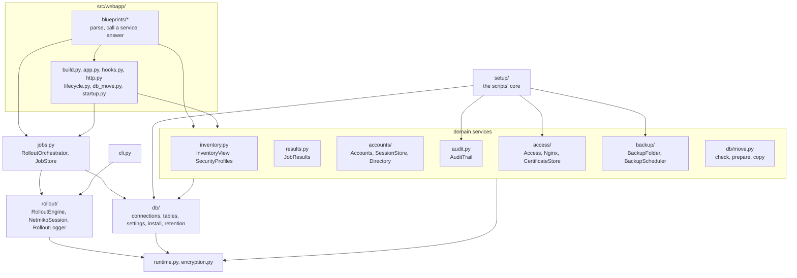

The rules that keep it this way:

- **The CLI must not import the web stack.** `src/rollout/` imports the database models only under `TYPE_CHECKING`, and redis-py not at all: the Redis client is typed by the `KeyValueStore` Protocol. `tests/unit/test_cli.py` checks that importing the CLI loads no web module, and the PyInstaller spec excludes them.
- **No import cycles.** Every module imports on its own. Where two modules need each other's types, one imports the other under `TYPE_CHECKING` only (for example `db/install.py` and `db/connections.py`).
- **No module-level singletons for services.** Routes reach the services through the typed `current_app` (`app.backend`, `app.orchestrator`, `app.access`, …) inside a request, never at import time. A connection that can be switched at run time (a database move, a Redis switch) is looked up per call.
- **Imports style.** All imports at the top, after the docstring: `from __future__` first, then the standard library, third-party packages and the project (`src` / `tests`), separated by a blank line; plain `import x` before `from x import …`, sorted by module. No import inside a function, except in `src/db/alembic/env.py`, which puts the project root on `sys.path` first.

---

## 6. The object model

### Design rules

- **A class only for a real thing with state and behaviour.** A rule without state stays a function: the input checks, `classify()`, `verify_commands()`, `job_status()`, the password rule, the backup schedule's `due()`, the port helper's `next_step()`, and the file protocols of `site.env` and nginx's `status.json`.
- **An ABC when NetRollout owns the whole family and the base shares code** (`Finish`, `Certificate`, `Setting`, `ServiceConnection`, `PeriodicTask`). An incomplete subclass fails when it is created, not in production.
- **A Protocol when the implementer is foreign or a test fake stands in**: `ConfigSession` (Netmiko's connection), `KeyValueStore` (redis-py), `SessionSerializer` (flask-session), `Echo`, `Notifier`. Structural, checked by mypy, nothing shared at run time.
- **A `Callable` for a one-call contract**: `hold` (may a background task run now?), `retention_days`, and the per-call `postgres` / Redis lookups that follow a database move or a Redis switch.
- **An enum when a closed set of values is spelled twice or crosses a boundary** (Redis, a file, the database, JSON, a script's exit code): `DeviceStatus`, `JobStatus`, `AuditAction`, `Role`, `ApplyState`, `BackupKind`, `SetupExit`, `CliExit`, and others. Its values are what those places hold, so they never change; a new value is a new member.
- **`isinstance` only to validate external data** (JSON from a file, a request or an API, bytes from Redis), never to choose behaviour.
- **One file is one concern**, and a name says what something is, not how it is used.
- **Domain services work in the caller's session and raise.** `InventoryView`, `JobResults`, `Accounts` and `SecurityProfiles` are built as `Service(session, viewer)` (or `Service(session)`), work inside the session the route opened, and raise their refusal (`RuleRefused`, `AccountError`, `SettingsError`, `ProxyError`; the routes' own `NotFound` and `Refused`). The route catches the exception **outside** its `with get_session()` block, so the session rolls back and a refused change never commits half.

### The four pillars, as applied

- **Encapsulation: each piece of state and each rule has one owner.** `JobStore` is the only code that spells a Redis job key. `AuditTrail` is the only writer of audit rows. `SecurityProfiles` is the one place device secrets are encrypted, and `Device.from_inventory()` is where a rollout decrypts them. `site_env.update()` is the only writer of `site.env`.
- **Abstraction: callers think in domain terms.** A route asks `InventoryView(session, viewer).get_editable(device_id)`, not for a query with the visibility filter written out. A page saves the hostname with `app.access.save(values, actor)`, not by renaming certificates and writing files.
- **Information hiding: callers don't know how things are stored.** The pages read rollouts as `RolloutRow` and `JobMeta` values, not Redis hashes. The settings are `SettingsStore.get(key)`, whatever the table looks like.
- **Polymorphism: a class per kind instead of "if it's this kind".** Each platform names its `Finish`; the engine calls `before_leave()`, `after_leave()` and `in_new_session()` without asking which. A certificate is `SelfSigned` or `Organisation`, and a new hostname is `rename_to()` on whichever it is: reissue, or refuse a name it doesn't cover.

### Patterns used

| Pattern | Where | Why |
|---|---|---|
| Strategy | `Finish` (how a platform's change takes effect), `Echo` (console or live log), `Certificate` (self-signed or organisation), the `Setting` kinds | Several real variants exist; the next one is a new class, not more branches. |
| Template method | `ServiceConnection` (bundled or yours, the live switch, written once; each service supplies its hooks), `PeriodicTask` (the loop, first delay, failure reporting and `hold()`; each task supplies `run_once()`) | One algorithm instead of copies. |
| Facade | `Access` (settings, certificates, `site.env`, the port request, nginx's verdict), `BackendServices` (PostgreSQL, Redis, settings) | A multi-system change behind one all-or-nothing call. |
| Factory method | `Device.from_inventory()`, `CertificateStore.current()` | The right object from stored data, in one place. |
| Service per area | `InventoryView`, `JobResults`, `Accounts`, `SecurityProfiles` | One home per rule and query. |
| Value objects | `Viewer`, `JobMeta`, `RolloutRow`, `Verdict`, `ApplyStatus`, `MoveStatus`, the enums | Types instead of dicts and magic strings. |
| Protocol (structural interface) | `ConfigSession`, `KeyValueStore`, `SessionSerializer`, `Notifier`, `Echo`, `Target`, `Report` | A typed contract for code NetRollout does not own, and for test fakes. |

### Considered and rejected

| Idea | Why not |
|---|---|
| `Repository[T]` and a unit of work | SQLAlchemy's `Session` already is the unit of work and the mapped classes the data mapper. Generic repositories would only re-wrap `session.get` and `add`, and their usual payoff (in-memory fakes) doesn't apply when the tests run on a real PostgreSQL. The per-area services give every query one home instead. |
| A `BaseConnector` ABC and `ConnectorFactory` | There is one backend (Netmiko). With one, there is nothing to choose between. Both come the day a second backend is written. |
| A template-method engine | Needs a second kind of rollout (a dry run, a staged rollout) to be worth it. |
| The State pattern for jobs, maintenance, the move, the port helper | Linear flows; an enum fits, and jobs must keep "claimed counts as running". |
| Observer for a job's finalize steps | A fixed, ordered sequence with step-specific error handling; a subscriber list would hide the order. |
| Splitting `InputParser` into CSV and form parsers | No form uses it; the web app builds devices from inventory rows. |
| A `Deployment` ABC, an OS strategy, a "Server" facade | Each would only forward to one-line decisions or to small classes that are already cohesive. |

What stays procedural on purpose: route functions; pure rules and text algorithms (`classify`, `verify_commands`, `rejection`, the input checks, the password rule, `due`, `next_step`); data tables (`PLATFORMS`, `SETTINGS`, `RETENTION_STATEMENTS`); one-shot flows and entry points (`install()`, backup `create` and `restore`, the release download, `cli.py`, `python -m src.setup` and `python -m src.backup`, the migrations); single-purpose modules (`encryption.py`, `runtime.py`, `site_env.py`).

### The main classes and how they work together

For each area: what each class is responsible for, who creates it, who calls it, and what it depends on. The class diagrams below show the same structure; the sequence diagrams after this section and in [§7](#7-key-flows) show the objects collaborating.

#### Rollout core (`src/rollout/`)

| Class | Responsibility | Created by | Called by | Depends on |
|---|---|---|---|---|
| `RolloutEngine` | One rollout: pushes to its devices in a thread pool, verifies, classifies, logs the summary. Holds no state between runs: the cancel flag and the logger are arguments of `run()`. | `RolloutOrchestrator.submit()` (web), `cli.rollout()` (CLI) | `RolloutJob`'s thread, the CLI | `Device`, `NetmikoSession`, `RunReport`, `verify_commands()`, `classify()` |
| `Device` | A target: address, platform, decrypted credentials, the rolling-out user's token mappings and the attribute values they read. `commands_for()` fills the tokens; `unresolved()` says what can't be filled. | `Device.from_inventory()` through `InputParser.import_from_inventory()` (web routes: New Rollout, rollback), `InputParser.prepare_devices()` (CLI) | `RolloutEngine`, `NetmikoSession`, the routes (unresolved tokens) | `encryption.decrypt()`, an `Inventory` row (type only) |
| `NetmikoSession` | One device's SSH conversation: `connect()` (also used by the connection tests), `push()` into config mode line by line then the platform's finish, `fetch_config()`. | `RolloutEngine`, once for the push and once for verify, per device | `RolloutEngine` | Netmiko (as `ConfigSession`), `Platform` / `Finish` from `PLATFORMS`, `RunReport`, `rejection()` |
| `RunReport` | What a rollout tells: forwards log lines (redacted) to its `Notifier`, and collects per endpoint what only a person can resolve. | `RolloutEngine.run()` | `NetmikoSession`, the `Finish` strategies (as `Report`) | a `Notifier` |
| `Platform` + `Finish` (`SaveConfig`, `Commit`, `RunCommand`, `NoFinish`) | Platform knowledge with no I/O of its own: how a change takes effect (`before_leave`, `after_leave`, `in_new_session`, acting on the session they are handed), the show command, flat or indented config, shell quirks. | Module constant `PLATFORMS` | `NetmikoSession` | `ConfigSession`, `Report`, `Target` Protocols |
| `RolloutLogger` | One rollout's log file, every line redacted; the notable lines also through its one `Echo`. Satisfies `Notifier`. | `RolloutJob` (web), `cli.rollout()`, and the CSV import / bulk-assign routes for their own reports | `RunReport`, `RolloutEngine`, `Validator`, `InputParser` | `Echo`, `redact()`, `runtime.logs_dir()` |
| `Echo`: `Console`, `LiveLog` | Where notable lines are shown: `Console` with ANSI colours; `LiveLog` HTML-escaped into Redis (history list + pub/sub channel), and the reader's side, `follow()`, and `close()`. | `RolloutLogger` (a `LiveLog` only for a web job with a Redis client) | `RolloutLogger`; `RolloutJob.follow_log()` for the stream | `KeyValueStore` (redis-py, by Protocol) |
| `InputParser`, `Validator` | The CLI's devices CSV and commands file (and the CSV import's rows): parse, check, build `Device`s, drop unreachable devices. | `cli.rollout()`, the inventory import route | the same | the input check functions, `RolloutLogger` |

#### Jobs (`src/jobs.py`) and results (`src/results.py`)

| Class | Responsibility | Created by | Called by | Depends on |
|---|---|---|---|---|
| `RolloutOrchestrator` | The web app's rollouts: submit, the dispatcher thread and its slots, cancel, finalize, drain, pause. Owns the in-memory jobs and the lock that makes claiming safe. | `launch_app()`, once | rollout routes (`submit`, `cancel`), Active Jobs, `Shutdown` (`drain`), `Maintenance` (`pause`, `idle`, `resume`), the health route (`counts`) | `JobStore`, `ResultRecorder`, `RolloutJob`, `BackendServices` |
| `RolloutJob` | One rollout's life: its engine, logger and live log, thread, cancel flag, `claim()` once, `start()`, `on_complete` always called. | `RolloutOrchestrator.submit()` | the orchestrator; the stream route through `follow_log()` | `RolloutEngine`, `RolloutLogger` |
| `JobStore` | The job state in Redis, and the only code that spells a job key: add, enqueue, next queued, status, counters, the stop-now mark, reading `JobMeta` and `RolloutRow`. | the orchestrator; also built on the fly by the job pages, the Prometheus collector, `clear_stale_jobs()` and `python -m src.jobs` | the same | `RedisConnection` (client looked up per call) |
| `ResultRecorder` | Finished jobs' device results into PostgreSQL, retried, else a JSON file in `logs/`; `busy()` while saving, so a move or a stop waits. | the orchestrator | the orchestrator's finalize | `PostgresConnection` |
| `JobResults` | Finished jobs as the viewer may see them: the owner-or-admin rule (`may_see`), Results' pages, summaries, config snapshots, totals, the admin's user scope. Reads only, in the caller's session. | routes, per request: `JobResults(session, viewer())` | jobs, rollout (rollback), analytics, account routes | `Viewer`, `InventoryView` (labels), `Accounts` (owner names) |

#### Domain services

| Class | Responsibility | Created by | Called by | Depends on |
|---|---|---|---|---|
| `Viewer` | Who the rules are about: a user id and whether an admin. A value. | `http.viewer()` once per request (`Viewer.of(current_user)`); `Viewer(user_id)` for another user's view (a rollback uses the job owner's) | every domain service | nothing |
| `InventoryView` | The inventory as one user sees it: visibility and edit rights, shared endpoints, label maps, property definitions and attribute values, mapping bindings, the device-saving rules (`save_device()` raises `RuleRefused`). | routes: `InventoryView(session, viewer())`; `import_csv()`; `JobResults` | inventory, rollout, mappings, analytics, jobs, security routes | the session, `Viewer`, the tables |
| `SecurityProfiles` | The viewer's security profiles; the one place device secrets are encrypted. | security and inventory routes, the CSV import | the same | the session, `Viewer`, `encryption` |
| `Accounts` | Making accounts (local: Request access, Add user; directory: a mapped group's first sign-in, the LDAP import), the name lookups, the access requests waiting. Raises `AccountError`. | routes per request, `jobs.with_owners()`, `JobResults` | auth, admin users, admin LDAP, jobs | the session, the password rule |
| `SessionStore` | The signed-in sessions in Redis: sign a user out everywhere (`end_for`), who is signed in, clear all at start, the idle limit. | `launch_app()` (`app.sessions`) | the request hooks, auth, admin users, Live Sessions, the Redis switch | a Redis client getter, flask-session's serializer (`SessionSerializer`), the settings getter |
| `Directory` | One configured LDAP server: bind as the user, group membership, user details, the admin page's test / explore / import. | auth and admin LDAP routes, per use: `Directory(server_row)` | the same | ldap3, `encryption.decrypt()` for the bind password |
| `AuditTrail` | The one writer of audit rows, each in its own session, independent of the caller's. | `WebServices`; `BackupScheduler`'s audit; the setup core's port-by-hand | `WebServices.audit()` (every route), `DatabaseMove`, backups | a `PostgresConnection` getter, `Actor`, `AuditAction` |

#### Infrastructure (`src/db/`, `src/runtime.py`)

| Class | Responsibility | Created by | Called by | Depends on |
|---|---|---|---|---|
| `BackendServices` | One PostgreSQL connection, one Redis connection and the settings per process; the move's and switch's entry points (`move_postgres`, `reload_redis`), `health()`, `connection_modes()`, the encryption sample. | `launch_app()` (tests pass their own) | everything that needs a connection, through `app.backend` | `RuntimeEnv`, `PostgresConnection`, `RedisConnection`, `install()`, `SettingsStore` |
| `ServiceConnection` → `PostgresConnection`, `RedisConnection` | Template method: the bundled-or-yours rule (`mode`, `bundled_config`) and the live switch (`switch_to`: swap, write `runtime.env`, undo on failure) written once; each subclass supplies `config_from_url`, `live_host`, `own_url`, `swap`, `after_swap`, `undo`. `PostgresConnection.get_session()` commits on a clean exit and rolls back on an exception; `reload_db()` raises `RuntimeError` when the new server is unreachable, changing nothing. Redis errors callers catch are the `REDIS_UNAVAILABLE` tuple. | `BackendServices`; the setup core and `python -m src.backup` build a `PostgresConnection` of their own | every data access | `PostgresConfig` / `RedisConfig` (frozen, from the URL or the separate variables: `unload_env`, `get_url`, `place`, `describe`, `to_env_dict`) |
| `RuntimeEnv` | `config/runtime.env`: loading it with override, merging a switch's keys, the remembered bundled addresses. | `BackendServices` | `ServiceConnection.switch_to`, `mode` | `python-dotenv`, `runtime.write_atomic` |
| `SettingsStore` + `Setting` kinds (`IntSetting`, `TextSetting`, `ChoiceSetting`) | Reading and changing System Settings, always from the table; `plan()` / `update()` all or nothing, raising `SettingsError`. Each `Setting` parses a typed value, coerces a stored one, renders its page fields and gives its seed. | `BackendServices.settings` (a `PostgresConnection` getter, so a move is followed); `SETTINGS` registry | settings routes, `Access`, the orchestrator's start, the scheduler, the hooks | `SystemSetting` table, `RULES` |
| `PeriodicTask` → `LogPruner`, `CertificateUpkeep`, `BackupScheduler`, `NightlyCleanUp` | A daemon loop: optional first delay, `run_once()` every interval, `failed()` reporting (may arrange a retry), `hold()` for "not now". | `src/webapp/__main__.py` | their own thread | each its own work |

#### Access (`src/access/`)

| Class | Responsibility | Created by | Called by | Depends on |
|---|---|---|---|---|
| `Access` | Facade (`app.access`): saving the hostname and HTTPS port, resetting a setting, confirming or retrying the port, uploading or generating a certificate; every multi-system change all or nothing (`SaveResult`). | `launch_app()` | System Settings and Server Management routes | `SettingsStore`, `CertificateStore`, `Nginx`, `access.port` |
| `Nginx` | nginx from the app's side: `managed`, `status()`, `overview()`, `change_hostname()` (certificate then `site.env`, under the certificate lock, returning an undo), `apply(change)` (make it, await the verdict, undo on rejection). | `Access` | `Access` | `CertificateStore`, `site_env`, `write_site()`, `wait_for_status()`, `Verdict` |
| `CertificateStore` + `Certificate` (`SelfSigned`, `Organisation`) | The certs folder; `current()` is the factory that returns the right kind; `rename()`, `install()`, `generate_selfsigned()`, `drop_expired()`, each under one lock with an undo. A `SelfSigned` certificate reissues itself for a new name; an `Organisation` one refuses a name it doesn't cover. | `Access` (the app); the setup core (install, status) | `Nginx`, `Access`, `CertificateUpkeep` | `certs.selfsigned()`, `certs.validate()`, cryptography |
| `CertificateUpkeep` | Hourly: drops previous hostnames whose 7-day transition ended. | `src/webapp/__main__.py` with `app.access.certificates` | its thread | `CertificateStore` |
| `ApplyStatus`, `ApplyState`, `PortPageState` | The port helper's answer typed, its states, and what the page shows. | `access.port.read_status()`, `state()` | `Access.port_state()`, the settings routes | `config/apply-status.json` |

#### Backups (`src/backup/`)

| Class | Responsibility | Created by | Called by | Depends on |
|---|---|---|---|---|
| `BackupFolder` + `BackupLock` | The backups folder: `entries()`, `prune(keep)` (scheduled ones only), the last scheduled outcome, and `lock()`, one backup or restore at a time, refreshed while held. | `archive.create()` / `restore()` / `check()`, the scheduler, the Backups page | the same | the folder, `runtime.write_json` |
| `BackupScheduler` | A `PeriodicTask`: when a scheduled time passed, `archive.create(kind=scheduled)`, then prune; a failure audited and retried after an hour. | `start_backup_schedule()` from `__main__` with `hold` = "a move is running" | its thread | `BackendServices`, `archive`, `AuditTrail`, the settings |

#### Web (`src/webapp/`)

| Class | Responsibility | Created by | Called by | Depends on |
|---|---|---|---|---|
| `NetRolloutApp` | Flask with the typed services: `backend`, `orchestrator`, `web`, `shutdown`, `maintenance`, `db_move`, `access`, `sessions`, `instance_token`, `settings_started_with`, `app_port`. The pages import its typed `current_app`. | `launch_app()` | every route | all of the above |
| `WebServices` | The request's audit row (`audit()`: who, from where, printed instead while maintenance blocks writes) and the shared `ReachabilityChecker`. | `launch_app()` (`app.web`) | every route that audits; inventory and rollout (reachability) | `AuditTrail`, `Maintenance`, `ReachabilityChecker` |
| `Caller` | An enum used as a light strategy: which signs (a JSON body, the XHR header, a background request, a method other than GET, the live log stream) make a request a script's in each situation, so an error is answered as JSON or as a page. | enum members | hooks and error handlers (`wants_json()`) | the request |
| `Shutdown` | This process's stop or restart: at most one, begun once, drain in the background, then exit (or relaunch in development). | `launch_app()` | the SIGTERM handler, the admin Restart route | `RolloutOrchestrator` |
| `Maintenance` | A database move's waiting and lock: pauses the orchestrator, then the request gate (`register_maintenance`) answers 503; counts requests under way (`enter` / `leave`). | `launch_app()` | `DatabaseMove`, `WebServices`, the gate, the banner | `RolloutOrchestrator` |
| `DatabaseMove` | One database move at a time, in a background thread: check, wait, lock, copy, switch; cancel; its status (`MoveStatus`) for the page. | `launch_app()` (`app.db_move`) | Server Management routes | `BackendServices`, `Maintenance`, `AuditTrail`, `db/move.py` |

#### A CLI rollout

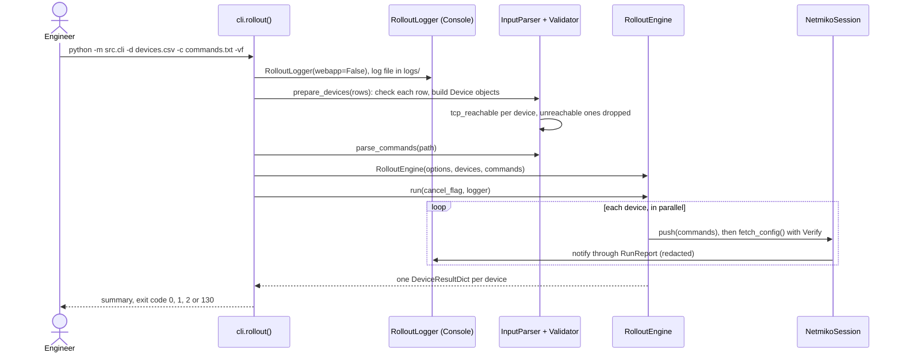

#### Saving the hostname through `Access`

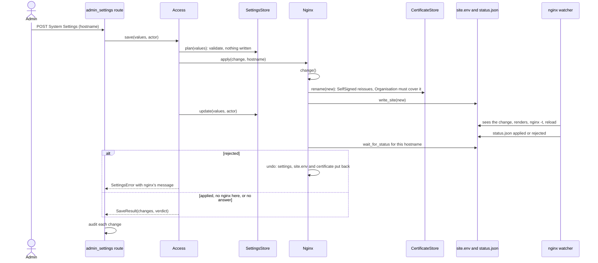

The web rollout, sign-in and database move are drawn object by object in [§7](#7-key-flows).

### Class diagrams

Stereotypes: `<<interface>>` is a `typing.Protocol`, `<<abstract>>` an ABC, `<<enumeration>>` a string or integer enum, `<<dataclass>>` a value type. A solid line with a hollow triangle is inheritance, a dashed one implements a Protocol, a filled diamond is ownership, an open diamond aggregation, a plain arrow uses. Only the public methods that matter for the design are shown.

#### `src/rollout/`


#### `src/jobs.py` and `src/results.py`

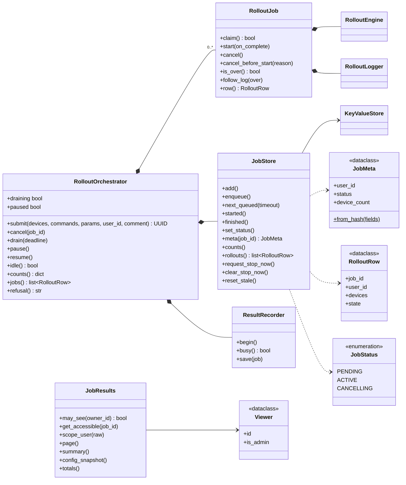

#### The data and domain layer: `db/`, `accounts/`, `inventory.py`, `audit.py`, `backup/`, `runtime.py`

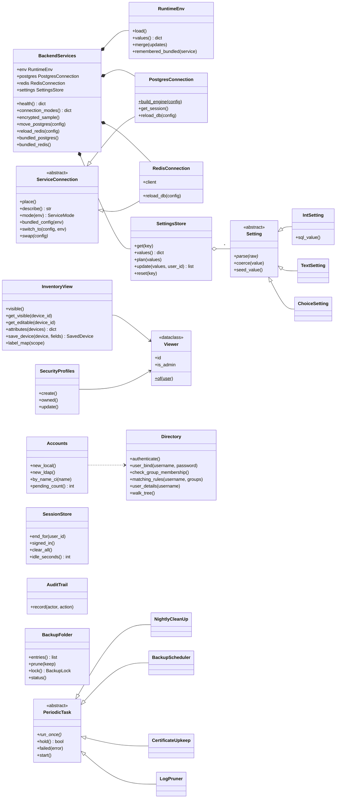

#### `src/access/` and `src/webapp/`

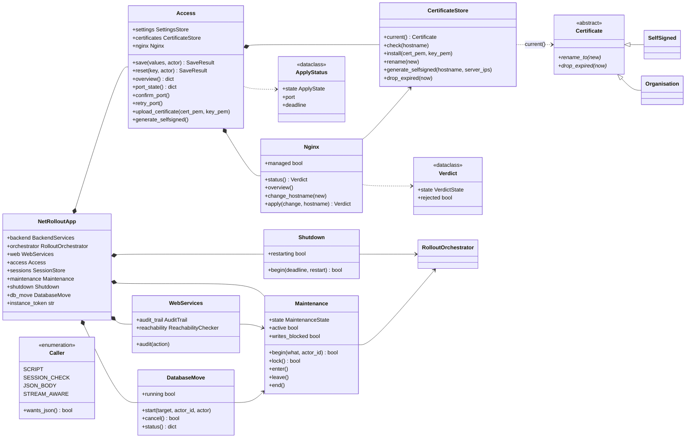

---

## 7. Key flows

### A web rollout

From the New Rollout page to the results in PostgreSQL, with the live log on the side.

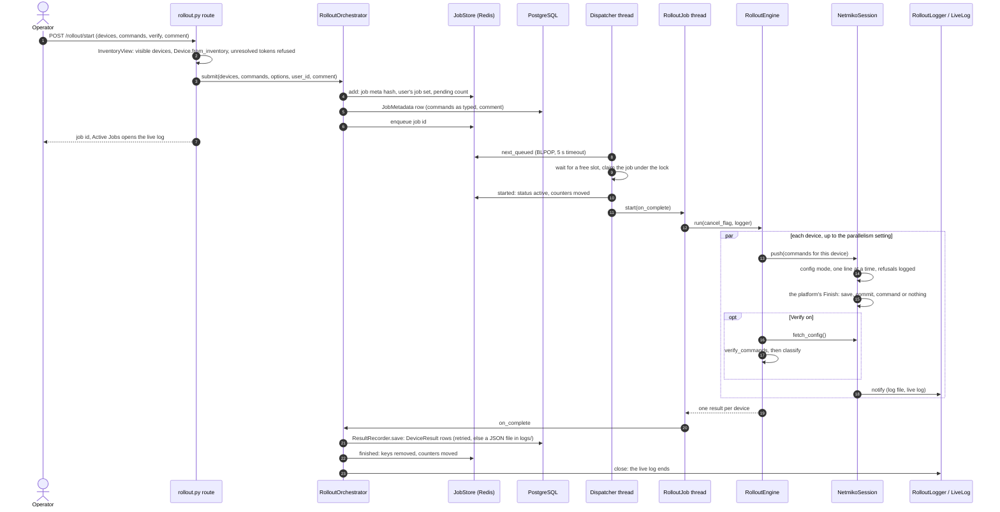

The live log, in parallel with the rollout:

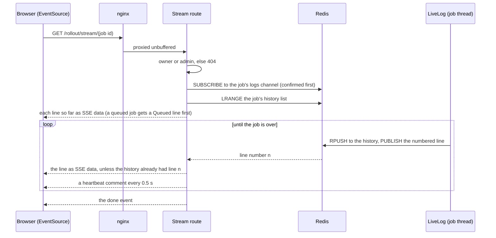

### Sign-in

```mermaid
sequenceDiagram
    actor U as User
    participant A as auth.py
    participant DB as PostgreSQL
    participant DIR as Directory (LDAP)
    participant RS as Redis sessions

    U->>A: POST /login (username, password), 10 per minute per address
    A->>A: Origin check (sign-in is exempt from the CSRF token)
    A->>DB: find the user (exact name, else a directory account in any case)
    alt local account
        A->>A: check_password_hash, approved, active
        alt the factory admin account
            A->>RS: new session id, signed in
        else every other local account
            A->>RS: pre_auth_user_id in the session
            A-->>U: /otp_verify, or /otp_enroll the first time
            U->>A: 6-digit code (5 wrong codes drop the half-done sign-in)
            A->>A: pyotp verify against the decrypted secret
            A->>RS: new session id, signed in
        end
    else known directory account
        A->>DIR: user_bind(username, password)
        opt the directory sets the role (service account + an active group rule)
            A->>DIR: matching_rules(username, active rules)
            A->>DB: Accounts.set_directory_role (the highest role; never the last admin away)
        end
        A->>RS: new session id, signed in (no 2FA)
    else unknown username
        A->>DIR: check_group_membership against the active server's mapped groups
        A->>DB: Accounts.new_ldap (approved, active, the highest role of the groups matched)
        A->>RS: new session id, signed in
    end
    A->>DB: audit auth.login (success or the reason)
    A-->>U: the page asked for (?next=, local paths only), else the Dashboard
```

After sign-in, every request passes `enforce_session_lifetime` (idle limit from System Settings, 12 hours absolute) and, while `must_change_password` is set, `require_password_change`. See [§10.9](#109-sessions-and-accounts).

### Changing the HTTPS port

The port is Docker's mapping, so the app cannot apply it. It asks the host's port helper through files and confirms the new port from a browser.

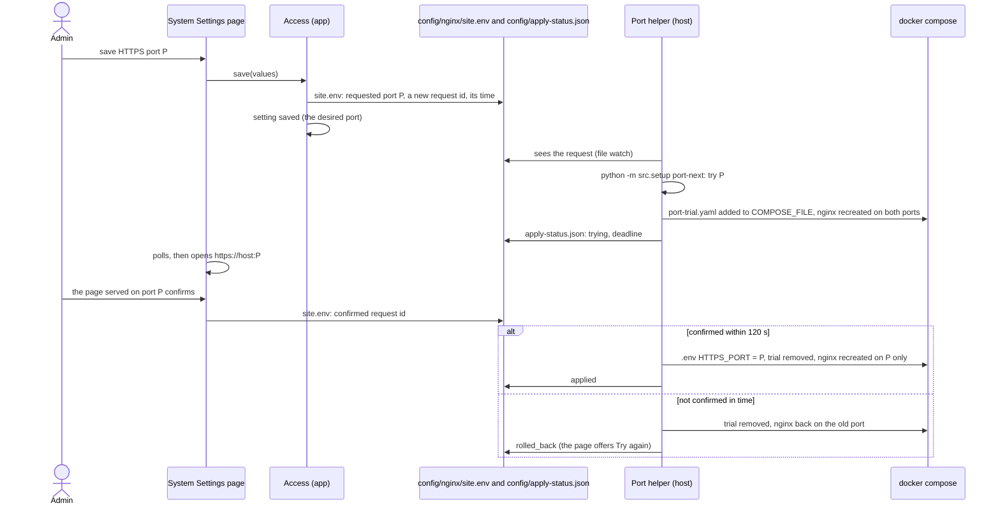

### An update

On Windows, NetRollout Manager (or the user) runs the new NetRollout Setup over the install. On Linux, `netrollout.sh update` does the same steps itself. Both refuse the same version and older versions before anything changes, and take a `before-update` backup with the installed version.

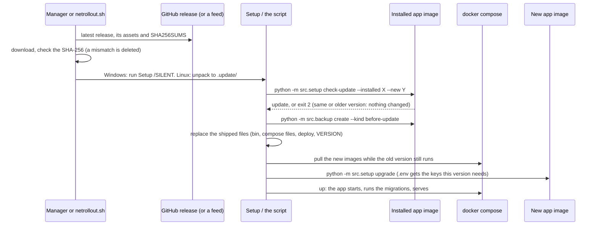

Details: [§10.12](#1012-netrollout-setup-and-netrollout-manager-windows) and the admin guide's [updating section](admin-guide.md#updating-netrollout).

### A database move

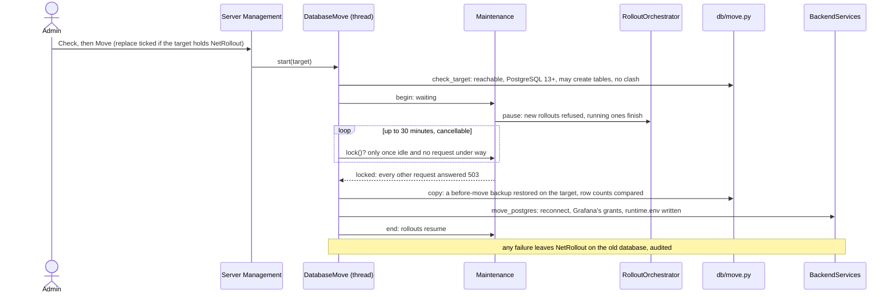

---

## 8. Data model

### PostgreSQL tables

The models are in `src/db/tables.py`; the schema is managed by Alembic (`src/db/alembic/versions/`). Every table has a UUID primary key, except `system_settings`, keyed by the setting's name. The history starts at the `v1_0_0_baseline` revision; from 1.0.0 on, released migrations are never edited, and every schema change is a new revision. The app applies migrations itself at every start.

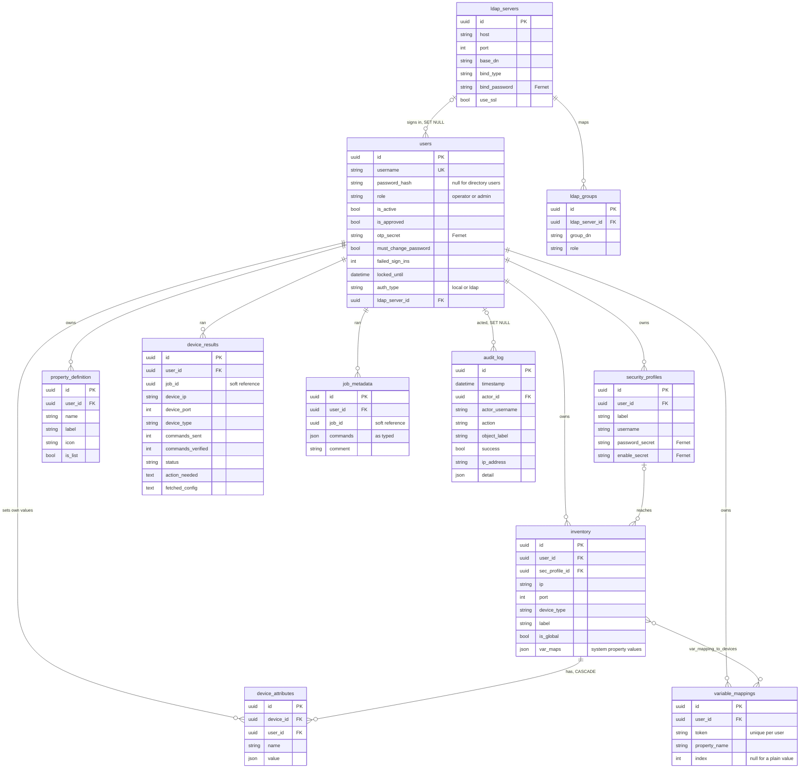

| Table | What it holds |
|---|---|
| `users` | Accounts, local or directory. `role` is `operator` or `admin`; `is_approved` (Request access waits for an admin) and `is_active` gate sign-in; `otp_secret` is the encrypted TOTP secret (null: not enrolled); `must_change_password` gates every page to the password change (the factory `admin`, after an admin reset); `failed_sign_ins` / `locked_until` are the lockout (5 wrong passwords in a row lock a local account for 15 minutes, 10 disable it; the factory admin is only ever locked). Deleting a user deletes their devices, profiles, mappings, properties, attribute values, results and job metadata. |
| `inventory` | Devices. `is_global` devices are visible to and usable by everyone, editable only by admins. `var_maps` holds the system properties' values (hostname, loopback_ip, asn, mgmt_vrf, mgmt_interface, site, domain, timezone, vrfs), shared by everyone who sees the device. Several devices may share an `ip:port`; the pages warn, nothing is blocked. |
| `security_profiles` | The credentials devices are reached with: username in clear, password and enable secret encrypted. A profile can't be deleted while a device uses it. |
| `variable_mappings` | A `$$TOKEN$$` bound to a property name (and an index for list properties), and the devices it applies to (`var_mapping_to_devices`). The join table is shared across users because of global devices, so a rollout applies only the rolling-out user's mappings. |
| `property_definition` | A user's own custom properties (name, label, icon, list or not). |
| `device_attributes` | One user's value of one of their custom properties on one device. Unique per device, user and name; deleted with the device, the user or the property. |
| `device_results` | One row per device per job: status (`success`, `partial`, `failed`, `cancelled`), commands sent and verified, `action_needed` (what only a person can resolve), and `fetched_config` (the running configuration Verify read, kept only when some commands didn't verify, for the Verify Diff). There is no job table: `job_id` groups the rows. |
| `job_metadata` | One row per job: the commands as typed (before token substitution) and the comment. Deleted once its job's results are gone. |
| `audit_log` | Who did what, when, from which address, with what outcome. `actor_username` and `object_label` are copied in, so a row survives the user's or the object's deletion. |
| `ldap_servers`, `ldap_groups` | Directory servers (bind type `anonymous`, `simple` or `regular` with a service account; bind password encrypted) and the groups whose direct members are given an account on their first sign-in; a group's `role` (operator or admin) decides its members' role at every sign-in (admin if any matching active rule gives it). |
| `system_settings` | The runtime value of each System Setting (`key`, JSON `value`, who changed it and when). The only runtime source of the settings. |

<details>
<summary>Column reference (every table)</summary>

| Table | Column | Type | Notes |
|---|---|---|---|
| `users` | `id` | UUID | Primary key |
| | `username` | string(64) | Unique, indexed |
| | `password_hash` | string(255) | Null for directory users |
| | `email` | string(120) | Unique, nullable |
| | `full_name`, `position` | string(120), string(64) | Nullable |
| | `role` | string(40) | `operator` (default) or `admin`; the app only checks for `admin` |
| | `is_active`, `is_approved` | bool | Default false |
| | `otp_secret` | string(255) | Fernet-encrypted TOTP secret; null until enrolled |
| | `must_change_password` | bool | Default false |
| | `failed_sign_ins` | int | Wrong passwords in a row (local accounts); the 5th disables the account, or locks the factory admin. Default 0 |
| | `locked_until` | timestamptz | The factory admin's 15-minute lock after 5 wrong passwords; null: not locked |
| | `auth_type` | string(20) | `local` or `ldap` |
| | `ldap_server_id` | UUID | FK `ldap_servers`, ON DELETE SET NULL |
| | `created_at` | datetime | |
| `inventory` | `id`, `user_id` | UUID | `user_id`: the owner |
| | `sec_profile_id` | UUID | FK `security_profiles`, nullable: a device without a profile can't be rolled out |
| | `ip`, `device_type`, `label` | string(64) | `label` required |
| | `port` | int | SSH port |
| | `is_global` | bool | Visible to and usable by everyone; admins edit |
| | `var_maps` | JSON | System property values, keyed by property name; list properties hold lists |
| `security_profiles` | `id`, `user_id` | UUID | |
| | `label` | string(64) | Nullable; the UI falls back to the username |
| | `username` | string(64) | Clear text |
| | `password_secret` | string(255) | Fernet |
| | `enable_secret` | string(255) | Fernet, nullable |
| `variable_mappings` | `id`, `user_id` | UUID | |
| | `label` | string(64) | Nullable |
| | `token` | string(64) | E.g. `$$HOSTNAME$$`; unique per user |
| | `property_name` | string(64) | The attribute it reads |
| | `index` | int | Null: the value as is; N: item N of a list property |
| `var_mapping_to_devices` | `mapping_id`, `device_id` | UUID | Join table, shared across users |
| `property_definition` | `id`, `user_id` | UUID | Unique `(name, user_id)` |
| | `name`, `label`, `icon` | string(64) | `icon`: a Bootstrap Icons class |
| | `is_list` | bool | A list value (enables index substitution) |
| `device_attributes` | `id` | UUID | Unique `(device_id, user_id, name)` |
| | `device_id`, `user_id` | UUID | Both ON DELETE CASCADE |
| | `name` | string(64) | The property's name |
| | `value` | JSON | A text or a list of texts |
| `device_results` | `id`, `user_id` | UUID | |
| | `job_id` | UUID | Soft reference, groups a job's rows |
| | `started_at`, `completed_at` | datetime | |
| | `device_ip`, `device_type` | string(64) | |
| | `device_port` | int | Server default 22 |
| | `commands_sent` | int | |
| | `commands_verified` | int | Commands confirmed plus those that can't be checked (navigation, operational); null when Verify didn't run or the config couldn't be fetched |
| | `status` | string(64) | `success`, `partial`, `failed`, `cancelled` |
| | `action_needed` | text | Nullable |
| | `fetched_config` | text | Nullable; cleared after *Config snapshots* (the page then says the Verify Diff expired) |
| `job_metadata` | `id`, `user_id`, `job_id` | UUID | `job_id` a soft reference |
| | `commands` | JSON | The command list before substitution |
| | `comment` | string(255) | Nullable |
| | `created_at` | datetime | |
| `audit_log` | `id` | UUID | |
| | `timestamp` | datetime | Indexed |
| | `actor_id` | UUID | FK `users`, ON DELETE SET NULL |
| | `actor_username` | string(64) | Copied: survives the user's deletion |
| | `action` | string(64) | Dot-namespaced (`auth.login`, `inventory.create`, …), indexed |
| | `object_type`, `object_id`, `object_label` | string(64), UUID, string(255) | The affected object; the label copied |
| | `success` | bool | |
| | `ip_address` | string(64) | The real client address (through `ProxyFix`) |
| | `detail` | JSON | Machine-readable detail (reason, changes) |
| `ldap_servers` | `id` | UUID | |
| | `name` | string(64) | Display name |
| | `host`, `base_dn` | string(255) | |
| | `port` | int | Default 389 (the page suggests 636 for LDAPS) |
| | `cn_identifier` | string(64) | Login attribute, default `sAMAccountName` (`uid` for OpenLDAP) |
| | `bind_type` | string(20) | `anonymous` (default), `simple`, `regular` (service account) |
| | `bind_dn` | string(255) | Service account DN, nullable |
| | `bind_password` | string(255) | Fernet, nullable |
| | `use_ssl`, `is_active` | bool | LDAPS; active (default true) |
| `ldap_groups` | `id`, `ldap_server_id` | UUID | FK ON DELETE CASCADE |
| | `group_dn` | string(512) | Matched against the user's groups (direct membership) |
| | `label` | string(128) | |
| | `role` | string(40) | Given to accounts created from this group |
| | `is_active` | bool | |
| `system_settings` | `key` | string(64) | Primary key: the setting's name |
| | `value` | JSON | |
| | `updated_at` | datetime | |
| | `updated_by` | UUID | FK `users`, ON DELETE SET NULL; null: seeded, never changed by an admin |

</details>

Retention (System Settings, applied by the nightly clean-up): job records 30 days, config snapshots 7 days, audit log 90 days. See [§10.7](#107-retention).

### Redis keys

Redis holds nothing that must survive: sessions, the job queue, live job state and the reachability cache. Every app start clears leftover job state and signs everyone out.

| Key | Type | Written by | What it holds |
|---|---|---|---|
| `job:{id}:meta` | hash | `JobStore` | A running or queued job: `user_id`, `status` (`pending`, `active`, `cancelling`), `device_count`, `created_at`, `started_at`. |
| `user_jobs:{user_id}` | set | `JobStore` | A user's job ids. |
| `netrollout:job_queue` | list | `JobStore` | Job ids waiting for the dispatcher. |
| `netrollout:pending_count`, `netrollout:active_count` | counters | `JobStore` | Queued and running jobs (the Prometheus gauges). |
| `netrollout:stop_now` | string, 15-minute expiry | `JobStore` | Set from the host (`python -m src.jobs stop-now`): the stop under way cancels running rollouts at once instead of waiting. |
| `job:{id}:history` | list | `LiveLog` | The live log's lines so far. |
| `job:{id}:logs` | pub/sub channel | `LiveLog` | New lines, published as `<n>\t<line>`, and `__done__` at the end. |
| `redis_session:{sid}` | string | Flask-Session (`_SafeRedisSessionInterface`) | A signed-in session. `SessionStore` reads them to list or end a user's sessions. |
| `reach:{ip}:{port}` | string with expiry | `ReachabilityChecker` | A cached TCP reachability probe (the *Reachability cache* setting). |

### Files on disk

The NetRollout home is `NETROLLOUT_HOME` (`/data` in the image), else the executable's folder for the CLI, else the repository root. An install mounts its `config/`, `certs/`, `logs/` and `backups/` folders there.

| Path | Written by | Read by | What it holds |
|---|---|---|---|
| `.env` (install folder) | The setup core | Docker Compose | The install's secrets and answers: database and Redis passwords, `SECRET_KEY`, `NETROLLOUT_ENCRYPTION_KEY`, Grafana's passwords, `HTTPS_PORT`, `COMPOSE_FILE`, `COMPOSE_PROFILES`, `TZ`, the version. |
| `config/runtime.env` | The app (a database move or Redis switch only) | The app, grafana-setup | The connection settings an admin chose, overriding the environment. |
| `config/nginx/site.env` | The app (`site_env.py`); the installer's first hostname | nginx's watcher, the port helper | Hostname and port in use; the port request, its id, time and confirmation. |
| `config/nginx/status.json` | nginx's watcher | The app (`nginx.read_status`) | `applied` or `rejected` for the last change, with nginx's message. |
| `config/apply-status.json` | The port helper (`src/setup/port.py`) | The app (`src/access/port.py`) | The port change's state: `trying`, `applied`, `rolled_back` or `failed`. |
| `config/port-trial.yaml` | The port helper | Docker Compose (listed in `COMPOSE_FILE` during a trial) | The trial's extra port mapping. |
| `config/retention-status.json` | The nightly clean-up | System Settings | The last clean-up's outcome. |
| `certs/fullchain.pem`, `certs/privkey.pem` | The setup core, `CertificateStore` | nginx | The certificate nginx serves. `.selfsigned` marks a generated one; `.old-names.json` holds previous hostnames' deadlines. |
| `logs/` | The rollout logger, the app, the scripts | Download Log, Alloy (Loki) | One file per rollout, `rollout_<time>_<job id>.log`; `unsaved-results-<job>.json` when results couldn't be saved; the scripts' install, update and port-helper logs. |
| `backups/` | `src/backup` | Restore | `netrollout-<version>-<time>-<kind>.zip`; `.schedule-status.json`, the lock `.backup.lock`. |

---

## 9. Installation, the setup core and the port helper

### One decision-maker, two thin host scripts

What installing and running NetRollout decides and writes lives once, in the **setup core** (`src/setup/`). It runs inside the app image with the install folder mounted: `python -m src.setup <command>`. The host scripts, `packaging/windows/manage.ps1` and `packaging/linux/netrollout.sh`, only do what needs the host: checks, Docker, file owners and permissions, auto-start, shortcuts. They call the setup core for everything else, so Windows and Linux make the same decisions.

| Command | What it decides |
|---|---|
| `init`, `check` | The install's answers (hostname, HTTPS port, monitoring, an organisation's certificate, timezone), checked against the host's facts (busy ports, IP addresses, computer name); `init` writes `.env`, `config/nginx/site.env`, the folders and, unless the organisation's certificate is used, a self-signed one. `check` validates only. `init --dev` writes a developer's `.env`, `config/runtime.env` and a localhost certificate. |
| `prepare-start` | Before a start: port 80's redirect is added to or dropped from `COMPOSE_FILE` as port 80 is free or busy, and the server's addresses are refreshed. |
| `status` | The `netrollout status` report (services, health, backups, what to do). |
| `restore-key` | After a restore: the backup's encryption key into `.env`. |
| `check-update` | An update's direction, run with the *installed* image before any file is replaced: `update`, or exit 2 for the same version (nothing to update) or an older one (downgrades aren't supported). Versions compare by PEP 440, so `1.0.0.dev0 < 1.0.0rc1 < 1.0.0`. |
| `upgrade` | After an update's files: `.env` gets the keys this version needs (a secret the data depends on is never made up: missing means refused) and an `# Updated to NetRollout X` line. |
| `release` | Linux's update: find the release (GitHub's latest, a tag, or a feed), download it, check it against `SHA256SUMS`, unpack it. |
| `port-ready`, `port-next`, `port-open`, `port-trying`, `port-close` | The port helper's steps (below). |
| `port-set`, `port-setting` | `netrollout port <n>`: set the HTTPS port by hand, without a trial. |

Exit codes are `SetupExit`: 0 done, 1 invalid input or a failed step (each reason on its own line), 2 refused.

### Windows

Windows installs only through **NetRollout Setup** (`packaging/windows/installer/netrollout.iss`, Inno Setup). Setup refuses Windows Server and a machine with virtualization off before its first page, checks or installs Docker Desktop, collects the answers on a settings page pre-filled by `manage.ps1 defaults`, and runs `manage.ps1 install -Yes` with them. Over an existing install it updates in place (see [§7](#an-update)); over the data an earlier uninstall kept, the version that data was last set up by decides between starting as before, updating, or refusing a downgrade. The installed folder holds `bin\` (NetRollout Manager, `manage.ps1`, `netrollout.bat`, the icon), `deploy\`, the compose files, `VERSION`, `LICENSE`, the uninstaller and, from the install, `.env` (hidden), `config\`, `certs\`, `logs\` and `backups\`. `manage.ps1` restricts the whole folder to Administrators, SYSTEM and the installing account (`icacls`), at install and at every start.

### Linux

`sudo ./bin/install.sh` asks the same questions (or takes them as flags with `--yes`), checks both images are published, and starts NetRollout; `bin/netrollout.sh` is the day-to-day script, with a numbered menu when run without a command. Docker Engine and the Compose plugin are checked and explained, never installed. As root it keeps `.env` at mode 600 owned by root, and `config/`, `certs/`, `logs/` and `backups/` at 700 owned by the app container's user (uid 10001), reset at every start. `netrollout.sh update` downloads and checks the release zip, asks, takes a `before-update` backup, replaces the shipped files and then runs the **new** script's `update-finish` (the whole script body is in `main`, read before it runs, so it can replace its own file). Both scripts run `docker compose` from the install folder, because compose reads `.env`'s `COMPOSE_FILE` relative to the folder it runs in.

### A release

`packaging/build_release.py --version <v>` builds `dist/release-<v>/`:

- `netrollout-<v>-linux.zip`: the install folder under `netrollout/` (`bin/`, the compose files, `deploy/`, `VERSION`, `LICENSE`, a README), Unix modes and LF line endings;
- `NetRollout-Setup-<v>.exe` and `netrollout-cli-<v>.exe` (built on Windows);
- `SHA256SUMS` for all of them;
- with `--feed-base`, a `release-feed.json` in the shape of GitHub's API, for a mirror or a test of the update.

`SHIPPED` in `build_release.py` is the one list of files an install gets besides the images; a unit test checks that the installer ships the same files and that every file compose mounts is in it. The two images (`itamarweinstein/netrollout` and `itamarweinstein/netrollout-nginx`) are built, checked end to end and pushed to Docker Hub by the release workflow, then the GitHub release is published with the files. The version in `VERSION` must equal the tag; the image build fails if its `VERSION` build argument differs.

### The port helper

A new HTTPS port means a new Docker port mapping, so nginx must be recreated on the host; the app never does it (it has no Docker access). The app and the helper talk through two files:

| File | Direction | Contents |
|---|---|---|
| `config/nginx/site.env` | app to helper | The port wanted, a new request id, its time; later the same id as confirmed, once an admin's browser reached NetRollout through the new port. |
| `config/apply-status.json` | helper to app | `id`, `state` (`trying`, `applied`, `rolled_back`, `failed`), `port`, `trying`, `deadline`, `message`, `time`. |

Each pass of the helper asks `python -m src.setup port-next` what to do:

| Step | Action |
|---|---|
| `none` | Nothing to do (no request, handled already, or refused, then recorded as failed with the reason). |
| `try P` | Open port P next to the current one: `config/port-trial.yaml` (a compose file publishing P) is listed in `.env`'s `COMPOSE_FILE`, nginx is recreated, the state becomes `trying`. nginx's own configuration never changes for a port: it always listens on 443 inside the container. |
| `wait` | A trial is running, not confirmed yet, the deadline not passed. |
| `keep` | Confirmed from the new port: `.env`'s `HTTPS_PORT` and `site.env`'s port in use become P, the trial file goes, nginx is recreated on P only. |
| `rollback` | Not confirmed within 120 s, superseded, or left over from a helper that died: nginx goes back to the old port. A rolled-back request is never retried by itself; the page's Try again makes a new one. |

The 120 s are timed by the script's own stopwatch, not by comparing clocks (Docker Desktop's VM clock can fall minutes behind the host's). The deadline in the status file is for the page's countdown, the app's confirmation check, and a trial whose helper died.

Where the helper runs:

- **Windows**: `NetRollout Manager.exe --helper`, headless, with its own single-instance lock, started at sign-in, by Setup and by `netrollout start`. It watches `site.env` and runs `manage.ps1 apply`. A request left pending (Docker stopped) is retried after 15 s, 60 s, 120 s, 240 s, then every 5 minutes. Its log is `logs\port-helper.log`.
- **Linux**: a systemd path unit, `netrollout-port-<project>.path`, triggers `netrollout.sh apply --yes` when `site.env` changes. It is written at every start and removed by uninstall.
- **Neither**: `netrollout apply` by hand. Where a helper runs, `port-ready` writes a first status, so the page waits for it instead of asking for the command.

Everything that shows or redirects to an address uses `serving_port()` (the helper's status, else the published port), not the setting, which is the *desired* port.

---

## 10. Subsystems

### 10.1 The rollout engine and platforms

`RolloutEngine(options, devices, commands).run(cancel_flag, logger)` runs the devices in a thread pool (`max_workers` = the *Devices in parallel per job* setting for the web app). For each device:

1. **Substitute tokens.** `Device.commands_for()` replaces each `$$TOKEN$$` from the user's variable mappings and the device's attribute values; `unresolved()` lists what can't be filled (the routes refuse such a rollout before queueing it, and the push checks again).
2. **Push.** `NetmikoSession(device, report).push(commands)` enters the CLI shell and config mode once (Junos uses `configure private`), then sends one command at a time exactly as typed (`send_config_set(…, enter_config_mode=False)`). A refused command (`rejection()`: one list of vendor error strings, the command's own echo skipped) is logged with the device's reply, and the rest are still sent. A typed `end` followed by more config commands is refused, as on the device. A prompt that changes mid-push (a new hostname) ends that session; the finish then runs from a fresh one.
3. **Finish the platform's way** (the `Finish` strategy on the platform's `PLATFORMS` row):

| Finish | Platforms | What it does |
|---|---|---|
| `SaveConfig` | `cisco_ios`, `cisco_xe`, `cisco_nxos`, `arista_eos`, `aruba_aoscx`, `hp_procurve`, `hp_comware` | `save_config()` after leaving config mode. Aruba CX sends `end` first (Netmiko only recognises `(config)#`). |
| `Commit` | `juniper_junos`, `paloalto_panos`, `cisco_xr` | `commit()` before leaving config mode (leaving discards uncommitted changes), up to 300 s. A failed commit is a failure; the candidate is discarded (Junos `rollback 0`; PAN-OS `revert config`, else `load config from running-config.xml`; IOS XR reverts by itself). |
| `RunCommand("save config")` | `checkpoint_gaia` | Runs `save config` after leaving config mode. An account that lands in expert (bash) is switched to `clish` first, or the device is refused. |
| `NoFinish` | `fortinet` | The change is live as typed. Any open config block is closed with `end`; `execute cfg save` runs when FortiOS is in manual or revert save mode. |

4. **Verify** (optional, only on devices the push applied to): `fetch_config()` reads the configuration with the platform's show command, and `verify_commands(device_type, config, commands)` gives each command a verdict: verified, not configured, still configured (a removal that didn't take), or not verifiable (navigation such as `exit` or `end`, operational commands such as `write memory` or `commit`). Indented configurations (Cisco style, FortiOS) are parsed into sections, and each typed command is placed in its section from the configuration's own structure. Flat configurations (Junos `display set`, PAN-OS set format, Gaia) are matched line by line with the `edit` / `up` / `top` prefix. `no`, `undo`, `unset` and `delete` pass when the setting is gone. A configuration that can't be fetched means "couldn't verify", not "failed". The Verify Diff page uses the same function, so it can't disagree with the rollout.
5. **Classify** (`classify()`):

| Status | When |
|---|---|
| `cancelled` | The device never started (the rollout was cancelled first). |
| `failed` | Nothing applied (no connection, a failed commit), or with Verify none of the checkable commands confirmed, or without Verify every configuring command refused. |
| `partial` | Some commands confirmed or accepted, some not; or the device stopped answering mid-push. |
| `success` | With Verify, every checkable command confirmed and none refused; without Verify, none refused. |

**ACTION NEEDED.** What only a person can resolve is reported per device by `RunReport.action_needed()`: Junos refusing private mode while someone has uncommitted shared edits, a refused save (for example a Gaia configuration lock), a commit still running after the timeout, PAN-OS changes left in the candidate, Gaia stuck in expert mode, a refused FortiOS `execute cfg save`, or a device whose configuration couldn't be read for Verify. Each becomes one `ACTION NEEDED — <ip:port>: …` line in the log, is counted in the rollout's summary, and is stored in `device_results.action_needed` for the Results page, the completion card and the dashboard.

**Redaction.** Every log line (the file, Download Log, the live log, the console) and every stored ACTION NEEDED text passes `rollout/log.redact()`: the value after a secret-bearing word (`password`, `secret`, `community`, `pre-shared-key`, `psksecret`, `key-string`, `authentication-key`, Junos `encrypted-password`, PAN-OS `phash`, Gaia `password-hash`, and others; `key`, `auth` and `priv` only with a type before the value or a quoted value) becomes `<redacted>`. The keyword and an encryption type stay. The commands as typed (`job_metadata.commands`) and config snapshots (`fetched_config`) are not redacted.

**Known limits of Verify**: typed abbreviations (`int gi1`), values the device rewrites (hashed secrets, normalised values such as Junos `area 0` shown as `0.0.0.0`, Comware VLAN ranges, defaults FortiOS `show` omits), settings that were already there before the rollout, multi-line banners, and compound PAN-OS `set` lines (PAN-OS prints one setting per line). A structural diff is on the [roadmap](roadmap.md).

**Adding a platform** is one `PLATFORMS` row in `src/rollout/platforms.py` (its `Finish`, show command, flat or indented, any shell or config-mode quirk) and a fixture in `tests/unit/rollout/test_platforms.py`. `SUPPORTED_PLATFORMS` is derived from `PLATFORMS`.

**The engine's data types** (`src/rollout/engine.py`, runtime only, no database coupling):

| Type | Fields |
|---|---|
| `RolloutOptions` | `verify` (run Verify after the push), `verbose` (show every message), `webapp` (log for the page as HTML, not a console), `max_workers` (devices at the same time, default 10) |
| `Device` | `ip`, `label`, `username`, `password` and `secret` (decrypted, hidden from `repr`), `device_type`, `port`, `var_map_subs` (`$$TOKEN$$` to the property name and list index, the rolling-out user's mappings only), `extra` (the attribute values that user sees); `endpoint` is `ip:port`, which identifies a target (several devices can share an IP behind NAT) |
| `DeviceResultDict` | `device_ip`, `device_port`, `device_type`, `commands_sent`, `commands_verified`, `fetched_config`, `status`, `action_needed`: a `device_results` row's fields |
| `PushResult`, `VerifyResult` | How the push went (applied, commands sent, refusals, interrupted) and how Verify went (verified, checkable, the config kept when something didn't verify); `classify()` reads both |

### 10.2 Jobs and orchestration

`RolloutOrchestrator(backend, max_concurrent)` is created once at app start; `max_concurrent` is the *Concurrent rollout jobs* setting as it was at start (a change applies after a restart).

- **Submit** builds the `RolloutEngine` and `RolloutJob`, writes the job's Redis state and its `JobMetadata` row, and queues it. A submit that fails partway withdraws the job: nothing is left in memory or Redis.
- **The dispatcher**, a permanent thread, takes job ids from the Redis queue (5 s blocking wait, so a switched Redis client is picked up), waits for one of `max_concurrent` slots, and claims the job under the lock before starting it. It survives any error reading the queue, with exponential backoff (1 to 30 s).
- **Claiming** (`RolloutJob.claim()`): each queued job is claimed exactly once, by the dispatcher to start it or by a cancel or the drain to record it as cancelled.
- **Cancel**: a queued job ends at once (recorded as cancelled, "Cancelled before it started"); a running one is asked to stop, and devices not reached yet are skipped.
- **Finalize**, when a job ends (in this order, each step running even if another failed): results to PostgreSQL through `ResultRecorder` (retried; still failing, they go to `logs/unsaved-results-<job>.json` and an ACTION NEEDED line is printed), the Redis keys removed, the live log closed. A status is written only to a job's existing hash (a Lua HSET-if-exists), so a cancel racing the job's end leaves no phantom row.
- **Drain** (`drain(deadline)`, on SIGTERM or the admin Restart): new rollouts are refused with `Draining`, queued ones are recorded as cancelled, running ones may finish within `NETROLLOUT_DRAIN_SECONDS` (default 600), then are cancelled. If `netrollout:stop_now` is set (by `netrollout stop` or an update choosing "Cancel all now"), running ones are cancelled at once.
- **Pause** (`pause()` / `idle()` / `resume()`, for a database move): new rollouts are refused with `Paused`; nothing is cancelled. `idle()` is true once no job is queued, running or still being recorded.
- **From the host**: `python -m src.jobs rollouts [--json]` lists the running app's rollouts with their owners, and `stop-now [--clear]` sets or clears the mark. The scripts run them with `docker compose exec -T app`.

Jobs live only in the process that runs them. Every start clears leftover job state (`clear_stale_jobs`), live log histories included.

### 10.3 Live logging

`RolloutLogger` writes every message to the job's log file and shows the notable ones (errors, important messages, all of them when verbose) through its one `Echo`: `Console` (ANSI colours) for the CLI, `LiveLog` (HTML-escaped) for a web job. `LiveLog` appends each line to `job:{id}:history` and publishes `<n>\t<line>` on `job:{id}:logs`, where `n` is the history's length after the push. A reader (`LiveLog.follow`) subscribes first and waits for the confirmation, then reads the history, then follows the channel, skipping a line the history already held. `__done__` ends it. The live log is best-effort: the file is written first, and a Redis error never fails the rollout.

The SSE route (`/rollout/stream/<job_id>`) sends each message as `data:` lines (a multi-line message whole), a heartbeat comment every 0.5 s, and a `done` event at the end. It sets `X-Accel-Buffering: no`, and nginx has its own unbuffered location for it. Waitress runs 32 threads by default (`NETROLLOUT_THREADS`, 4 to 256), because each open live log holds one for the whole rollout.

### 10.4 Access: hostname, certificates and nginx

**The nginx image** (`deploy/nginx/`) serves one site rendered from `site.conf.template` with values only: the hostname and port from `config/nginx/site.env`, else the container's environment. Values are validated; nginx syntax never comes from the app. Other names redirect to the canonical hostname (IP addresses and `localhost` are served as they are), port 80 redirects to HTTPS, `/rollout/stream/` is unbuffered, `/metrics` answers 404, and the app is resolved per request through Docker's DNS. `netrollout-watcher.sh` waits for the certificate at boot, then every 3 s checks `site.env` and the certificate; a change is rendered and tested with `nginx -t` in a staging folder, swapped in and reloaded, or else the last good site keeps serving. The outcome goes to `config/nginx/status.json`.

**The app's side** (`src/access/`):

- `nginx.write_site()` writes `site.env` atomically and only when it changes; every start syncs it (`sync_at_start`). `Nginx.apply(change)` makes a change, waits for nginx's verdict for that hostname, and undoes the change if nginx rejects it. `Nginx.managed` tells whether an nginx reports here at all (a deployment behind its own proxy has none).
- **Saving the hostname** (`Access.save`) is all or nothing: `SettingsStore.plan()` validates without writing; `Nginx.change_hostname()` renames the certificate by its kind (`CertificateStore.rename` → `Certificate.rename_to`): a `SelfSigned` certificate is reissued for the new name, keeping its IP addresses and the previous names for a 7-day transition, and an `Organisation` certificate is never reissued and refuses a name it doesn't cover. Then `site.env` is written, the setting saved, and nginx's verdict awaited; a rejection puts the setting, `site.env` and the certificate back.
- **Certificates**: `CertificateStore` owns the certs folder (`fullchain.pem`, `privkey.pem`, the `.selfsigned` marker, `.old-names.json`); every change runs under one lock from a snapshot, and its undo puts back only what no later change replaced. An uploaded certificate is validated first (`certs.validate`: the key matches, the key is not encrypted, the dates, the names cover the hostname, the chain order); any problem refuses it. A generated one is ECDSA P-256, valid 825 days, with the server's IP addresses (`NETROLLOUT_SERVER_IPS`) as extra names. `CertificateUpkeep` drops expired previous names hourly.
- **The HTTPS port**: see [§9](#the-port-helper).

### 10.5 Backups

`python -m src.backup create [--kind manual|scheduled|before-restore|before-update]` writes `backups/netrollout-<version>-<YYYYMMDD-HHMMSS>-<kind>.zip` (the database move also makes a `before-move` one):

- `manifest.json`: version, migration level, row counts;
- `db/<table>.csv`: NetRollout's tables from one read-only REPEATABLE READ snapshot (`COPY … CSV HEADER`), through the app's own connection, never a superuser, so it works on the bundled database or an organisation's;
- `grafana.db` (an SQLite online backup of Grafana's volume, mounted read-only into the app), `certs/`, the rollout logs, and `encryption.key`.

The zip is as secret as `.env`, so it is written owner-only.

**Restore** (`python -m src.backup restore <zip>`, with NetRollout stopped, from the host scripts) runs in one transaction: `alembic downgrade base` (NetRollout's own tables only; anything else in the schema survives), `upgrade` to the backup's migration level, `COPY` in foreign-key order, the sequences, a check that the backup's key decrypts a stored credential, this install's `https_port` kept, and an audit row `backup.restored`. Any failure rolls back. Then the certificates, logs and Grafana's database are put back. It refuses a backup from a newer version, an unknown migration level or an incomplete zip; an older backup is migrated forward by the app at its next start. The scripts then write the backup's key into `.env` (`python -m src.setup restore-key`, as root, because the handed-over key file is root's) and reset Grafana's admin password to the install's.

`BackupFolder` (`archive.py`) is the folder: `entries()`, `prune(keep)` (deletes only the oldest *scheduled* backups), the last scheduled outcome, and `lock()`: one backup or restore at a time (`.backup.lock`, refreshed every 60 s while held, stale after 5 minutes without a refresh). **Scheduled backups**: `BackupScheduler`, a `PeriodicTask` (first check after 2 minutes, then every 30 s), backs up when a scheduled time passed since the newest scheduled backup (a missed one is caught up once), then prunes; a failure is audited (`backup.failed`) and retried after an hour.

### 10.6 System Settings

`src/db/settings.py`. The `system_settings` table is the only runtime source. `SETTINGS` registers each setting as a `Setting` kind (`IntSetting` with a range, `TextSetting` with an optional format, `ChoiceSetting` from a fixed list), with its card, label, help, default, when a change applies, and an optional install-time seed variable.

| Setting | Card | Default | Range | A change applies |
|---|---|---|---|---|
| `job_retention_days` | Retention | 30 | 1–3650 | next nightly clean-up |
| `config_snapshot_retention_days` | Retention | 7 | 1–3650 | next nightly clean-up |
| `audit_retention_days` | Retention | 90 | 7–3650 | next nightly clean-up |
| `log_retention_days` | Retention | 60 | 1–3650 | next daily log clean-up |
| `orchestrator_workers` | Rollouts | 4 | 1–32 | after a restart (seed `ORCHESTRATOR_WORKERS`) |
| `device_parallelism` | Rollouts | 10 | 1–64 | next rollout |
| `reachability_cache_seconds` | Rollouts | 60 | 10–3600 | immediately |
| `public_hostname` | Access | none | a hostname | immediately (seed `NETROLLOUT_PUBLIC_HOSTNAME`, or the installer's `site.env`) |
| `https_port` | Access | 443 | 1–65535 | once confirmed on the new port (seed `NETROLLOUT_HTTPS_PORT`) |
| `session_idle_minutes` | Sessions | 15 | 5–480 | within 30 s |
| `backup_schedule` | Backups | daily | off, daily, weekly | next scheduled time |
| `backup_time` | Backups | 02:00 | HH:MM | next scheduled time |
| `backup_weekday` | Backups | Sunday | a weekday | next scheduled time |
| `backup_keep` | Backups | 14 | 1–365 | next scheduled backup |

- **Seeding**: at every start `install()` inserts a row for each missing setting, from its seed variable if set and valid, else the default. Existing rows are never overwritten; after that, environment variables are ignored.
- **Cross-setting rules** (`RULES`) are declarative and sent to the page as data, so the same rules run on the server and in the browser: log files are kept at least as long as job records, and config snapshots no longer than their job record.
- **`SettingsStore`**: `get(key)` coerces a bad stored value to the nearest valid one and never raises; `plan(values)` validates without writing; `update(values, user_id)` is all or nothing and returns the changes, which are audited; `reset(key)` writes the default. A setting that applies after a restart shows "restart pending" while the saved value differs from the one the process started with.

### 10.7 Retention

The nightly clean-up runs in the app (`src/db/retention.py`, `NightlyCleanUp`, a `PeriodicTask`): daily at 03:00 server time, on whatever database the app is connected to; a missed time is caught up once, and a failure is retried after an hour. `RETENTION_STATEMENTS` read their period from `system_settings` at run time, so a change applies at the next run.

| Statement | Action | Setting (default) |
|---|---|---|
| `device_result_retention` | Delete old `device_results` rows | Job records (30 days) |
| `job_metadata_retention` | Delete `job_metadata` rows whose job has no results left | Job records (30 days) |
| `device_result_config_retention` | Set `fetched_config` to NULL, keep the row | Config snapshots (7 days) |
| `audit_log_retention` | Delete old `audit_log` rows | Audit log (90 days) |

The last outcome is in `config/retention-status.json`, shown on System Settings. Log files are pruned separately by `LogPruner` (daily, the *Log files* setting, default 60 days); the CLI prunes once per run.

### 10.8 Lifecycle and maintenance mode

**Start** (`launch_app`): resolve `SECRET_KEY` and require the encryption key in a container (fail fast); seed the hostname from the installer's `site.env`; build `BackendServices` (load `runtime.env`, connect PostgreSQL, run `install()`: migrations, the factory `admin` / `admin` account if missing, the missing settings, Grafana's grants; connect Redis); check the encryption key against a stored credential; build the orchestrator, `Maintenance`, `WebServices` and the Flask app; register the maintenance gate (the first request hook), the extensions, the session checks and the error handlers; then sign everyone out (`SessionStore.clear_all`), clear leftover job state and sync nginx's `site.env`. `__main__` then installs the SIGTERM handler, starts the background tasks (`LogPruner`, `CertificateUpkeep`, `BackupScheduler`, `NightlyCleanUp`) and serves with Waitress on `0.0.0.0:$PORT`.

**The encryption key check** (`init_encryption`) refuses to start, with a readable message and no traceback (`EncryptionStartupError`, a `StartupError`), when the key is malformed, missing while encrypted data exists, missing while the database is unreachable (it can't tell whether data exists), or doesn't match the stored data. A key is generated only in development, on a reachable database with no encrypted data. A secret that fails to decrypt later, during a request, renders `key_error.html` (what to restore, for admins).

**Error handlers** (`register_handlers` in `hooks.py`): a stale CSRF token (JSON for a script, else back to sign-in); 404 (`404.html` for a person, JSON for a script); PostgreSQL `OperationalError` and Redis connection or timeout errors (503, `db_error.html` saying which service is down and where it was looked for); and `InvalidEncryptionKeyError` (above). `Caller` decides between JSON and a page in each case.

**The development startup check** (`startup.py`, not in a container: the console isn't watched there and the published port isn't reliably reachable from inside): each run serves a random token at `/_netrollout/instance`. Once Waitress answers, a background check fetches it through nginx twice: first by connecting to 127.0.0.1 while presenting the public hostname (SNI and Host), then through the public URL itself (the hostname and serving port from the settings, else `https://localhost` with the dev stack's port). It proves nginx forwards to *this* process, prints the address people should use with a message that fits the case (no proxy, wrong upstream, DNS), and opens it in the browser on a desktop launch (`NETROLLOUT_OPEN_BROWSER=0` disables that).

**Stop and Restart** (`Shutdown`): at most one, begun once. SIGTERM (`docker stop`, `netrollout stop`, an update) and the admin Restart drain the orchestrator, then exit. In a container, Restart exits and Docker's restart policy brings the app back; compose's `stop_grace_period` (11 minutes) is longer than the drain. Every page shows a banner while it drains. With rollouts running, the Restart dialog lists them and asks: when they finish, or now.

**Maintenance mode** (`Maintenance`, for the database move): **waiting** pauses the orchestrator (new rollouts refused, queued and running ones finish, nothing cancelled), with a banner on every page; then **locked**, once the orchestrator is idle and no request is being answered (the gate counts every request it lets through). While locked, every request gets 503 with `Retry-After` (a page for browsers, JSON otherwise), except views marked `@during_maintenance` (health, instance, Grafana's auth check, the move's status; none of them write), static files and `/metrics`. Audit rows are printed instead of written, and the scheduled backup and the clean-up wait (`hold`). Maintenance is in memory only, so a restart ends it. `tests/integration/test_maintenance.py` sweeps the whole URL map.

**Health**: `/_netrollout/health` (public) reports PostgreSQL and Redis up, running and queued rollouts, draining, maintenance, and the version; 200, or 503 when a service is down. The image's health check and the scripts' status use it.

### 10.9 Sessions and accounts

- **Sessions** live in Redis (`redis_session:<sid>`), through `_SafeRedisSessionInterface` (Flask-Session's interface, made tolerant of a Redis outage). The cookie is `Secure`, `HttpOnly`, `SameSite=Lax`. A sign-in regenerates the session id. A session ends after `session_idle_minutes` without user activity and after 12 hours however active (`enforce_session_lifetime`); background requests (header `X-NR-Background: 1`, `?_bg=1`, the live log stream) are checked but don't extend it. Every page warns a minute before the idle limit and checks `/account/session` every 30 s, so a session ended elsewhere leaves the page within 30 s. `SessionStore.end_for(user_id)` signs a user out everywhere by decoding every session with flask-session's serializer; a password reset or Terminate Session does that, and a password change ends the user's other sessions. Scanning every session is complete and cheap at this scale; a per-user index would be faster but would miss sessions written before it and need its own expiry clean-up. Live Sessions and the Users page read sessions the same way (`SessionStore.signed_in`). Every app start signs everyone out.
- **Accounts** (`Accounts`): one set of checks for both ways a local account is made (Request access, waiting for approval; an admin's Add user, active at once with a temporary password and `must_change_password`), and the directory accounts made at a mapped group member's first sign-in. Usernames are unique; directory sign-in matches names case-insensitively. `netrollout-grafana-admin` is reserved (`is_reserved`), because Grafana trusts the username nginx hands it.
- **Passwords** (local accounts): `password_problem()` is the one rule, for registration, the password change and generated temporary passwords: at least 8 characters, at least 2 of letters, digits and special characters, ASCII only, not containing the username, and a change must differ from the current password. Hashes are Werkzeug's `generate_password_hash` (scrypt by default). `templates/_password_rule_script.html` mirrors the rule in the browser.
- **Two-factor** (TOTP, pyotp) is required for every local account except the factory `admin` (which must stay reachable for recovery). Directory accounts sign in without it. Admins can reset a user's 2FA.
- **Directory** (`Directory`): binds as the user with a DN constructed from the login attribute (`cn_identifier`) or found by a service-account search (bind type `regular`), checks group membership (direct members only; nested groups are not resolved), reads display details, and backs the admin page's test, explore and import tools. Bad credentials are a normal "no"; any other LDAP error is `LdapUnavailable`, so the sign-in page can tell a wrong password from a directory that is down.

The security view of all this is in [security.md](security.md).

### 10.10 Database move and Redis switch

**Database move** (Server Management → PostgreSQL). `src/db/move.py` holds the steps, without Flask:

- `check_target`: the database **and schema** named are reachable, PostgreSQL is 13 or later, the login may create tables there (a hidden schema is told apart from a missing one). Empty, or NetRollout's (a known Alembic revision: replaced only when the admin ticks "replace"), passes; a clash with one of NetRollout's table names is refused. Other tables are left alone.
- `Plan`, `preparation_sql` and `ACCESS_NEEDED`: the SQL a DBA runs to prepare the target (passwords filled in, including Grafana's read-only login), and what to ask the DBA for, in words. `prepare_with_admin` does the same with an administrator login given once and never stored; it never takes over an existing login or database.
- `copy`: a `before-move` backup restored onto the target with `backup.restore_database` (the `database.moved` audit row in the same transaction), row counts compared.

`DatabaseMove` (`src/webapp/db_move.py`, `app.db_move`) runs it in a background thread: check, maintenance waiting (up to 30 minutes, cancellable), locked, copy, then `BackendServices.move_postgres` (reconnect, then `install_extras` for Grafana's grants; never `install()`, which would seed the factory admin into the copy; anything failing after the reconnect puts the connection back on the old database), and `config/runtime.env` written. Leaving the bundled database, its URL is remembered as `NETROLLOUT_BUNDLED_DATABASE_URL`, which enables Move back. Any failure or a cancel leaves NetRollout where it was, audited (`database.move_failed`, `database.move_cancelled`).

**Redis switch**: a plain live switch, with no copy and no restart, because Redis holds nothing worth copying and every user of Redis looks the client up per call. `switch_redis` is refused while rollouts run; sessions and leftover job state are cleared in the Redis switched to; the switching admin stays signed in; leaving the bundled Redis remembers its URL (`NETROLLOUT_BUNDLED_REDIS_URL`) for Switch back. Audited as `server.redis_switched`.

### 10.11 Monitoring

The `monitoring` compose profile (switched on by `COMPOSE_PROFILES=monitoring` in `.env`) adds:

| Service | Role |
|---|---|
| Prometheus | Scrapes the app's `/metrics` directly on the compose network (nginx answers `/metrics` with 404): Flask request rates and latencies, and the `netrollout_active_jobs` / `netrollout_pending_jobs` gauges (`RolloutSessionCollector`, read from Redis). Keeps 30 days. |
| Loki + Alloy | Alloy ships the log files (labels `prefix` and `job_id` from the file name, continuation lines joined, local time); Loki keeps 60 days. |
| Grafana | Dashboards over PostgreSQL (through the read-only `grafana_reader` login, which may read exactly `device_results`, `job_metadata` and `audit_log`), Prometheus and Loki. |
| grafana-setup | Runs on the app image (`deploy/grafana/setup.py`) and stays running, re-applying every 5 minutes: the folders, the shipped dashboards (re-imported, view-only), the database data source (kept through Grafana's API from `config/runtime.env`, so it follows a database move), and the users' roles. |

Grafana is served by nginx at `/grafana/` to signed-in NetRollout **admins only**: nginx's `auth_request` asks the app (`/_netrollout/grafana-auth`: 204 with `X-NetRollout-User`, 401, or 403), and Grafana runs in proxy-auth mode trusting `X-WEBAUTH-USER`, which nginx always sets from that answer. Every Grafana user is an Editor; there is no Grafana login form. Operators are excluded because free Grafana lets any signed-in user query every data source through its API, which would bypass the own-jobs-only rule.

Dashboard folders: `NetRollout` → `Operations` (Operations Overview, Job Analytics), `Jobs` (Job Details), `Security` (Audit & Security), all view-only and replaced by updates; and `Custom`, the admins' own, never touched (backups include Grafana's database).

| Dashboard | File (`deploy/grafana/dashboards/`) | Data sources | Shows |
|---|---|---|---|
| Operations Overview | `Operations/operations_overview.json` | Prometheus, PostgreSQL | Live job state, request rates and latency, recent outcomes |
| Job Analytics | `Operations/job_analytics.json` | PostgreSQL, Prometheus | Historical outcomes, platform breakdown, durations |
| Job Details | `Jobs/job_details.json` | PostgreSQL, Loki | One job (`$job_id`): its device results, commands and log stream |
| Audit & Security | `Security/audit_security.json` | PostgreSQL | The audit trail, failure rates, top actors |

The dashboards are Grafana dashboard v2 files, imported through Grafana's API. `tests/unit/packaging/test_monitoring_config.py` checks that every data source they reference exists (by uid, so keep the uids) and that every subfolder is one the setup imports. The app's admin sidebar shows the Grafana link when `NETROLLOUT_MONITORING` contains `monitoring`. The app itself runs unaffected when the monitoring services are down.

### 10.12 NetRollout Setup and NetRollout Manager (Windows)

**NetRollout Setup** (Inno Setup 6, `packaging/windows/installer/netrollout.iss`, built to `NetRollout-Setup-<version>.exe`) is the only Windows install. It installs per user (no elevation for NetRollout itself), adds a Settings → Apps entry, Start Menu and desktop shortcuts, an optional tray icon at sign-in, an optional `bin` on the user's `PATH` (`netrollout status` in any terminal), and `netrollout` in Win+R. Its pages: the licence, Docker, the install location, Settings (pre-filled from `manage.ps1 defaults`), and a review page; then `manage.ps1 install` (output in `logs\install.log`). Over an install it is an updater: only the review page ("Ready to update X → Y"), `manage.ps1 prepare-update` from Setup's temporary copy before any file is replaced (`check-update` with the installed image, then a `before-update` backup), the files, then `manage.ps1 update -Yes` (pull while the old version runs, both images checked, `setup upgrade`, restart; `logs\update.log`). The uninstaller runs `manage.ps1 uninstall` and asks whether to keep the data.

**NetRollout Manager** (`packaging/windows/manager/`, C# 5 on .NET Framework 4.8, built by `build.ps1` with Windows' own compiler): a status light from `/_netrollout/health` on 127.0.0.1 (a self-signed certificate accepted for 127.0.0.1 only), Start, Stop, Back up, Restore, Open, a tray icon, and **Update**: GitHub's latest release (or a mirror or test feed named by `HKCU\Software\NetRollout\Manager\UpdateFeed`), the release notes, then the Setup downloaded to `%TEMP%`, checked against the release's `SHA256SUMS` (a mismatch is deleted), and run silently; the Manager reopens afterwards and shows the update log's last line. A daily check (switchable off) announces a newer version in the tray. Stop and Update first list running rollouts (`manage.ps1 rollouts -Json`) and offer Wait, Cancel all now, or Don't. One instance runs per install folder. `--helper` runs the port helper headless; `--tray` starts in the tray. All actions run `manage.ps1` hidden.

### 10.13 The CLI

`python -m src.cli -d <devices.csv> -c <commands.txt> [-vf] [-v]` runs one rollout with the same `RolloutEngine`: missing paths are prompted for, credentials come from the CSV, unreachable devices are dropped before the push, and the exit code (`CliExit`) is 0 when every device succeeded, 1 for mixed results, 2 when nothing was applied, 130 on Ctrl+C. Logs go to `logs/` next to the executable. The standalone `netrollout-cli.exe` is one PyInstaller file (`pyinstaller --clean --noconfirm packaging/netrollout-cli.spec`), with the web stack excluded. The user-facing reference is [cli.md](cli.md).

### 10.14 Configuration

Folders (`src/runtime.py`, resolved per call): `NETROLLOUT_HOME` (the image sets `/data`), else the executable's folder when frozen, else the repository root; under it `logs/`, `config/`, `certs/`, `backups/`.

Connection settings come from three places, in this order of precedence:

1. `config/runtime.env`: written only by a Server Management switch (a database move, a Redis switch), loaded with override. A switch writes every key of that service, blank when unused, so nothing inherited can override it.
2. The environment: in Docker, compose passes the install's `.env` values.
3. The code's defaults.

| Variable | Purpose |
|---|---|
| `DATABASE_URL`, or `PG_HOST` / `PG_PORT` / `PG_NAME` / `PG_USER` / `PG_PASSWORD` / `PG_SCHEMA` | PostgreSQL; the URL wins. A schema is a plain lowercase name (`^[a-z_][a-z0-9_]{0,62}$`). |
| `REDIS_URL`, or `REDIS_HOST` / `REDIS_PORT` / `REDIS_DB` / `REDIS_PASSWORD` | Redis; the URL wins. |
| `SECRET_KEY` | Signs the session cookies. Required in a container; in development a missing key becomes a random per-run key. |
| `NETROLLOUT_ENCRYPTION_KEY` | The Fernet key for stored credentials. Required in a container; in development, else `~/.netrollout/encryption.key`. |
| `PORT` | The app's internal port (default 8080). |
| `NETROLLOUT_THREADS` | Waitress worker threads (default 32, 4–256). |
| `NETROLLOUT_DRAIN_SECONDS` | How long a stop waits for running rollouts (default 600). |
| `NETROLLOUT_HTTPS_PORT` | The published HTTPS port (compose passes it); seeds the setting at first start. |
| `NETROLLOUT_SERVER_IPS` | The server's addresses, added to every generated self-signed certificate. |
| `NETROLLOUT_MONITORING` | Contains `monitoring` when the profile runs (the Grafana link). |
| `GRAFANA_DB_PASSWORD` | Grafana's read-only database login, for a database move's SQL. |
| `ORCHESTRATOR_WORKERS`, `NETROLLOUT_PUBLIC_HOSTNAME` | Install-time seeds for the matching settings only. |
| `NETROLLOUT_OPEN_BROWSER` | `0` stops a development start from opening the browser. |
| `NETROLLOUT_DEPLOYMENT` | `docker` (set by the image) turns on container behaviour. |
| `NETROLLOUT_HOME` | The base folder (above). |
| `TZ` | The server's timezone (compose passes it to every service). |

Runtime settings that admins change are System Settings ([§10.6](#106-system-settings)), not environment variables.

### 10.15 Deployment modes

| | Docker (`NETROLLOUT_DEPLOYMENT=docker`) | Development (the app on the host) |
|---|---|---|
| Secrets | `SECRET_KEY` and the encryption key required, never generated | A random per-run `SECRET_KEY`; a key file generated on a fresh database |
| Restart | Exits; Docker's restart policy brings it back | Relaunches the process |
| Startup check | One log line with the expected URL | Checks that nginx forwards to this process (a per-run token at `/_netrollout/instance`), prints the address, opens the browser |
| Services | The install's compose project | The dev stack (`compose.dev.yaml`, project `netrollout-dev`): PostgreSQL and Redis on 127.0.0.1, nginx on 8443 forwarding to the host's 8080, monitoring |

The image runs as the unprivileged user `netrollout` (uid 10001), with `NETROLLOUT_HOME=/data`, and its health check calls `/_netrollout/health`.

---

## 11. Testing strategy

How to run the tests is in [CONTRIBUTING.md](../CONTRIBUTING.md). The strategy:

| Level | Where | What it proves | Needs |
|---|---|---|---|
| Unit | `tests/unit/`, mirroring `src/` | Rules and algorithms in isolation: the platforms' verify and rejection fixtures, `classify`, the input checks, redaction, the settings registry, the setup core's decisions, the release contract, the CLI's import isolation. | Nothing: hermetic. |
| Integration | `tests/integration/`, by page or subsystem | Routes, services and the database together, on a real PostgreSQL (a scratch `rollout_test` database) and Redis (a separate db number): every page, the route matrix (sign-in and admin rules on every route), maintenance mode over the whole URL map, real database moves on scratch databases, backups and restores, the Redis switch. LDAP tests start a throwaway OpenLDAP container. | PostgreSQL and Redis; tests are skipped with a reason when a service is down. |
| End to end | `tests/e2e/` | An install the way it reaches people: a scratch folder from `SHIPPED`, the setup core's `init` and `prepare-start` as the Linux script runs them, the images by tag, `docker compose up --wait` with monitoring under the project `nre2e` (ports 18443 and 18080). Checked from outside with the standard library: health, TLS names, redirects, the unbuffered stream, the database logins' rights, the first sign-in's password gate, Grafana's admins-only access, nginx applying or refusing a changed `site.env` without a restart, the image's contents. | Docker; opt-in with `NETROLLOUT_E2E=1`. |

Known bugs are recorded as strict `xfail` tests, so fixing one fails the test until the marker is removed.

**Continuous integration** (`.github/workflows/ci.yml`, on every push and pull request):

- **Tests (Linux)**: the type gate (`python -m mypy`), `alembic upgrade head` + `alembic check` + `downgrade base` (the migrations match the models), and the unit and integration tests against PostgreSQL 17 and Redis with a password.
- **End-to-end (informative)**: builds both images and runs `tests/e2e`; it reports but never fails the run.
- **Shell scripts**: ShellCheck on the Linux and container scripts.
- **Windows**: the unit tests on Windows, PSScriptAnalyzer on `manage.ps1` (errors fail the run), and the Manager's build.

**Release** (`.github/workflows/release.yml`, on a version tag): the tag must equal `VERSION`; the CI checks run on the tagged commit; both images are built and checked end to end; the real Linux zip installs unattended and must come up healthy at this version; the Windows files (Manager, Setup, CLI) are built and the CLI must report its version; then the images go to Docker Hub (`latest` only for a final release) and the GitHub release is published with the files, `SHA256SUMS` and the version's CHANGELOG section.

---

## 12. Design decisions

| Decision | Why |
|---|---|
| **PostgreSQL for what lasts, Redis for what doesn't.** | Results, inventory, accounts and the audit log need durability and SQL (Results, Analytics, Grafana). The job queue, live state, live logs and sessions are short-lived, written often, and need pub/sub and blocking pops. Losing Redis loses nothing that must be kept: every start clears it anyway. |
| **One process runs the jobs; Redis only describes them.** | A job's definition (devices with decrypted credentials) stays in the process's memory and never reaches Redis. The cost: a crash loses queued jobs, so a restart drains first and records queued jobs as cancelled. |
| **No Docker socket in any container.** | Access to the Docker socket is root on the host. Everything that needs Docker (a port change, an update, a restore) is done by the host scripts, through files the app writes and the host reads. |
| **nginx follows a values file and validates it itself.** | The app never writes nginx syntax and never reloads nginx. The watcher renders, tests with `nginx -t`, and swaps in only a configuration that passes, so a bad hostname can't take the site down; the app reads the verdict and undoes its change on a rejection. |
| **The HTTPS port changes through a confirm-or-roll-back trial on the host.** | A wrong port would lock everyone out. The new port is opened next to the old one and kept only once a browser reached it; otherwise it rolls back by itself after 120 s. |
| **Migrations run at every start.** | An update is "new image, start": no separate database step to forget. From 1.0.0 on, released migrations are never edited, so any older database can be brought forward. |
| **The `system_settings` table is the only runtime source of settings.** | One truth, editable in the UI and readable by SQL (the retention statements); environment variables only seed it once and never silently override an admin's change. |
| **The setup core decides, the host scripts act.** | Windows and Linux make the same decisions from one tested Python module, run inside the release's own image, so the host needs no Python. |
| **One release is images, Setup, the CLI and a zip, with `SHA256SUMS`.** | The images carry the code; the shipped files are the same list (`SHIPPED`) for every channel; both update paths verify the download before running anything. |
| **Credentials are encrypted with one Fernet key, checked at startup.** | A wrong or missing key stops the app at once instead of failing at a user's first rollout, and a new key is never generated over existing encrypted data. Secrets are decrypted only in memory, where they are used: a rollout's devices (`Device.from_inventory()`), a profile's connection test, the CSV import's profile matching, an LDAP bind, a 2FA check. |
| **Services raise, routes catch outside the session block.** | A refused change rolls back as a whole; a route that returned an error from inside its block used to commit half a change. |
| **The `Access` facade for multi-system changes.** | A hostname change touches the settings, the certificate, `site.env` and nginx's verdict; one all-or-nothing call replaces undo steps written by hand in each route. |
| **The CLI shares the engine but none of the web stack.** | One rollout implementation, tested once; a small, standalone executable for one-off rollouts without a server. |
| **Every start signs everyone out.** | A restart, update or reboot starts clean; sessions never outlive the process that issued them. |
| **Server-rendered pages, no frontend build.** | One maintainer, one language on the server; per-page scripts inline in their template. Extracting shared assets is a later step. |
| **`RolloutJob` owns the cancel flag; the engine gets its context as arguments.** | Cancelling is a lifecycle concern, not the logger's or the pipeline's. `RolloutEngine.run(cancel_flag, logger)` holds no state between calls. |
| **Results are one row per device per job, identified by `ip:port`.** | Per-device analytics in plain SQL; devices behind NAT or port forwarding (one IP, several ports) stay distinct. |
| **Credentials live in security profiles, apart from devices.** | Topology is separate from credentials; one profile serves many devices and is changed in one place. |
| **Flask extensions at module level with `init_app()`; services on the app object.** | Blueprints import the extensions at definition time, before an app exists. The services are set on `NetRolloutApp` in `launch_app()` and reached through the typed `current_app`, which avoids circular imports and lets mypy check every use. |
| **`url_for` always names the blueprint** (`"auth.home"`, `"jobs.dashboard"`). | No endpoint name collisions between pages. |
| **`_SafeRedisSessionInterface` is the only session interface.** | Set in `launch_app()`; Flask-Session's `Session(app)` would only build an interface from config that this one replaces, so it isn't called. The subclass keeps a Redis outage from failing the response. |
| **Directory group rules create accounts at first sign-in.** | No manual onboarding for directory users; the role comes from the mapped group. |
| **Audit rows copy the actor's username and the object's label.** | A row survives the deletion of its user or object, with no dangling reference. |
| **The development startup check uses a per-run token fetched through nginx.** | It proves the proxy reaches *this* process, not a stale one, and tells the developer the right address. |
| **Bundled services by default, your own by choice.** | A new install works with nothing but Docker. An organisation can move the data to its own PostgreSQL (with a verified copy and a way back) or switch Redis live, from the UI. |

