# NetRollout architecture

This is the developer reference for NetRollout: the tech stack, the containers and how they talk, every package and module in `src/`, the object model (its design rules and UML class diagrams), the main flows, the data model, and the reasoning behind the significant design decisions.

It is written for contributors and for anyone reviewing the code. To install or run NetRollout, read [install.md](install.md) and [admin-guide.md](admin-guide.md). For the security posture, read [security.md](security.md). For setting up a development environment, running the tests and the code style, read [CONTRIBUTING.md](../CONTRIBUTING.md).

The code is the final authority. When this document and the code disagree, the code is right and this document has a bug.

## Contents

1. [Overview](#1-overview)
2. [Tech stack](#2-tech-stack)
3. [Repository layout](#3-repository-layout)
4. [Packages and modules](#4-packages-and-modules)
5. [Layers and dependency rules](#5-layers-and-dependency-rules)
6. [The object model](#6-the-object-model)
7. [Key flows](#7-key-flows)
8. [Data model](#8-data-model)
9. [Installation, the setup core and the port helper](#9-installation-the-setup-core-and-the-port-helper)
10. [Subsystems](#10-subsystems)
11. [Testing strategy](#11-testing-strategy)
12. [Design decisions](#12-design-decisions)

---

## 1. Overview

NetRollout pushes configuration snippets to many network devices at once over SSH, verifies them by reading each device's configuration back, and records every result. It has two front ends that share one rollout engine (`src/rollout/`):

- **The web app** (`src/webapp/`): a Flask application served by Waitress behind nginx, with PostgreSQL for everything that must last and Redis for sessions, the job queue and live job state. It is installed with Docker Compose on Windows (NetRollout Setup and NetRollout Manager) or Linux (`install.sh` and `netrollout.sh`). An optional monitoring profile adds Grafana, Prometheus, Loki and Alloy.
- **The CLI** (`src/cli.py`, also built as the standalone `netrollout-cli.exe`): one headless rollout from a devices CSV and a commands file. It has no database, no Redis and no web stack.

### System context

- **Only nginx publishes ports**: the HTTPS port (443 by default) and, when port 80 is free at install, port 80, which redirects to HTTPS. PostgreSQL, Redis, the app and the monitoring services are reachable only on the compose network.
- **The app has no Docker access.** Whatever needs Docker (a new HTTPS port, an update, a backup restore) is done on the host by the scripts, through files the app writes and the host reads.
- **nginx follows the app through files.** The app writes plain values (hostname, port) into `config/nginx/site.env`. A watcher inside the nginx container renders the site from its template, tests it with `nginx -t`, and reloads, or keeps the last good site and reports why.
- **The CLI uses only `src/rollout/`**, the same engine the web app runs. An import test guards that it never loads the web stack.

---

## 2. Tech stack

Versions are the major.minor in use at the time of writing; the exact pins are in the file named in the last column (Dependabot keeps them current).

| Area | Technology | Version | Pinned in |
|---|---|---|---|
| Language | Python | 3.12 | `Dockerfile` (`python:3.12-slim-bookworm`), CI |
| Web framework | Flask, Werkzeug, Jinja2 | 3.1, 3.1, 3.1 | `requirements.txt` |
| Flask extensions | Flask-Login (sign-in), Flask-WTF (CSRF), Flask-Limiter (rate limits), Flask-Session (Redis sessions, subclassed), prometheus-flask-exporter (`/metrics`) | 0.6, 1.3, 4.1, 0.8, 0.23 | `requirements.txt` |
| WSGI server | Waitress | 3.0 | `requirements.txt` |
| ORM and migrations | SQLAlchemy, Alembic | 2.1, 1.20 | `requirements.txt` |
| PostgreSQL driver | psycopg2-binary | 2.9 | `requirements.txt` |
| Redis client | redis-py | 8.1 | `requirements.txt` |
| Device access | Netmiko (on Paramiko) | 4.8 (5.0) | `requirements.txt` |
| Cryptography | cryptography: Fernet for stored secrets, X.509 for certificates | 50.0 | `requirements.txt` |
| Directory sign-in | ldap3 | 2.9 | `requirements.txt` |
| Two-factor | pyotp (TOTP), qrcode + Pillow (enrolment QR code) | 2.10, 8.2, 12.3 | `requirements.txt` |
| Other runtime | python-dotenv (`runtime.env`, `.env`), tzlocal + tzdata, packaging (version comparison) | 1.2, 5.4, 26 | `requirements.txt` |
| Frontend | Server-rendered Jinja templates; Bootstrap, Bootstrap Icons, jQuery + jQuery QueryBuilder (Analytics); Inter and JetBrains Mono fonts. Per-page CSS and JS inline, no build step | 5.3, 1.11, 3.6 + 2.6 | `templates/` (CDN links) |
| Reverse proxy | nginx | 1.30 (Alpine) | `deploy/nginx/Dockerfile` |
| Database | PostgreSQL (any 13+ works; the bundled one is 17) | 17 (Debian bookworm) | `compose.yaml` |
| Queue, sessions, live state | Redis | 8.6 (Alpine) | `compose.yaml` |
| Monitoring (optional) | Grafana, Prometheus, Loki, Grafana Alloy | 13.0, 3.11, 3.7, 1.20 | `compose.yaml` |
| Containers | Docker Engine or Docker Desktop, Docker Compose v2 | | |
| Windows installer | Inno Setup | 6.7+ | `packaging/windows/installer/netrollout.iss` |
| NetRollout Manager | C# 5 on .NET Framework 4.8, compiled with Windows' own `csc.exe` | | `packaging/windows/manager/build.ps1` |
| Host scripts | PowerShell 5.1 (Windows), Bash (Linux) | | `packaging/` |
| Standalone CLI | PyInstaller | 6.22 | `requirements-dev.txt` |
| Tests and types | pytest, mypy, coverage | 9.1, 2.4, 7.16 | `requirements-dev.txt` |
| Dependencies | pip-tools (`requirements.in` compiled to `requirements.txt`), Dependabot | 7.6 | `requirements-dev.txt`, `.github/dependabot.yml` |
| CI/CD | GitHub Actions: `ci.yml`, `release.yml`, `stats.yml` | | `.github/workflows/` |

---

## 3. Repository layout

| Path | What it holds |
|---|---|
| `src/` | The application: the web app, the CLI, the rollout engine, the setup core the install scripts call, backups. Everything is imported as `src.*`, and every command runs from the repository root. |
| `templates/` | Jinja templates (one per page, three page skeletons, shared includes). `src/static/` holds the logo. |
| `tests/` | `unit/` (hermetic, mirrors `src/`), `integration/` (real PostgreSQL and Redis, by page), `e2e/` (a scratch install from the release files and images). |
| `deploy/` | What runs in or beside the containers: the nginx image and its scripts, PostgreSQL's first-start script, Grafana's setup and dashboards, the Prometheus, Loki and Alloy configurations. An install has this folder at the same path, because compose mounts `./deploy/…`. |
| `packaging/` | How NetRollout is built and installed on a host: `windows/` (`manage.ps1`, `netrollout.bat`, the icon, `installer/` for Inno Setup, `manager/` for the Manager's C#), `linux/` (`install.sh`, `netrollout.sh`), `build_release.py`, `netrollout-cli.spec`. |
| `compose.yaml` | The whole product: postgres, redis, app, nginx, and the monitoring profile. Shipped. |
| `compose.http.yaml` | Port 80 (redirect to HTTPS), added through `COMPOSE_FILE` only when port 80 is free. Shipped. |
| `compose.build.yaml`, `compose.dev.yaml` | Repository only: build the images locally; the development stack (the app runs on the host, PostgreSQL and Redis published on 127.0.0.1, nginx on 8443). |
| `Dockerfile` | The app image. Its build context is whitelisted by `.dockerignore`. |
| `pyproject.toml` | mypy and pytest settings. |
| `requirements.in`, `requirements.txt`, `requirements-dev.txt` | Dependency ranges, the compiled exact pins, and the development tools. |
| `VERSION` | The one version source: the app reads it, the image build checks it, the release must match it. |
| `.github/` | CI workflows, Dependabot, issue forms. |

Never tracked: `build/` and `dist/` (build outputs), `.env`, `config/`, `certs/`, `logs/`, `backups/` (a development checkout's runtime folders).

---

## 4. Packages and modules

One module holds one whole concern. This section lists every module in `src/` with its job and its main classes; [§6](#6-the-object-model) explains why each class is a class.

### `src/rollout/`: the rollout engine

Shared by the CLI and the web app, and free of the web stack: it imports the database models and Redis for type checking only, so the CLI executable never loads them.

| Module | Job | Main names |
|---|---|---|
| `engine.py` | Runs one rollout: devices in parallel, the push, verify, the status of each device. | `Device` (a target: address, decrypted credentials, its mappings; `from_inventory()`, `unresolved()`, `commands_for()`), `RolloutEngine` (`run()`, `cancelled_results()`), `RolloutOptions`, `classify()` (the status rules), `VerifyResult`, `DeviceResultDict`, `DeviceStatus`, `SubstitutionError`, `endpoint()` (`ip:port`, IPv6 as `[addr]:port`) |
| `session.py` | One device's SSH conversation: connect, push line by line, finish the platform's way, fetch the configuration. | `NetmikoSession` (`connect()`, `push()`, `fetch_config()`), `RunReport` (what a rollout tells, and what only a person can resolve), `PushResult`, the `Notifier` Protocol |
| `platforms.py` | What NetRollout knows about each platform, with no I/O of its own: how a push takes effect, how the config is printed, how a refusal looks, and verify. | `PLATFORMS` (one `Platform` row per Netmiko device type), the `Finish` family (`SaveConfig`, `Commit`, `RunCommand`, `NoFinish`), the `ConfigSession` / `Target` / `Report` Protocols, `rejection()`, `verify_commands()` |
| `inputs.py` | Input checks as functions, and the CLI / CSV-import files. | `validate_ip`, `normalize_ip`, `validate_port`, `validate_platform`, `tcp_reachable`, `token_problem`, `property_name_problem`, `index_problem`, `SUPPORTED_PLATFORMS`; `Validator` and `InputParser` (the devices CSV, the commands file) |
| `log.py` | The rollout log: one file per rollout, echoed to a console or to the live log in Redis; redaction; log pruning. | `RolloutLogger`, the `Echo` Protocol with `Console` and `LiveLog`, the `KeyValueStore` Protocol, `Tone`, `redact()`, `live_log_keys()`, `LogPruner` |

### Top-level modules

| Module | Job | Main names |
|---|---|---|
| `jobs.py` | A web rollout's life: queued in Redis, run in this process with at most N at a time, its results into PostgreSQL. Stop / Restart drain it; a database move pauses it. Also `python -m src.jobs rollouts \| stop-now`, read by the host scripts. | `RolloutOrchestrator`, `RolloutJob`, `JobStore` (the only code that spells a job key), `ResultRecorder`, `JobMeta`, `RolloutRow`, `JobStatus`, `Draining`, `Paused`, `clear_stale_jobs()`, `with_owners()` |
| `results.py` | Finished jobs as the viewer may see them: the owner-or-admin rule, Results' paging, summaries, config snapshots, the dashboard numbers. | `JobResults`, `JobPage`, `JobScope`, `ConfigSnapshot`, `job_status()`, `job_status_condition()`, `build_kpi()` |
| `audit.py` | The audit log's vocabulary and its one writer. | `AuditAction` (every action a row can record), `Actor` (a user or the server itself), `AuditTrail` |
| `inventory.py` | The device inventory's rules as one user sees it: visibility, edit rights, shared endpoints, attributes, the device-saving rules, security profiles, reachability, the CSV import. | `InventoryView`, `SecurityProfiles`, `ReachabilityChecker`, `LabelScope`, `DeviceFields`, `SavedDevice`, `RuleRefused`, `ImportReport`, `import_csv()`, `SYSTEM_PROPERTIES` |
| `encryption.py` | Encryption of stored credentials with one Fernet key, and the startup check of that key against the stored data. | `init_encryption()`, `encrypt()`, `decrypt()`, `require_key_in_container()`, `InvalidEncryptionKeyError`, `EncryptionStartupError` |
| `runtime.py` | How and where this process runs: version and release name, container or development, the folders, JSON and atomic file writes, the background-loop base class. | `VERSION`, `CODENAME`, `source_url()`, `in_container()`, `home()`, `logs_dir()`, `config_dir()`, `certs_dir()`, `backups_dir()`, `read_json()`, `write_json()`, `write_atomic()`, `PeriodicTask`, `StartupError` |
| `cli.py` | The headless CLI: arguments, prompts for what is missing, one rollout, exit codes. | `main()`, `rollout()`, `CliExit` |

### `src/db/`: the database layer

| Module | Job | Main names |
|---|---|---|
| `connections.py` | The connections to PostgreSQL and Redis, built from settings; bundled or an organisation's server; the live switch; `config/runtime.env`. | `BackendServices` (one per process), `ServiceConnection` (ABC) with `PostgresConnection` and `RedisConnection`, `PostgresConfig`, `RedisConfig`, `RuntimeEnv`, `ServiceMode`, `REDIS_UNAVAILABLE` |
| `tables.py` | The SQLAlchemy models (see [§8](#8-data-model)). | `User`, `Inventory`, `SecurityProfile`, `VariableMapping`, `PropertyDefinition`, `DeviceAttribute`, `DeviceResult`, `JobMetadata`, `AuditLog`, `LDAPServer`, `LDAPGroup`, `SystemSetting`; enums `Role`, `AuthType`, `BindType` |
| `install.py` | The database's set-up at every start: migrations, the factory admin, missing settings, Grafana's read grants. | `install()`, `install_extras()`, `alembic_config()` |
| `retention.py` | The nightly clean-up of old job records, config snapshots and audit rows. | `RETENTION_STATEMENTS`, `run_retention()`, `NightlyCleanUp` |
| `settings.py` | The System Settings: the registry of settings and their rules, and the store that reads and changes them. | `SETTINGS`, `Setting` (ABC) with `IntSetting`, `TextSetting`, `ChoiceSetting`; `SettingsStore`, `RULES`, `SettingsError`, `BackupSchedule`, `Weekday` |
| `move.py` | Moving NetRollout's data to another PostgreSQL server, without Flask: check the target, the DBA's preparation SQL, preparation with an administrator login, the copy. | `check_target()`, `Plan`, `preparation_sql()`, `ACCESS_NEEDED`, `prepare_with_admin()`, `copy()`, `MoveError` |
| `alembic/` | Alembic's environment and the migration revisions (history starts at `v1_0_0_baseline`). | `env.py`, `versions/` |

### `src/accounts/`: users and sign-in

| Module | Job | Main names |
|---|---|---|
| `users.py` | Who the data rules are about, local accounts, the password rule, and the signed-in sessions in Redis. No Flask import. | `Viewer`, `Accounts`, `AccountError`, `SessionStore`, the `SessionSerializer` Protocol, `password_problem()`, `temporary_password()`, `is_reserved()` |
| `ldap.py` | Sign-in through one configured directory server (LDAP or Active Directory) and the admin page's tools. | `Directory`, `LdapUnavailable` |

### `src/access/`: how NetRollout is reached

| Module | Job | Main names |
|---|---|---|
| `site_env.py` | `config/nginx/site.env`, the only code that writes it: keys updated together under a lock, the file replaced atomically. | `read()`, `update()`, `put_back()` |
| `nginx.py` | nginx from the app's side: the values it serves, its verdicts, and changes it must accept or have undone. | `Nginx` (`managed`, `status()`, `overview()`, `change_hostname()`, `apply()`), `Verdict`, `VerdictState`, `write_site()`, `read_status()`, `wait_for_status()`, `sync_at_start()` |
| `port.py` | The app's side of the HTTPS port change: the request it writes and the helper's answer it reads. | `ApplyStatus`, `ApplyState`, `PortPageState`, `request_port()`, `confirm()`, `serving_port()` |
| `certs.py` | TLS certificates for nginx: generate a self-signed one, validate an uploaded one, the certs folder, the hourly upkeep. Also `python -m src.access.certs`. | `CertificateStore`, `Certificate` (ABC) with `SelfSigned` and `Organisation`, `CertificateUpkeep`, `validate()`, `CertCheck`, `ProxyError` |
| `service.py` | The facade the pages change all of the above through: every multi-system change all or nothing. | `Access` (`app.access`), `SaveResult` |

### `src/backup/`: backups

| Module | Job | Main names |
|---|---|---|
| `archive.py` | One zip that brings NetRollout back, on this computer or another: create, check, restore; the backups folder and its lock. | `create()`, `check()`, `restore()`, `restore_database()`, `BackupFolder`, `BackupLock`, `BackupKind`, `Manifest`, `BackupError` |
| `schedule.py` | Scheduled backups made by the app itself. | `BackupScheduler`, `due()`, `start_backup_schedule()` |
| `__main__.py` | `python -m src.backup create \| check \| restore`, called by the host scripts. | `main()`, `BackupExit` |

### `src/setup/`: the setup core

What installing and running NetRollout decides and writes, once for Windows and Linux. The host scripts run it inside the app image with the install folder mounted: `python -m src.setup <command>`. See [§9](#9-installation-the-setup-core-and-the-port-helper).

| Module | Job | Main names |
|---|---|---|
| `__main__.py` | The command line: `init`, `check`, `prepare-start`, `status`, `restore-key`, `check-update`, `upgrade`, `release`, `port-ready`, `port-next`, `port-open`, `port-trying`, `port-close`, `port-set`, `port-setting`. | `COMMANDS`, `SetupExit` |
| `install.py` | The install's questions: what the host knows, what the admin answers, their checks and defaults; writing a new install (or a developer's). | `Facts`, `Answers`, `collect()`, `install()`, `install_dev()`, `check_hostname()`, `check_port()`, `check_timezone()` |
| `env.py` | The install's `.env`: every line explained, the generated secrets, reading and updating keys. | `env_text()`, `generate_secrets()`, `env_read()`, `env_write()`, `env_set()`, `compose_files()` |
| `update.py` | Releases: finding one (GitHub or a feed), downloading and checking it against `SHA256SUMS`, unpacking it; the update's direction; `.env`'s new keys after an update. | `Release`, `find()`, `download()`, `unpack()`, `update_kind()`, `upgrade()`, `ReleaseError` |
| `manage.py` | What the scripts ask after the install: the checks before a start, the `netrollout status` report, a restored encryption key into `.env`. | `prepare_start()`, `status()`, `restore_key()` |
| `port.py` | The port helper's decisions and records (the scripts do the Docker part). | `next_step()`, `StepAction`, `open_trial()`, `trying()`, `close()`, `set_by_hand()` |

### `src/webapp/`: the web app

| Module | Job | Main names |
|---|---|---|
| `__main__.py` | `python -m src.webapp` (the image's command): build the app, start the background tasks, handle SIGTERM with a drain, serve with Waitress. | |
| `build.py` | Builds the app at start, services in dependency order, then every blueprint. | `launch_app()`, `create_app()`, `resolve_secret_key()`, `configure_app()`, `RolloutSessionCollector` (the Prometheus gauges) |
| `app.py` | The Flask application's type: Flask plus the typed services the pages use. | `NetRolloutApp`, a typed `current_app` |
| `hooks.py` | Request-wide machinery: Flask-Login, CSRF, rate limits, metrics; the session lifetime and forced password change checks; error pages. | `register_extensions()`, `register_auth()`, `register_handlers()`, `login_mng`, `conn_limit`, `csrf` |
| `http.py` | What many pages share: JSON answers, decorators, the viewer, row loading, the request's audit row. | `WebServices`, `Caller`, `viewer()`, `load_owned()`, `NotFound`, `Refused`, `require_admin`, `with_json`, `with_form`, `is_background()` |
| `lifecycle.py` | This process's states beside serving: a stop or restart, and maintenance mode with its request gate. | `Shutdown`, `Maintenance`, `MaintenanceState`, `register_maintenance()`, `during_maintenance` |
| `db_move.py` | The database move run in the background, and the Redis switch. | `DatabaseMove`, `MoveStatus`, `MoveState`, `switch_redis()`, `RolloutsRunning` |
| `startup.py` | Development only: checks that nginx forwards to this process and prints the address to use. | `start_announcer()`, `check_proxy()`, `container_announcement()` |

#### `src/webapp/blueprints/`: one file per page

| File | Blueprint (prefix) | The page |
|---|---|---|
| `auth.py` | `auth` (none) | Sign-in (local, LDAP, 2FA enrol and verify), Request access, sign-out, the Account page, the password change, the session check. |
| `jobs.py` | `jobs` (none) | Dashboard, Active Jobs, Results (with Verify Diff, the job summary card and Download Log). |
| `rollout.py` | `rollout` (`/rollout`) | New rollout, start, cancel, the live log stream (SSE), rollback. |
| `inventory.py` | `inventory` (`/inventory`) | Devices: create, edit, delete, the user's own attribute values, connection test, reachability, CSV import, bulk profile assignment. |
| `security.py` | `security` (`/security`) | Security profiles (the credentials devices are reached with), their test. |
| `mappings.py` | `mappings` (`/mappings`), `properties` (`/properties`) | Variable mappings (`$$TOKEN$$` bound to a property) and property definitions. |
| `analytics.py` | `analytics` (`/analytics`), `admin_observability` (`/admin`) | The user's last 30 days and query builder; the admins' analytics over the audit log; the active job count. |
| `admin_users.py` | `admin_users` (`/admin`) | Admin home, Users (approve, enable, promote, reset password or 2FA, add, bulk actions), Live Sessions. |
| `admin_servers.py` | `admin_servers` (`/admin/server`) | Server Management: database move and move back, Redis switch, TLS certificate upload or self-signed, the running rollouts, Restart. |
| `admin_ldap.py` | `admin_ldap` (`/admin/server`) | Directory servers and group mappings: add, edit, test, explore, import. |
| `admin_audit.py` | `admin_audit` (`/admin`) | The audit log. |
| `admin_settings.py` | `admin_settings` (`/admin/settings`), `admin_backups` (`/admin/backups`) | System Settings (save, reset, the HTTPS port's status, confirm and retry, the access test) and the Backups list (back up now, download, delete). |
| `system.py` | `system` (none) | Not pages: `/_netrollout/health`, `/_netrollout/instance`, `/_netrollout/grafana-auth`. |

`tests/integration/test_route_matrix.py` checks every route: all require sign-in except the public ones (sign-in, Request access, the two 2FA pages, which work on the half-done sign-in in the session, sign-out, `/_netrollout/health`, `/_netrollout/instance` and `/metrics`), and every `/admin` route requires the admin role. `/_netrollout/grafana-auth` answers a bare 401 instead of the sign-in redirect, because its caller is nginx.

### `templates/`

- **Three skeletons**: `base.html` (the sign-in, register, 2FA and password pages), `operator_base.html` (every operator page), `admin.html` (the admin panel, with its own sidebar and topbar). Every page extends one of them.
- **Shared includes**, named with a leading underscore, are written once: the theme (`_theme_core_css.html`, `_theme_pages_css.html`, `_classes_css.html`), the footer with the version and the source link (`_footer.html`), the idle sign-out warning (`_idle_timeout.html`), the drain and maintenance banners, the Restart dialog, the shared widgets (`_op_widgets_js.html`, `_rollouts_table_js.html`), the password rule (`_password_rule_script.html`) and `nrEscape()` (`_escape_js.html`, which every script uses before putting a value into HTML).
- **Error pages**: `404.html`, `db_error.html` (which service is down), `key_error.html` (the encryption key does not match), `maintenance.html`.

### `deploy/`

| Path | What it is |
|---|---|
| `deploy/nginx/` | The nginx image: `nginx.conf`, `site.conf.template` (the one site, rendered from values), `netrollout-render.sh` (render and test), `netrollout-watcher.sh` (apply a changed `site.env` or certificate), `40-netrollout.sh` (the entrypoint hook). |
| `deploy/initdb/10-netrollout.sh` | PostgreSQL's first start (empty volume only): creates the `netrollout` login (owns the `netrollout` database) and the `grafana_reader` login. |
| `deploy/grafana/` | `setup.py` (the `grafana-setup` service: folders, dashboards, the database data source, user roles), `dashboards/` (the shipped dashboards), `provisioning/` (Prometheus and Loki data sources). |
| `deploy/prometheus/`, `deploy/loki/`, `deploy/alloy/` | The monitoring services' configurations. |

### `packaging/`

| Path | What it is |
|---|---|
| `windows/manage.ps1`, `windows/netrollout.bat` | The Windows host script and its command-line wrapper (installed as `bin\`). |
| `windows/installer/netrollout.iss` | NetRollout Setup (Inno Setup): install, update in place, uninstall. |
| `windows/manager/*.cs`, `build.ps1` | NetRollout Manager (status, start and stop, backup and restore, updates, the port helper). |
| `linux/install.sh`, `linux/netrollout.sh` | The Linux install and host script. |
| `build_release.py` | Builds a release's files into `dist/release-<version>/`. `SHIPPED` is the one list of files an install gets besides the images. |
| `netrollout-cli.spec` | PyInstaller's spec for `netrollout-cli.exe` (the web stack excluded). |

### `tests/`

| Path | What it holds |
|---|---|
| `tests/unit/` | Hermetic tests, mirroring `src/` (`rollout/`, `db/`, `access/`, `setup/`, `packaging/`, …). No services needed. |
| `tests/integration/` | Tests on a real PostgreSQL and Redis, organised by page or subsystem (`test_auth.py`, `test_db_move.py`, `test_route_matrix.py`, …). Skipped with a reason when a service is down. |
| `tests/e2e/` | A scratch install from the release's files and the images by tag, checked from outside. Opt-in: `NETROLLOUT_E2E=1`. |

---

## 5. Layers and dependency rules

The code is layered, and imports point downwards only:

1. **Routes** (`src/webapp/blueprints/`): parse the request, call a service, answer. A route holds no business rule of its own.
2. **Web infrastructure** (`src/webapp/` outside `blueprints/`): the app's construction, request hooks, shared helpers, the process's lifecycle, the database move's runner.
3. **Domain services** (`inventory.py`, `results.py`, `accounts/`, `audit.py`, `access/`, `backup/`, `db/move.py`): every rule and query has one home here.
4. **The rollout core** (`jobs.py` over `rollout/`): the web app's jobs on top of the engine the CLI also uses.
5. **Data and infrastructure** (`db/` connections, tables, settings, install, retention) and the process basics (`runtime.py`, `encryption.py`).

The setup core (`src/setup/`) and the CLI (`src/cli.py`) are separate entry points beside the web app: the setup core uses `access/`, `audit.py`, `backup/` and `db/`, never `webapp/`; the CLI uses `rollout/` only.

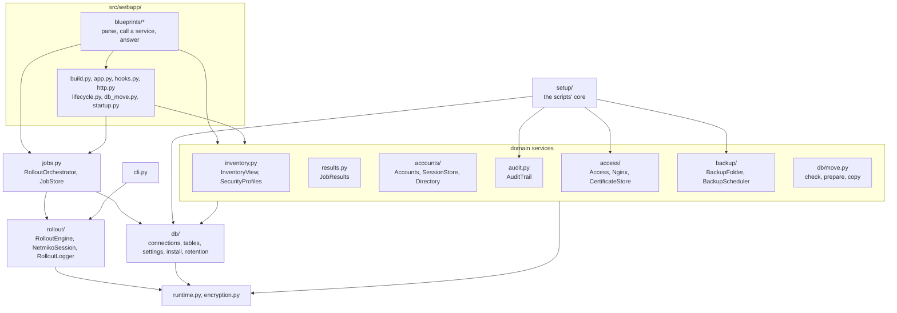

The rules that keep it this way:

- **The CLI must not import the web stack.** `src/rollout/` imports the database models only under `TYPE_CHECKING`, and redis-py not at all: the Redis client is typed by the `KeyValueStore` Protocol. `tests/unit/test_cli.py` checks that importing the CLI loads no web module, and the PyInstaller spec excludes them.
- **No import cycles.** Every module imports on its own. Where two modules need each other's types, one imports the other under `TYPE_CHECKING` only (for example `db/install.py` and `db/connections.py`).
- **No module-level singletons for services.** Routes reach the services through the typed `current_app` (`app.backend`, `app.orchestrator`, `app.access`, …) inside a request, never at import time. A connection that can be switched at run time (a database move, a Redis switch) is looked up per call.
- **Imports style.** All imports at the top, after the docstring: `from __future__` first, then the standard library, third-party packages and the project (`src` / `tests`), separated by a blank line; plain `import x` before `from x import …`, sorted by module. No import inside a function, except in `src/db/alembic/env.py`, which puts the project root on `sys.path` first.

---

## 6. The object model

### Design rules

- **A class only for a real thing with state and behaviour.** A rule without state stays a function: the input checks, `classify()`, `verify_commands()`, `job_status()`, the password rule, the backup schedule's `due()`, the port helper's `next_step()`, and the file protocols of `site.env` and nginx's `status.json`.
- **An ABC when NetRollout owns the whole family and the base shares code** (`Finish`, `Certificate`, `Setting`, `ServiceConnection`, `PeriodicTask`). An incomplete subclass fails when it is created, not in production.
- **A Protocol when the implementer is foreign or a test fake stands in**: `ConfigSession` (Netmiko's connection), `KeyValueStore` (redis-py), `SessionSerializer` (flask-session), `Echo`, `Notifier`. Structural, checked by mypy, nothing shared at run time.
- **A `Callable` for a one-call contract**: `hold` (may a background task run now?), `retention_days`, and the per-call `postgres` / Redis lookups that follow a database move or a Redis switch.
- **An enum when a closed set of values is spelled twice or crosses a boundary** (Redis, a file, the database, JSON, a script's exit code): `DeviceStatus`, `JobStatus`, `AuditAction`, `Role`, `ApplyState`, `BackupKind`, `SetupExit`, `CliExit`, and others. Its values are what those places hold, so they never change; a new value is a new member.
- **`isinstance` only to validate external data** (JSON from a file, a request or an API, bytes from Redis), never to choose behaviour.
- **One file is one concern**, and a name says what something is, not how it is used.
- **Domain services work in the caller's session and raise.** `InventoryView`, `JobResults`, `Accounts` and `SecurityProfiles` are built as `Service(session, viewer)` (or `Service(session)`), work inside the session the route opened, and raise their refusal (`RuleRefused`, `AccountError`, `SettingsError`, `ProxyError`; the routes' own `NotFound` and `Refused`). The route catches the exception **outside** its `with get_session()` block, so the session rolls back and a refused change never commits half.

### The four pillars, as applied

- **Encapsulation: each piece of state and each rule has one owner.** `JobStore` is the only code that spells a Redis job key. `AuditTrail` is the only writer of audit rows. `SecurityProfiles` is the one place device secrets are encrypted, and `Device.from_inventory()` the one place they are decrypted. `site_env.update()` is the only writer of `site.env`.
- **Abstraction: callers think in domain terms.** A route asks `InventoryView(session, viewer).get_editable(device_id)`, not for a query with the visibility filter written out. A page saves the hostname with `app.access.save(values, actor)`, not by renaming certificates and writing files.
- **Information hiding: callers don't know how things are stored.** The pages read rollouts as `RolloutRow` and `JobMeta` values, not Redis hashes. The settings are `SettingsStore.get(key)`, whatever the table looks like.
- **Polymorphism: a class per kind instead of "if it's this kind".** Each platform names its `Finish`; the engine calls `before_leave()`, `after_leave()` and `in_new_session()` without asking which. A certificate is `SelfSigned` or `Organisation`, and a new hostname is `rename_to()` on whichever it is: reissue, or refuse a name it doesn't cover.

### Patterns used

| Pattern | Where | Why |
|---|---|---|
| Strategy | `Finish` (how a platform's change takes effect), `Echo` (console or live log), `Certificate` (self-signed or organisation), the `Setting` kinds | Several real variants exist; the next one is a new class, not more branches. |
| Template method | `ServiceConnection` (bundled or yours, the live switch, written once; each service supplies its hooks), `PeriodicTask` (the loop, first delay, failure reporting and `hold()`; each task supplies `run_once()`) | One algorithm instead of copies. |
| Facade | `Access` (settings, certificates, `site.env`, the port request, nginx's verdict), `BackendServices` (PostgreSQL, Redis, settings) | A multi-system change behind one all-or-nothing call. |
| Factory method | `Device.from_inventory()`, `CertificateStore.current()` | The right object from stored data, in one place. |
| Service per area | `InventoryView`, `JobResults`, `Accounts`, `SecurityProfiles` | One home per rule and query. |
| Value objects | `Viewer`, `JobMeta`, `RolloutRow`, `Verdict`, `ApplyStatus`, `MoveStatus`, the enums | Types instead of dicts and magic strings. |
| Protocol (structural interface) | `ConfigSession`, `KeyValueStore`, `SessionSerializer`, `Notifier`, `Echo`, `Target`, `Report` | A typed contract for code NetRollout does not own, and for test fakes. |

### Considered and rejected

| Idea | Why not |
|---|---|
| `Repository[T]` and a unit of work | SQLAlchemy's `Session` already is the unit of work and the mapped classes the data mapper. Generic repositories would only re-wrap `session.get` and `add`, and their usual payoff (in-memory fakes) doesn't apply when the tests run on a real PostgreSQL. The per-area services give every query one home instead. |
| A `BaseConnector` ABC and `ConnectorFactory` | There is one backend (Netmiko). With one, there is nothing to choose between. Both come the day a second backend is written. |
| A template-method engine | Needs a second kind of rollout (a dry run, a staged rollout) to be worth it. |
| The State pattern for jobs, maintenance, the move, the port helper | Linear flows; an enum fits, and jobs must keep "claimed counts as running". |
| Observer for a job's finalize steps | A fixed, ordered sequence with step-specific error handling; a subscriber list would hide the order. |
| Splitting `InputParser` into CSV and form parsers | No form uses it; the web app builds devices from inventory rows. |
| A `Deployment` ABC, an OS strategy, a "Server" facade | Each would only forward to one-line decisions or to small classes that are already cohesive. |

What stays procedural on purpose: route functions; pure rules and text algorithms (`classify`, `verify_commands`, `rejection`, the input checks, the password rule, `due`, `next_step`); data tables (`PLATFORMS`, `SETTINGS`, `RETENTION_STATEMENTS`); one-shot flows and entry points (`install()`, backup `create` and `restore`, the release download, `cli.py`, `python -m src.setup` and `python -m src.backup`, the migrations); single-purpose modules (`encryption.py`, `runtime.py`, `site_env.py`).

### Class diagrams

Stereotypes: `<<interface>>` is a `typing.Protocol`, `<<abstract>>` an ABC, `<<enumeration>>` a string or integer enum, `<<dataclass>>` a value type. A solid line with a hollow triangle is inheritance, a dashed one implements a Protocol, a filled diamond is ownership, an open diamond aggregation, a plain arrow uses. Only the public methods that matter for the design are shown.

#### `src/rollout/`

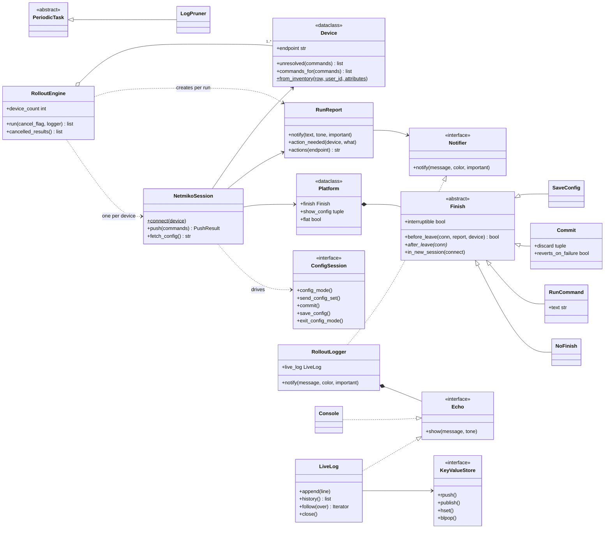

#### `src/jobs.py` and `src/results.py`

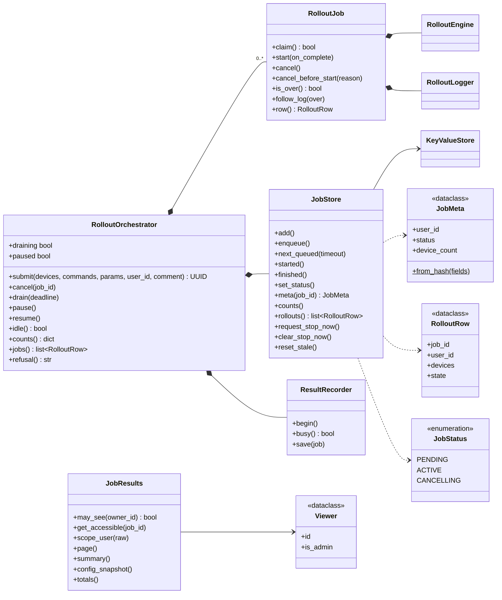

#### The data and domain layer: `db/`, `accounts/`, `inventory.py`, `audit.py`, `backup/`, `runtime.py`

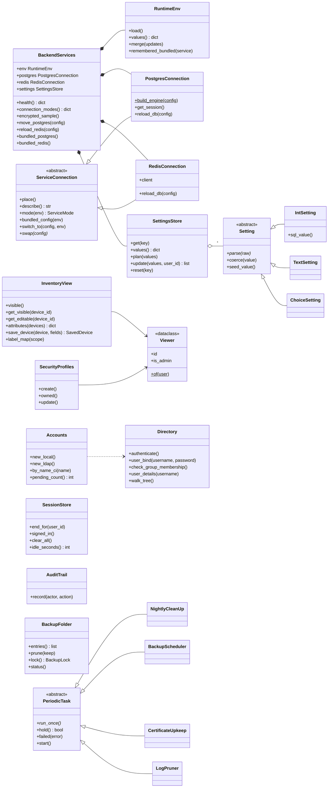

#### `src/access/` and `src/webapp/`

---

## 7. Key flows

### A web rollout

From the New Rollout page to the results in PostgreSQL, with the live log on the side.

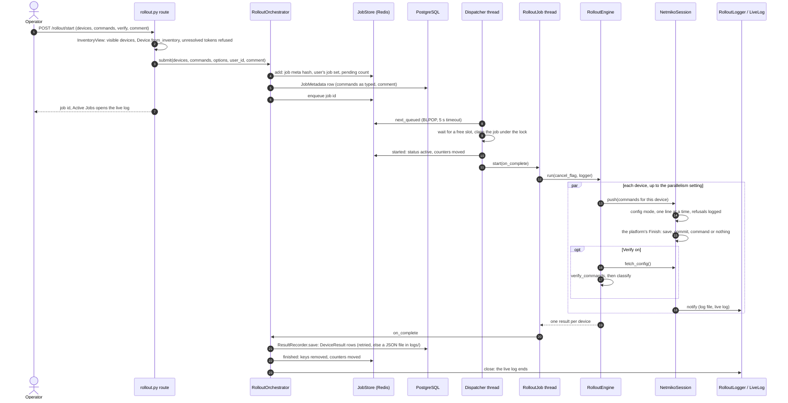

The live log, in parallel with the rollout:

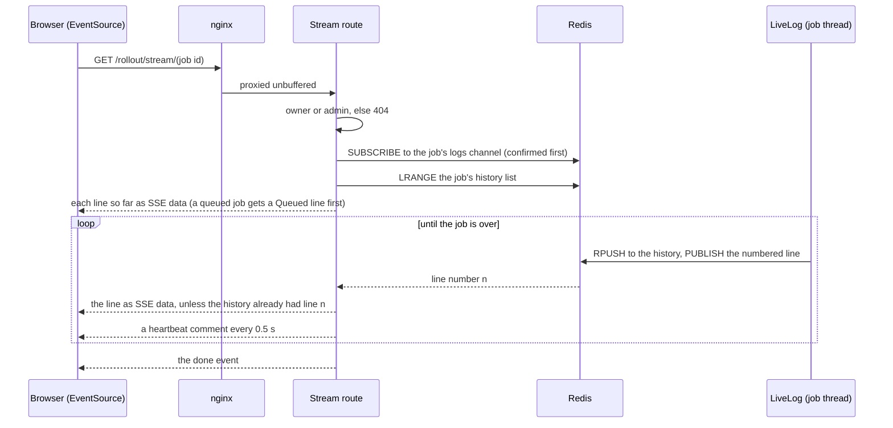

### Sign-in

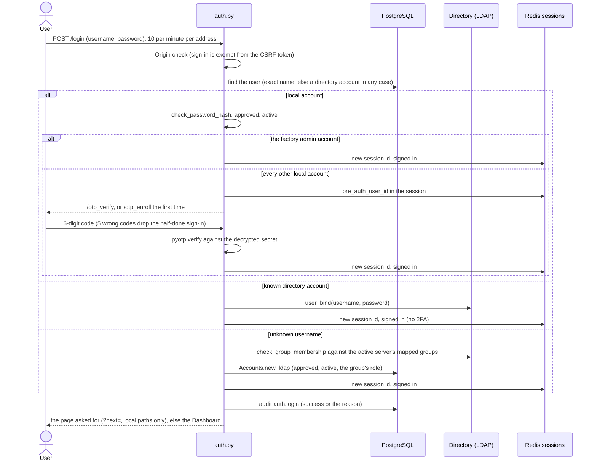

After sign-in, every request passes `enforce_session_lifetime` (idle limit from System Settings, 12 hours absolute) and, while `must_change_password` is set, `require_password_change`. See [§10.9](#109-sessions-and-accounts).

### Changing the HTTPS port

The port is Docker's mapping, so the app cannot apply it. It asks the host's port helper through files and confirms the new port from a browser.

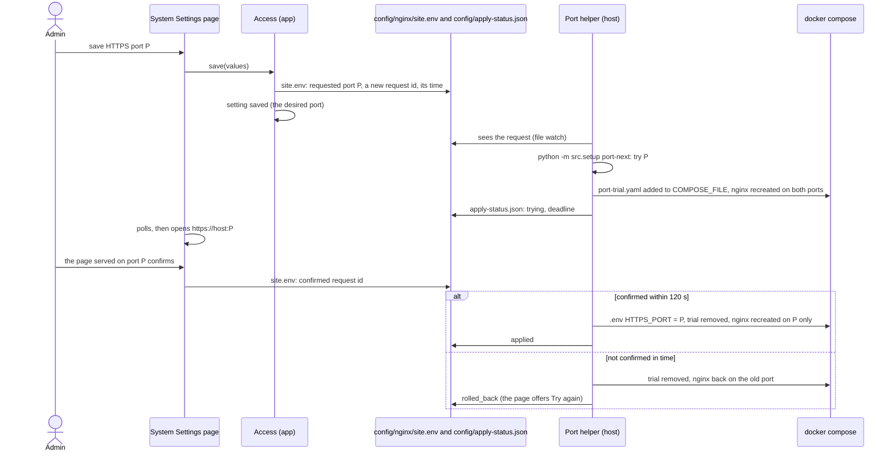

### An update

On Windows, NetRollout Manager (or the user) runs the new NetRollout Setup over the install. On Linux, `netrollout.sh update` does the same steps itself. Both refuse the same version and older versions before anything changes, and take a `before-update` backup with the installed version.

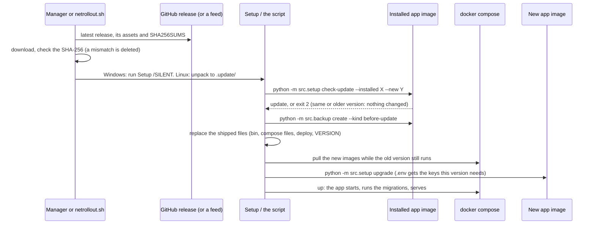

Details: [§10.12](#1012-netrollout-setup-and-netrollout-manager-windows) and the admin guide's [updating section](admin-guide.md#updates).

### A database move

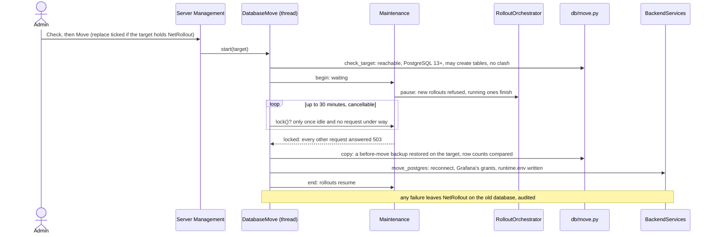

---

## 8. Data model

### PostgreSQL tables

The models are in `src/db/tables.py`; the schema is managed by Alembic (`src/db/alembic/versions/`). Every table has a UUID primary key, except `system_settings`, keyed by the setting's name. The history starts at the `v1_0_0_baseline` revision; from 1.0.0 on, released migrations are never edited, and every schema change is a new revision. The app applies migrations itself at every start.

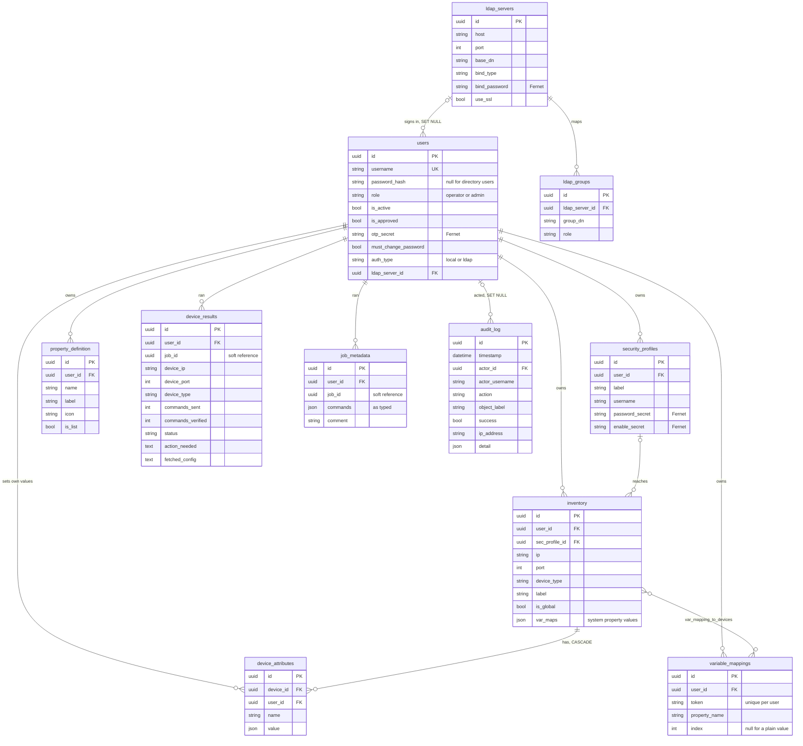

| Table | What it holds |
|---|---|
| `users` | Accounts, local or directory. `role` is `operator` or `admin`; `is_approved` (Request access waits for an admin) and `is_active` gate sign-in; `otp_secret` is the encrypted TOTP secret (null: not enrolled); `must_change_password` gates every page to the password change (the factory `admin`, after an admin reset). Deleting a user deletes their devices, profiles, mappings, properties, attribute values, results and job metadata. |
| `inventory` | Devices. `is_global` devices are visible to and usable by everyone, editable only by admins. `var_maps` holds the system properties' values (hostname, loopback_ip, asn, mgmt_vrf, mgmt_interface, site, domain, timezone, vrfs), shared by everyone who sees the device. Several devices may share an `ip:port`; the pages warn, nothing is blocked. |
| `security_profiles` | The credentials devices are reached with: username in clear, password and enable secret encrypted. A profile can't be deleted while a device uses it. |
| `variable_mappings` | A `$$TOKEN$$` bound to a property name (and an index for list properties), and the devices it applies to (`var_mapping_to_devices`). The join table is shared across users because of global devices, so a rollout applies only the rolling-out user's mappings. |
| `property_definition` | A user's own custom properties (name, label, icon, list or not). |
| `device_attributes` | One user's value of one of their custom properties on one device. Unique per device, user and name; deleted with the device, the user or the property. |
| `device_results` | One row per device per job: status (`success`, `partial`, `failed`, `cancelled`), commands sent and verified, `action_needed` (what only a person can resolve), and `fetched_config` (the running configuration Verify read, kept only when some commands didn't verify, for the Verify Diff). There is no job table: `job_id` groups the rows. |
| `job_metadata` | One row per job: the commands as typed (before token substitution) and the comment. Deleted once its job's results are gone. |
| `audit_log` | Who did what, when, from which address, with what outcome. `actor_username` and `object_label` are copied in, so a row survives the user's or the object's deletion. |
| `ldap_servers`, `ldap_groups` | Directory servers (bind type `anonymous`, `simple` or `regular` with a service account; bind password encrypted) and the groups whose direct members are given an account on their first sign-in, with the group's role. |
| `system_settings` | The runtime value of each System Setting (`key`, JSON `value`, who changed it and when). The only runtime source of the settings. |

Retention (System Settings, applied by the nightly clean-up): job records 30 days, config snapshots 7 days, audit log 90 days. See [§10.7](#107-retention).

### Redis keys

Redis holds nothing that must survive: sessions, the job queue, live job state and the reachability cache. Every app start clears leftover job state and signs everyone out.

| Key | Type | Written by | What it holds |
|---|---|---|---|
| `job:{id}:meta` | hash | `JobStore` | A running or queued job: `user_id`, `status` (`pending`, `active`, `cancelling`), `device_count`, `created_at`, `started_at`. |
| `user_jobs:{user_id}` | set | `JobStore` | A user's job ids. |
| `netrollout:job_queue` | list | `JobStore` | Job ids waiting for the dispatcher. |
| `netrollout:pending_count`, `netrollout:active_count` | counters | `JobStore` | Queued and running jobs (the Prometheus gauges). |
| `netrollout:stop_now` | string, 15-minute expiry | `JobStore` | Set from the host (`python -m src.jobs stop-now`): the stop under way cancels running rollouts at once instead of waiting. |
| `job:{id}:history` | list | `LiveLog` | The live log's lines so far. |
| `job:{id}:logs` | pub/sub channel | `LiveLog` | New lines, published as `<n>\t<line>`, and `__done__` at the end. |
| `redis_session:{sid}` | string | Flask-Session (`_SafeRedisSessionInterface`) | A signed-in session. `SessionStore` reads them to list or end a user's sessions. |
| `reach:{ip}:{port}` | string with expiry | `ReachabilityChecker` | A cached TCP reachability probe (the *Reachability cache* setting). |

### Files on disk

The NetRollout home is `NETROLLOUT_HOME` (`/data` in the image), else the executable's folder for the CLI, else the repository root. An install mounts its `config/`, `certs/`, `logs/` and `backups/` folders there.

| Path | Written by | Read by | What it holds |
|---|---|---|---|
| `.env` (install folder) | The setup core | Docker Compose | The install's secrets and answers: database and Redis passwords, `SECRET_KEY`, `NETROLLOUT_ENCRYPTION_KEY`, Grafana's passwords, `HTTPS_PORT`, `COMPOSE_FILE`, `COMPOSE_PROFILES`, `TZ`, the version. |
| `config/runtime.env` | The app (a database move or Redis switch only) | The app, grafana-setup | The connection settings an admin chose, overriding the environment. |
| `config/nginx/site.env` | The app (`site_env.py`); the installer's first hostname | nginx's watcher, the port helper | Hostname and port in use; the port request, its id, time and confirmation. |
| `config/nginx/status.json` | nginx's watcher | The app (`nginx.read_status`) | `applied` or `rejected` for the last change, with nginx's message. |
| `config/apply-status.json` | The port helper (`src/setup/port.py`) | The app (`src/access/port.py`) | The port change's state: `trying`, `applied`, `rolled_back` or `failed`. |
| `config/port-trial.yaml` | The port helper | Docker Compose (listed in `COMPOSE_FILE` during a trial) | The trial's extra port mapping. |
| `config/retention-status.json` | The nightly clean-up | System Settings | The last clean-up's outcome. |
| `certs/fullchain.pem`, `certs/privkey.pem` | The setup core, `CertificateStore` | nginx | The certificate nginx serves. `.selfsigned` marks a generated one; `.old-names.json` holds previous hostnames' deadlines. |
| `logs/` | The rollout logger, the app, the scripts | Download Log, Alloy (Loki) | One file per rollout, `rollout_<time>_<job id>.log`; `unsaved-results-<job>.json` when results couldn't be saved; the scripts' install, update and port-helper logs. |
| `backups/` | `src/backup` | Restore | `netrollout-<version>-<time>-<kind>.zip`; `.schedule-status.json`, the lock `.backup.lock`. |

<!-- CONTINUE -->
