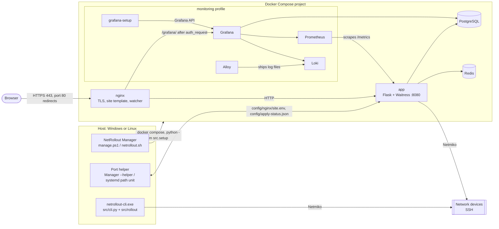

# NetRollout architecture

This is the developer reference for NetRollout: the tech stack, the containers and how they talk, every package and module in `src/`, the object model (its design rules and UML class diagrams), the main flows, the data model, and the reasoning behind the significant design decisions.

It is written for contributors and for anyone reviewing the code. To install or run NetRollout, read [install.md](install.md) and [admin-guide.md](admin-guide.md). For the security posture, read [security.md](security.md). For setting up a development environment, running the tests and the code style, read [CONTRIBUTING.md](../CONTRIBUTING.md).

The code is the final authority. When this document and the code disagree, the code is right and this document has a bug.

## Contents

1. [Overview](#1-overview)
2. [Tech stack](#2-tech-stack)
3. [Repository layout](#3-repository-layout)
4. [Packages and modules](#4-packages-and-modules)
5. [Layers and dependency rules](#5-layers-and-dependency-rules)
6. [The object model](#6-the-object-model)
7. [Key flows](#7-key-flows)
8. [Data model](#8-data-model)
9. [Installation, the setup core and the port helper](#9-installation-the-setup-core-and-the-port-helper)
10. [Subsystems](#10-subsystems)
11. [Testing strategy](#11-testing-strategy)
12. [Design decisions](#12-design-decisions)

---

## 1. Overview

NetRollout pushes configuration snippets to many network devices at once over SSH, verifies them by reading each device's configuration back, and records every result. It has two front ends that share one rollout engine (`src/rollout/`):

- **The web app** (`src/webapp/`): a Flask application served by Waitress behind nginx, with PostgreSQL for everything that must last and Redis for sessions, the job queue and live job state. It is installed with Docker Compose on Windows (NetRollout Setup and NetRollout Manager) or Linux (`install.sh` and `netrollout.sh`). An optional monitoring profile adds Grafana, Prometheus, Loki and Alloy.
- **The CLI** (`src/cli.py`, also built as the standalone `netrollout-cli.exe`): one headless rollout from a devices CSV and a commands file. It has no database, no Redis and no web stack.

### System context

- **Only nginx publishes ports**: the HTTPS port (443 by default) and, when port 80 is free at install, port 80, which redirects to HTTPS. PostgreSQL, Redis, the app and the monitoring services are reachable only on the compose network.
- **The app has no Docker access.** Whatever needs Docker (a new HTTPS port, an update, a backup restore) is done on the host by the scripts, through files the app writes and the host reads.
- **nginx follows the app through files.** The app writes plain values (hostname, port) into `config/nginx/site.env`. A watcher inside the nginx container renders the site from its template, tests it with `nginx -t`, and reloads, or keeps the last good site and reports why.
- **The CLI uses only `src/rollout/`**, the same engine the web app runs. An import test guards that it never loads the web stack.

---

## 2. Tech stack

Versions are the major.minor in use at the time of writing; the exact pins are in the file named in the last column (Dependabot keeps them current).

| Area | Technology | Version | Pinned in |
|---|---|---|---|
| Language | Python | 3.12 | `Dockerfile` (`python:3.12-slim-bookworm`), CI |
| Web framework | Flask, Werkzeug, Jinja2 | 3.1, 3.1, 3.1 | `requirements.txt` |
| Flask extensions | Flask-Login (sign-in), Flask-WTF (CSRF), Flask-Limiter (rate limits), Flask-Session (Redis sessions, subclassed), prometheus-flask-exporter (`/metrics`) | 0.6, 1.3, 4.1, 0.8, 0.23 | `requirements.txt` |
| WSGI server | Waitress | 3.0 | `requirements.txt` |
| ORM and migrations | SQLAlchemy, Alembic | 2.1, 1.20 | `requirements.txt` |
| PostgreSQL driver | psycopg2-binary | 2.9 | `requirements.txt` |
| Redis client | redis-py | 8.1 | `requirements.txt` |
| Device access | Netmiko (on Paramiko) | 4.8 (5.0) | `requirements.txt` |
| Cryptography | cryptography: Fernet for stored secrets, X.509 for certificates | 50.0 | `requirements.txt` |
| Directory sign-in | ldap3 | 2.9 | `requirements.txt` |
| Two-factor | pyotp (TOTP), qrcode + Pillow (enrolment QR code) | 2.10, 8.2, 12.3 | `requirements.txt` |
| Other runtime | python-dotenv (`runtime.env`, `.env`), tzlocal + tzdata, packaging (version comparison) | 1.2, 5.4, 26 | `requirements.txt` |
| Frontend | Server-rendered Jinja templates; Bootstrap, Bootstrap Icons, jQuery + jQuery QueryBuilder (Analytics); Inter and JetBrains Mono fonts. Per-page CSS and JS inline, no build step | 5.3, 1.11, 3.6 + 2.6 | `templates/` (CDN links) |
| Reverse proxy | nginx | 1.30 (Alpine) | `deploy/nginx/Dockerfile` |
| Database | PostgreSQL (any 13+ works; the bundled one is 17) | 17 (Debian bookworm) | `compose.yaml` |
| Queue, sessions, live state | Redis | 8.6 (Alpine) | `compose.yaml` |
| Monitoring (optional) | Grafana, Prometheus, Loki, Grafana Alloy | 13.0, 3.11, 3.7, 1.20 | `compose.yaml` |
| Containers | Docker Engine or Docker Desktop, Docker Compose v2 | | |
| Windows installer | Inno Setup | 6.7+ | `packaging/windows/installer/netrollout.iss` |
| NetRollout Manager | C# 5 on .NET Framework 4.8, compiled with Windows' own `csc.exe` | | `packaging/windows/manager/build.ps1` |
| Host scripts | PowerShell 5.1 (Windows), Bash (Linux) | | `packaging/` |
| Standalone CLI | PyInstaller | 6.22 | `requirements-dev.txt` |
| Tests and types | pytest, mypy, coverage | 9.1, 2.4, 7.16 | `requirements-dev.txt` |
| Dependencies | pip-tools (`requirements.in` compiled to `requirements.txt`), Dependabot | 7.6 | `requirements-dev.txt`, `.github/dependabot.yml` |
| CI/CD | GitHub Actions: `ci.yml`, `release.yml`, `stats.yml` | | `.github/workflows/` |

---

## 3. Repository layout

| Path | What it holds |
|---|---|
| `src/` | The application: the web app, the CLI, the rollout engine, the setup core the install scripts call, backups. Everything is imported as `src.*`, and every command runs from the repository root. |
| `templates/` | Jinja templates (one per page, three page skeletons, shared includes). `src/static/` holds the logo. |
| `tests/` | `unit/` (hermetic, mirrors `src/`), `integration/` (real PostgreSQL and Redis, by page), `e2e/` (a scratch install from the release files and images). |
| `deploy/` | What runs in or beside the containers: the nginx image and its scripts, PostgreSQL's first-start script, Grafana's setup and dashboards, the Prometheus, Loki and Alloy configurations. An install has this folder at the same path, because compose mounts `./deploy/…`. |
| `packaging/` | How NetRollout is built and installed on a host: `windows/` (`manage.ps1`, `netrollout.bat`, the icon, `installer/` for Inno Setup, `manager/` for the Manager's C#), `linux/` (`install.sh`, `netrollout.sh`), `build_release.py`, `netrollout-cli.spec`. |
| `compose.yaml` | The whole product: postgres, redis, app, nginx, and the monitoring profile. Shipped. |
| `compose.http.yaml` | Port 80 (redirect to HTTPS), added through `COMPOSE_FILE` only when port 80 is free. Shipped. |
| `compose.build.yaml`, `compose.dev.yaml` | Repository only: build the images locally; the development stack (the app runs on the host, PostgreSQL and Redis published on 127.0.0.1, nginx on 8443). |
| `Dockerfile` | The app image. Its build context is whitelisted by `.dockerignore`. |
| `pyproject.toml` | mypy and pytest settings. |
| `requirements.in`, `requirements.txt`, `requirements-dev.txt` | Dependency ranges, the compiled exact pins, and the development tools. |
| `VERSION` | The one version source: the app reads it, the image build checks it, the release must match it. |
| `.github/` | CI workflows, Dependabot, issue forms. |

Never tracked: `build/` and `dist/` (build outputs), `.env`, `config/`, `certs/`, `logs/`, `backups/` (a development checkout's runtime folders).

---

## 4. Packages and modules

One module holds one whole concern. This section lists every module in `src/` with its job and its main classes; [§6](#6-the-object-model) explains why each class is a class.

### `src/rollout/`: the rollout engine

Shared by the CLI and the web app, and free of the web stack: it imports the database models and Redis for type checking only, so the CLI executable never loads them.

| Module | Job | Main names |
|---|---|---|
| `engine.py` | Runs one rollout: devices in parallel, the push, verify, the status of each device. | `Device` (a target: address, decrypted credentials, its mappings; `from_inventory()`, `unresolved()`, `commands_for()`), `RolloutEngine` (`run()`, `cancelled_results()`), `RolloutOptions`, `classify()` (the status rules), `VerifyResult`, `DeviceResultDict`, `DeviceStatus`, `SubstitutionError`, `endpoint()` (`ip:port`, IPv6 as `[addr]:port`) |
| `session.py` | One device's SSH conversation: connect, push line by line, finish the platform's way, fetch the configuration. | `NetmikoSession` (`connect()`, `push()`, `fetch_config()`), `RunReport` (what a rollout tells, and what only a person can resolve), `PushResult`, the `Notifier` Protocol |
| `platforms.py` | What NetRollout knows about each platform, with no I/O of its own: how a push takes effect, how the config is printed, how a refusal looks, and verify. | `PLATFORMS` (one `Platform` row per Netmiko device type), the `Finish` family (`SaveConfig`, `Commit`, `RunCommand`, `NoFinish`), the `ConfigSession` / `Target` / `Report` Protocols, `rejection()`, `verify_commands()` |
| `inputs.py` | Input checks as functions, and the CLI / CSV-import files. | `validate_ip`, `normalize_ip`, `validate_port`, `validate_platform`, `tcp_reachable`, `token_problem`, `property_name_problem`, `index_problem`, `SUPPORTED_PLATFORMS`; `Validator` and `InputParser` (the devices CSV, the commands file) |
| `log.py` | The rollout log: one file per rollout, echoed to a console or to the live log in Redis; redaction; log pruning. | `RolloutLogger`, the `Echo` Protocol with `Console` and `LiveLog`, the `KeyValueStore` Protocol, `Tone`, `redact()`, `live_log_keys()`, `LogPruner` |

### Top-level modules

| Module | Job | Main names |
|---|---|---|
| `jobs.py` | A web rollout's life: queued in Redis, run in this process with at most N at a time, its results into PostgreSQL. Stop / Restart drain it; a database move pauses it. Also `python -m src.jobs rollouts \| stop-now`, read by the host scripts. | `RolloutOrchestrator`, `RolloutJob`, `JobStore` (the only code that spells a job key), `ResultRecorder`, `JobMeta`, `RolloutRow`, `JobStatus`, `Draining`, `Paused`, `clear_stale_jobs()`, `with_owners()` |
| `results.py` | Finished jobs as the viewer may see them: the owner-or-admin rule, Results' paging, summaries, config snapshots, the dashboard numbers. | `JobResults`, `JobPage`, `JobScope`, `ConfigSnapshot`, `job_status()`, `job_status_condition()`, `build_kpi()` |
| `audit.py` | The audit log's vocabulary and its one writer. | `AuditAction` (every action a row can record), `Actor` (a user or the server itself), `AuditTrail` |
| `inventory.py` | The device inventory's rules as one user sees it: visibility, edit rights, shared endpoints, attributes, the device-saving rules, security profiles, reachability, the CSV import. | `InventoryView`, `SecurityProfiles`, `ReachabilityChecker`, `LabelScope`, `DeviceFields`, `SavedDevice`, `RuleRefused`, `ImportReport`, `import_csv()`, `SYSTEM_PROPERTIES` |
| `encryption.py` | Encryption of stored credentials with one Fernet key, and the startup check of that key against the stored data. | `init_encryption()`, `encrypt()`, `decrypt()`, `require_key_in_container()`, `InvalidEncryptionKeyError`, `EncryptionStartupError` |
| `runtime.py` | How and where this process runs: version and release name, container or development, the folders, JSON and atomic file writes, the background-loop base class. | `VERSION`, `CODENAME`, `source_url()`, `in_container()`, `home()`, `logs_dir()`, `config_dir()`, `certs_dir()`, `backups_dir()`, `read_json()`, `write_json()`, `write_atomic()`, `PeriodicTask`, `StartupError` |
| `cli.py` | The headless CLI: arguments, prompts for what is missing, one rollout, exit codes. | `main()`, `rollout()`, `CliExit` |

### `src/db/`: the database layer

| Module | Job | Main names |
|---|---|---|
| `connections.py` | The connections to PostgreSQL and Redis, built from settings; bundled or an organisation's server; the live switch; `config/runtime.env`. | `BackendServices` (one per process), `ServiceConnection` (ABC) with `PostgresConnection` and `RedisConnection`, `PostgresConfig`, `RedisConfig`, `RuntimeEnv`, `ServiceMode`, `REDIS_UNAVAILABLE` |
| `tables.py` | The SQLAlchemy models (see [§8](#8-data-model)). | `User`, `Inventory`, `SecurityProfile`, `VariableMapping`, `PropertyDefinition`, `DeviceAttribute`, `DeviceResult`, `JobMetadata`, `AuditLog`, `LDAPServer`, `LDAPGroup`, `SystemSetting`; enums `Role`, `AuthType`, `BindType` |
| `install.py` | The database's set-up at every start: migrations, the factory admin, missing settings, Grafana's read grants. | `install()`, `install_extras()`, `alembic_config()` |
| `retention.py` | The nightly clean-up of old job records, config snapshots and audit rows. | `RETENTION_STATEMENTS`, `run_retention()`, `NightlyCleanUp` |
| `settings.py` | The System Settings: the registry of settings and their rules, and the store that reads and changes them. | `SETTINGS`, `Setting` (ABC) with `IntSetting`, `TextSetting`, `ChoiceSetting`; `SettingsStore`, `RULES`, `SettingsError`, `BackupSchedule`, `Weekday` |
| `move.py` | Moving NetRollout's data to another PostgreSQL server, without Flask: check the target, the DBA's preparation SQL, preparation with an administrator login, the copy. | `check_target()`, `Plan`, `preparation_sql()`, `ACCESS_NEEDED`, `prepare_with_admin()`, `copy()`, `MoveError` |
| `alembic/` | Alembic's environment and the migration revisions (history starts at `v1_0_0_baseline`). | `env.py`, `versions/` |

### `src/accounts/`: users and sign-in

| Module | Job | Main names |
|---|---|---|
| `users.py` | Who the data rules are about, local accounts, the password rule, and the signed-in sessions in Redis. No Flask import. | `Viewer`, `Accounts`, `AccountError`, `SessionStore`, the `SessionSerializer` Protocol, `password_problem()`, `temporary_password()`, `is_reserved()` |
| `ldap.py` | Sign-in through one configured directory server (LDAP or Active Directory) and the admin page's tools. | `Directory`, `LdapUnavailable` |

### `src/access/`: how NetRollout is reached

| Module | Job | Main names |
|---|---|---|
| `site_env.py` | `config/nginx/site.env`, the only code that writes it: keys updated together under a lock, the file replaced atomically. | `read()`, `update()`, `put_back()` |
| `nginx.py` | nginx from the app's side: the values it serves, its verdicts, and changes it must accept or have undone. | `Nginx` (`managed`, `status()`, `overview()`, `change_hostname()`, `apply()`), `Verdict`, `VerdictState`, `write_site()`, `read_status()`, `wait_for_status()`, `sync_at_start()` |
| `port.py` | The app's side of the HTTPS port change: the request it writes and the helper's answer it reads. | `ApplyStatus`, `ApplyState`, `PortPageState`, `request_port()`, `confirm()`, `serving_port()` |
| `certs.py` | TLS certificates for nginx: generate a self-signed one, validate an uploaded one, the certs folder, the hourly upkeep. Also `python -m src.access.certs`. | `CertificateStore`, `Certificate` (ABC) with `SelfSigned` and `Organisation`, `CertificateUpkeep`, `validate()`, `CertCheck`, `ProxyError` |
| `service.py` | The facade the pages change all of the above through: every multi-system change all or nothing. | `Access` (`app.access`), `SaveResult` |

### `src/backup/`: backups

| Module | Job | Main names |
|---|---|---|
| `archive.py` | One zip that brings NetRollout back, on this computer or another: create, check, restore; the backups folder and its lock. | `create()`, `check()`, `restore()`, `restore_database()`, `BackupFolder`, `BackupLock`, `BackupKind`, `Manifest`, `BackupError` |
| `schedule.py` | Scheduled backups made by the app itself. | `BackupScheduler`, `due()`, `start_backup_schedule()` |
| `__main__.py` | `python -m src.backup create \| check \| restore`, called by the host scripts. | `main()`, `BackupExit` |

### `src/setup/`: the setup core

What installing and running NetRollout decides and writes, once for Windows and Linux. The host scripts run it inside the app image with the install folder mounted: `python -m src.setup <command>`. See [§9](#9-installation-the-setup-core-and-the-port-helper).

| Module | Job | Main names |
|---|---|---|
| `__main__.py` | The command line: `init`, `check`, `prepare-start`, `status`, `restore-key`, `check-update`, `upgrade`, `release`, `port-ready`, `port-next`, `port-open`, `port-trying`, `port-close`, `port-set`, `port-setting`. | `COMMANDS`, `SetupExit` |
| `install.py` | The install's questions: what the host knows, what the admin answers, their checks and defaults; writing a new install (or a developer's). | `Facts`, `Answers`, `collect()`, `install()`, `install_dev()`, `check_hostname()`, `check_port()`, `check_timezone()` |
| `env.py` | The install's `.env`: every line explained, the generated secrets, reading and updating keys. | `env_text()`, `generate_secrets()`, `env_read()`, `env_write()`, `env_set()`, `compose_files()` |
| `update.py` | Releases: finding one (GitHub or a feed), downloading and checking it against `SHA256SUMS`, unpacking it; the update's direction; `.env`'s new keys after an update. | `Release`, `find()`, `download()`, `unpack()`, `update_kind()`, `upgrade()`, `ReleaseError` |
| `manage.py` | What the scripts ask after the install: the checks before a start, the `netrollout status` report, a restored encryption key into `.env`. | `prepare_start()`, `status()`, `restore_key()` |
| `port.py` | The port helper's decisions and records (the scripts do the Docker part). | `next_step()`, `StepAction`, `open_trial()`, `trying()`, `close()`, `set_by_hand()` |

### `src/webapp/`: the web app

| Module | Job | Main names |
|---|---|---|
| `__main__.py` | `python -m src.webapp` (the image's command): build the app, start the background tasks, handle SIGTERM with a drain, serve with Waitress. | |
| `build.py` | Builds the app at start, services in dependency order, then every blueprint. | `launch_app()`, `create_app()`, `resolve_secret_key()`, `configure_app()`, `RolloutSessionCollector` (the Prometheus gauges) |
| `app.py` | The Flask application's type: Flask plus the typed services the pages use. | `NetRolloutApp`, a typed `current_app` |
| `hooks.py` | Request-wide machinery: Flask-Login, CSRF, rate limits, metrics; the session lifetime and forced password change checks; error pages. | `register_extensions()`, `register_auth()`, `register_handlers()`, `login_mng`, `conn_limit`, `csrf` |
| `http.py` | What many pages share: JSON answers, decorators, the viewer, row loading, the request's audit row. | `WebServices`, `Caller`, `viewer()`, `load_owned()`, `NotFound`, `Refused`, `require_admin`, `with_json`, `with_form`, `is_background()` |
| `lifecycle.py` | This process's states beside serving: a stop or restart, and maintenance mode with its request gate. | `Shutdown`, `Maintenance`, `MaintenanceState`, `register_maintenance()`, `during_maintenance` |
| `db_move.py` | The database move run in the background, and the Redis switch. | `DatabaseMove`, `MoveStatus`, `MoveState`, `switch_redis()`, `RolloutsRunning` |
| `startup.py` | Development only: checks that nginx forwards to this process and prints the address to use. | `start_announcer()`, `check_proxy()`, `container_announcement()` |

#### `src/webapp/blueprints/`: one file per page

| File | Blueprint (prefix) | The page |
|---|---|---|
| `auth.py` | `auth` (none) | Sign-in (local, LDAP, 2FA enrol and verify), Request access, sign-out, the Account page, the password change, the session check. |
| `jobs.py` | `jobs` (none) | Dashboard, Active Jobs, Results (with Verify Diff, the job summary card and Download Log). |
| `rollout.py` | `rollout` (`/rollout`) | New rollout, start, cancel, the live log stream (SSE), rollback. |
| `inventory.py` | `inventory` (`/inventory`) | Devices: create, edit, delete, the user's own attribute values, connection test, reachability, CSV import, bulk profile assignment. |
| `security.py` | `security` (`/security`) | Security profiles (the credentials devices are reached with), their test. |
| `mappings.py` | `mappings` (`/mappings`), `properties` (`/properties`) | Variable mappings (`$$TOKEN$$` bound to a property) and property definitions. |
| `analytics.py` | `analytics` (`/analytics`), `admin_observability` (`/admin`) | The user's last 30 days and query builder; the admins' analytics over the audit log; the active job count. |
| `admin_users.py` | `admin_users` (`/admin`) | Admin home, Users (approve, enable, promote, reset password or 2FA, add, bulk actions), Live Sessions. |
| `admin_servers.py` | `admin_servers` (`/admin/server`) | Server Management: database move and move back, Redis switch, TLS certificate upload or self-signed, the running rollouts, Restart. |
| `admin_ldap.py` | `admin_ldap` (`/admin/server`) | Directory servers and group mappings: add, edit, test, explore, import. |
| `admin_audit.py` | `admin_audit` (`/admin`) | The audit log. |
| `admin_settings.py` | `admin_settings` (`/admin/settings`), `admin_backups` (`/admin/backups`) | System Settings (save, reset, the HTTPS port's status, confirm and retry, the access test) and the Backups list (back up now, download, delete). |
| `system.py` | `system` (none) | Not pages: `/_netrollout/health`, `/_netrollout/instance`, `/_netrollout/grafana-auth`. |

`tests/integration/test_route_matrix.py` checks every route: all require sign-in except the public ones (sign-in, register, health, instance), and every `/admin` route requires the admin role.

### `templates/`

- **Three skeletons**: `base.html` (the sign-in, register, 2FA and password pages), `operator_base.html` (every operator page), `admin.html` (the admin panel, with its own sidebar and topbar). Every page extends one of them.
- **Shared includes**, named with a leading underscore, are written once: the theme (`_theme_core_css.html`, `_theme_pages_css.html`, `_classes_css.html`), the footer with the version and the source link (`_footer.html`), the idle sign-out warning (`_idle_timeout.html`), the drain and maintenance banners, the Restart dialog, the shared widgets (`_op_widgets_js.html`, `_rollouts_table_js.html`), the password rule (`_password_rule_script.html`) and `nrEscape()` (`_escape_js.html`, which every script uses before putting a value into HTML).
- **Error pages**: `404.html`, `db_error.html` (which service is down), `key_error.html` (the encryption key does not match), `maintenance.html`.

### `deploy/`

| Path | What it is |
|---|---|
| `deploy/nginx/` | The nginx image: `nginx.conf`, `site.conf.template` (the one site, rendered from values), `netrollout-render.sh` (render and test), `netrollout-watcher.sh` (apply a changed `site.env` or certificate), `40-netrollout.sh` (the entrypoint hook). |
| `deploy/initdb/10-netrollout.sh` | PostgreSQL's first start (empty volume only): creates the `netrollout` login (owns the `netrollout` database) and the `grafana_reader` login. |
| `deploy/grafana/` | `setup.py` (the `grafana-setup` service: folders, dashboards, the database data source, user roles), `dashboards/` (the shipped dashboards), `provisioning/` (Prometheus and Loki data sources). |
| `deploy/prometheus/`, `deploy/loki/`, `deploy/alloy/` | The monitoring services' configurations. |

### `packaging/`

| Path | What it is |
|---|---|
| `windows/manage.ps1`, `windows/netrollout.bat` | The Windows host script and its command-line wrapper (installed as `bin\`). |
| `windows/installer/netrollout.iss` | NetRollout Setup (Inno Setup): install, update in place, uninstall. |
| `windows/manager/*.cs`, `build.ps1` | NetRollout Manager (status, start and stop, backup and restore, updates, the port helper). |
| `linux/install.sh`, `linux/netrollout.sh` | The Linux install and host script. |
| `build_release.py` | Builds a release's files into `dist/release-<version>/`. `SHIPPED` is the one list of files an install gets besides the images. |
| `netrollout-cli.spec` | PyInstaller's spec for `netrollout-cli.exe` (the web stack excluded). |

### `tests/`

| Path | What it holds |
|---|---|
| `tests/unit/` | Hermetic tests, mirroring `src/` (`rollout/`, `db/`, `access/`, `setup/`, `packaging/`, …). No services needed. |
| `tests/integration/` | Tests on a real PostgreSQL and Redis, organised by page or subsystem (`test_auth.py`, `test_db_move.py`, `test_route_matrix.py`, …). Skipped with a reason when a service is down. |
| `tests/e2e/` | A scratch install from the release's files and the images by tag, checked from outside. Opt-in: `NETROLLOUT_E2E=1`. |

<!-- CONTINUE -->
