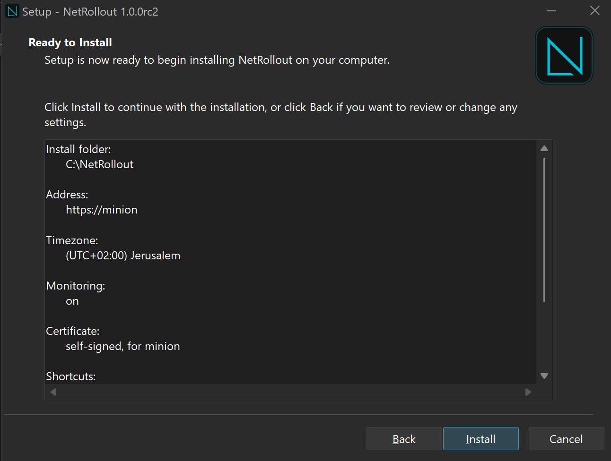

# Installing NetRollout

This guide is for the admin who installs NetRollout on a server: what the server needs, how to install on Windows and Linux, the first sign-in, certificates, upgrading over an existing install, uninstalling, and what to do when something goes wrong.

Running NetRollout day to day (NetRollout Manager, the `netrollout` commands, upgrades, backups, users) is in the [admin guide](admin-guide.md). If you only need the command-line tool, see the [CLI guide](cli.md); it needs no installation.

## Contents

- [Requirements](#requirements)
- [Install on Windows](#install-on-windows)
- [Install on Linux](#install-on-linux)
- [First sign-in](#first-sign-in)
- [Certificates and the hostname](#certificates-and-the-hostname)
- [Upgrading an existing install](#upgrading-an-existing-install)
- [Kept data and starting fresh](#kept-data-and-starting-fresh)
- [Uninstall](#uninstall)
- [Running on a virtual machine](#running-on-a-virtual-machine)
- [Troubleshooting](#troubleshooting)

## Requirements

NetRollout runs as a set of Docker containers: the app, nginx in front of it, PostgreSQL and Redis, and optionally Prometheus, Loki, Alloy and Grafana for monitoring. The images are pulled from Docker Hub at install time.

### Windows

- Windows 10 or 11, 64-bit. **Not Windows Server**: Docker Desktop doesn't support it, and Setup refuses it.
- Virtualization turned on (Intel VT-x or AMD-V in the BIOS/UEFI; on a virtual machine, nested virtualization). Setup refuses to start without it and says how to turn it on.
- Docker Desktop. If it is missing, Setup installs it (through `winget`, or Docker's own installer if `winget` fails). Docker Desktop's installer asks for administrator rights and may ask you to restart Windows.
- Internet access during install and upgrade, to download Docker Desktop, the images and new releases.

NetRollout itself installs per user, without an administrator prompt.

### Linux

- A 64-bit Linux server with **Docker Engine** and the **Docker Compose plugin** (`docker compose`). The installer checks both and explains how to get them, but never installs Docker itself. See [Docker's install guide](https://docs.docker.com/engine/install/).
- `root` (run the scripts with `sudo`).
- `unzip`, to extract the release, and `curl`, which the scripts use to check that NetRollout answers. Without `curl`, `start` and `status` report that NetRollout doesn't answer even when it runs.
- Internet access during install and upgrade.

The scripts were verified on Ubuntu 24.04. They use `ss`, `ip` and, when present, `systemd` and `timedatectl`.

### Network

| Port | Direction | Purpose |
| --- | --- | --- |
| 443/tcp (or the port you choose) | Browsers to the server | The web app over HTTPS |
| 80/tcp (optional) | Browsers to the server | Redirects `http://` to HTTPS. Used only if port 80 is free at install time |
| 22/tcp (or each device's SSH port) | Server to your devices | The rollouts |

NetRollout doesn't open ports in a host firewall. If the server runs one, allow the HTTPS port (and port 80 if you want the redirect) yourself.

If port 443 is taken on the server, the installer suggests the first free port of 8443, 9443, 10443 and 11443. You can change the port later in System Settings, or with `netrollout port <N>` when the current one is taken (see [Troubleshooting](#troubleshooting)).

### Size

NetRollout doesn't enforce a minimum. As guidance for a virtual machine: about 4 vCPUs and 8 GB of RAM, or 16 GB with monitoring on. Docker Desktop's own needs come on top on Windows.

## Install on Windows

NetRollout Setup (`NetRollout-Setup-<version>.exe`) is the only way to install NetRollout on Windows. Download it from the [Releases page](https://github.com/itamar14-byte/NetRollout/releases). While NetRollout is at release candidate stage, the newest release is marked "Pre-release".



### Before the first page

Setup checks the computer first. It stops with a reason if:

- the computer runs Windows Server, or
- virtualization is turned off.

It also looks for an existing NetRollout: an install (Setup then [upgrades it](#upgrading-an-existing-install)), data kept by an earlier uninstall (see [Kept data](#kept-data-and-starting-fresh)), or a [damaged install](#a-damaged-install).

### The wizard, page by page

1. **Licence.** NetRollout's licence notice, then the full GNU AGPL v3 text. Accept it to go on.
2. **Docker Desktop.** Setup says whether Docker Desktop is running, installed but stopped, or missing. Click **Next**: Setup starts it, or installs it and waits (up to 15 minutes). If Docker's installer asks you to restart Windows, restart, then run Setup again.
3. **Install location.** `C:\NetRollout` is pre-selected. NetRollout and all its data (settings, certificates, logs, backups) live in this folder. If NetRollout's data from an earlier install is kept somewhere, this page is locked to that folder (see [Kept data](#kept-data-and-starting-fresh)).
4. **Settings.** How people will reach NetRollout. Everything here can be changed later in System Settings.
   - **Hostname people will use.** Pre-filled with the computer's name. The certificate is made for it. Letters, digits, dots and hyphens only: no `https://`, port or path.
   - **HTTPS port.** `443`, or the first free alternative if 443 is taken. A port in use is refused with the name of the program or container that holds it. Port 80 is refused: it is reserved for the `http://` redirect. If port 80 is taken, the page says by what, and that typing `http://` won't redirect.
   - **Timezone.** Pre-selected from Windows. It sets the time in logs and when the nightly clean-up runs (03:00).
   - **Monitoring.** Prometheus, Loki and Grafana dashboards for admins. On by default.
   - **Use my organisation's certificate.** Off by default: Setup then makes a self-signed certificate. If you tick it, choose the certificate file (yours first, then each issuer) and its private key (without a password). See [Certificates](#certificates-and-the-hostname).

   This page is skipped when the folder already holds NetRollout's settings.
5. **Select additional tasks.** All three are ticked by default:
   - desktop shortcuts (NetRollout and NetRollout Manager),
   - start NetRollout Manager in the tray when you sign in,
   - add the `netrollout` command to `PATH`.
6. **Ready to install.** A review of every choice: the folder, the address, the timezone, monitoring, the certificate and the shortcuts. Anything Setup will delete first (kept data you chose to discard, a damaged install) is listed here. Nothing is changed before you click **Install**.
7. **Installing.** Setup copies its files, then sets up and starts NetRollout. The current step is shown under the progress bar. The first install downloads the images, which takes a few minutes. The output is written to `logs\install.log` in the install folder.
8. **Finished.** "NetRollout is installed and running", with **Open NetRollout in the browser** ticked. Sign in as described in [First sign-in](#first-sign-in).

If setting up fails, Setup shows the end of the log and offers **Retry**: fix the cause (for example, stop the program that holds the port) and retry. If you cancel, the finished page says "NetRollout is installed, but not running" and what to do next: click **Start** in NetRollout Manager, or run Setup again in the same folder. If the release itself is broken (its images aren't published), Setup asks you to report it.

### What gets installed

| Where | What |
| --- | --- |
| `<folder>\bin\` | NetRollout Manager, `manage.ps1` and `netrollout.bat` (the command line), the icon |
| `<folder>\deploy\` | Configuration the containers mount (Postgres' first-start script, Prometheus, Loki, Alloy, Grafana) |
| `<folder>\` | `compose.yaml`, `compose.http.yaml`, `VERSION`, `LICENSE`, the uninstaller |
| `<folder>\.env` (hidden) | The generated passwords and keys. Keep it secret |
| `<folder>\config\`, `certs\`, `logs\`, `backups\` | Settings, the TLS certificate, logs, backups |
| Start Menu | NetRollout Manager |
| Desktop (optional) | NetRollout and NetRollout Manager |
| Startup | The port helper (applies an HTTPS port saved in System Settings), and NetRollout Manager in the tray (optional) |
| Settings > Apps | NetRollout, with its uninstaller |

Setup restricts the install folder to Administrators, SYSTEM and your account. The containers restart with Docker (`restart: unless-stopped`), so NetRollout is back whenever Docker Desktop runs.

### Finding NetRollout afterwards

- **NetRollout Manager**: Start Menu, desktop, or the tray icon. Its status light shows whether NetRollout runs; it starts, stops, opens, upgrades and backs up NetRollout.
- **Win+R**, type `netrollout`: opens NetRollout Manager. This works even if you didn't add the command to `PATH`.
- **A terminal**: `netrollout status`, `netrollout open`, `netrollout help`. Open a **new** terminal after the install: a terminal opened before it doesn't see the new `PATH`. Without `PATH`, use the full path, for example `C:\NetRollout\bin\netrollout.bat status`.

The commands are described in the [admin guide](admin-guide.md).

## Install on Linux

1. Download `netrollout-<version>-linux.zip` from the [Releases page](https://github.com/itamar14-byte/NetRollout/releases), and check it against the release's `SHA256SUMS` file if you like.
2. Extract it where NetRollout should live. Everything is under a `netrollout/` folder:

   ```bash
   sudo unzip netrollout-<version>-linux.zip -d /opt
   cd /opt/netrollout
   ```

3. Run the installer:

   ```bash
   sudo ./bin/install.sh
   ```

### The interactive install

The installer:

1. Shows the licence notice and asks you to type `yes`.
2. Downloads the images for this version.
3. Asks five questions. The default is in square brackets; press Enter to accept it.

   | Question | Default |
   | --- | --- |
   | Hostname people will use | The server's name, if it is a valid hostname; else `netrollout` |
   | HTTPS port | `443`, else the first free of 8443, 9443, 10443, 11443 |
   | Monitoring (Prometheus, Loki, Grafana) y/n | `y` |
   | Use your organisation's certificate? y/n | `n` (a self-signed one is made) |
   | Timezone | The server's timezone, else `UTC` |

   A wrong answer is asked again, with the reason. If you answer `y` to the certificate question, the installer asks you to copy `fullchain.pem` and `privkey.pem` into the `certs/` folder and waits until they are there and valid.
4. Writes the settings, makes the certificate, and starts NetRollout.
5. Prints the address: `Installed. Open https://<host> and sign in as admin / admin`.

If Docker isn't enabled at boot, the installer warns you, because NetRollout then won't start at boot either. Fix it with `sudo systemctl enable docker`.

### Unattended install

Add `--yes` and give the answers as flags. Anything you leave out takes its default. `--yes` also accepts the licence.

```bash
sudo ./bin/install.sh --yes --hostname netrollout.example.com --https-port 443 \
  --monitoring y --org-certificate n --timezone Europe/London
```

| Flag | Value |
| --- | --- |
| `--hostname` | The hostname people will use |
| `--https-port` | The HTTPS port |
| `--monitoring` | `y` or `n` |
| `--org-certificate` | `y` (put `fullchain.pem` and `privkey.pem` into `certs/` first) or `n` |
| `--timezone` | An IANA name such as `Europe/London` or `UTC` |
| `--start-fresh` | Delete NetRollout's kept data first (see [Kept data](#kept-data-and-starting-fresh)) |
| `--no-browser` | Don't open a browser |

### What gets installed

Everything stays in the folder you extracted to:

| Path | What |
| --- | --- |
| `bin/` | `install.sh`, `netrollout.sh` |
| `deploy/`, `compose.yaml`, `compose.http.yaml`, `VERSION`, `LICENSE`, `README.md` | The release |
| `.env` | Generated passwords and keys, owned by root with mode 600. Keep it secret |
| `config/`, `certs/`, `logs/`, `backups/` | Owned by the app container's user (uid 10001); `backups/` is mode 700 |

Where systemd is available, the installer also adds a `netrollout-port-netrollout.path` unit and its `.service`, which apply an HTTPS port saved in System Settings. Without systemd, run `sudo ./bin/netrollout.sh apply` after such a change.

Run `sudo ./bin/netrollout.sh` without a command for a numbered menu, or see `sudo ./bin/netrollout.sh help`. The commands are described in the [admin guide](admin-guide.md).

## First sign-in

1. Open the address the installer printed, for example `https://netrollout` or `https://netrollout:8443`. Addresses by IP work too.
2. With the default self-signed certificate, your browser warns that the certificate isn't trusted. Accept it, or install an [organisation certificate](#certificates-and-the-hostname).
3. Sign in as `admin` with the password `admin`.
4. NetRollout takes you straight to **Change password**. Choose a new one: at least 8 characters, ASCII, with at least two of letters, digits and special characters, and not containing the username.

The factory `admin` account doesn't use two-factor authentication, so that it always stays reachable for recovery. Every other local account sets up an authenticator app at its first sign-in. Adding users, LDAP and the other sign-in settings are in the [admin guide](admin-guide.md).

## Certificates and the hostname

NetRollout serves HTTPS only. Port 80, when it is published, just redirects to HTTPS.

- **Self-signed (the default).** The installer makes a certificate for the hostname and the server's IP addresses (ECDSA P-256, valid 825 days). Browsers warn about it until you trust it or replace it.
- **Your organisation's certificate.** Provide `fullchain.pem` (your certificate first, then each issuer) and `privkey.pem` (the private key, not password-protected). The installer checks that the key matches, that the dates are valid and that the certificate covers the hostname, and refuses it otherwise.

Requests to another name than the configured hostname are redirected to it. Requests by IP address and to `localhost` are served as they are.

After the install, change the hostname in **System Settings** and the certificate in **Server Management > TLS Certificate** (upload one, or generate a new self-signed one). Both take effect without a restart. See the [admin guide](admin-guide.md).

## Upgrading an existing install

Every upgrade makes a backup (`...-before-upgrade.zip` in `backups`) before it changes anything. Downgrades aren't supported: an older Setup or release is refused, and nothing is changed. While an upgrade runs, running rollouts finish first, NetRollout is down for about a minute, and everyone signs in again afterwards.

### Windows

Run the new version's NetRollout Setup, or click **Upgrade** in NetRollout Manager, which downloads Setup, checks it against the release's `SHA256SUMS` and runs it for you.

Over an install, Setup shows only the review page, "Ready to upgrade", with the versions (for example `1.0.0rc1 → 1.0.0rc2`), the folder, what is kept and the backup made first. The Docker page appears only if Docker isn't running. Click **Upgrade**. The old version keeps running while the new images download; then NetRollout restarts. The output is in `logs\upgrade.log`.

Setup refuses before its first page if the same version or a newer one is installed.

> [!NOTE]
> The 1.0.0rc1 NetRollout Manager can't see pre-releases. To upgrade from 1.0.0rc1 to a later release candidate, download the new NetRollout Setup from the [Releases page](https://github.com/itamar14-byte/NetRollout/releases) and run it.

### Linux

```bash
sudo ./bin/netrollout.sh upgrade            # the newest release, asks first
sudo ./bin/netrollout.sh upgrade --check    # only look
sudo ./bin/netrollout.sh upgrade --version 1.0.0rc2
sudo ./bin/netrollout.sh upgrade --from /path/netrollout-<version>-linux.zip   # offline
```

An installed release candidate looks for the newest release including pre-releases; a final release looks for final releases only. The 1.0.0rc1 script only knows GitHub's latest final release, so from 1.0.0rc1 give the version: `upgrade --version 1.0.0rc2`.

Mirrors and offline upgrades are covered in the [admin guide](admin-guide.md).

### An upgrade that didn't finish

An upgrade has two halves: the files are replaced, then the new images are pulled, the settings are brought up to date, and NetRollout restarts. If the second half fails, NetRollout remembers it (a `.upgrade-pending` file in the install folder) and never starts the new version without finishing it:

- **Windows:** fix the cause, then click **Retry** in Setup's message. Or later: run the same Setup again (its review page then says "Ready to finish the upgrade" and its button is **Finish upgrade**), click **Finish upgrade** in NetRollout Manager, or run `netrollout start`.
- **Linux:** `sudo ./bin/netrollout.sh start` (or the install again) finishes the upgrade first.

To go back to the earlier version instead, install it and restore the `before-upgrade` backup.

### A damaged install

If an install's folder was partly deleted by hand (its uninstaller, `VERSION` or `compose.yaml` missing, or its `.env` gone while Docker still holds its data), NetRollout can be neither upgraded nor uninstalled normally. Setup notices this before its first page and asks: **Clear what's left of it and install NetRollout again?** If the install's `.env` is still there, it then asks whether to keep its data. Without `.env`, the data can't be used and is deleted. The backups are always kept. Nothing is cleared before you click **Install** on the review page.

## Kept data and starting fresh

Uninstalling can keep NetRollout's data: the database (in Docker volumes), `.env` with its passwords and encryption key, settings, certificates and logs. The next install picks it up:

- the **same version** starts as it was,
- an **older version** is upgraded, with a backup first,
- a **newer version** is refused (downgrades aren't supported).

The data belongs to the Docker project `netrollout`, not to a folder, and it only works with the `.env` it was created with. So NetRollout installs where the kept data is:

- **Windows:** Setup announces the kept data and locks the install location page to its folder. To install elsewhere, tick **Start fresh instead - delete the kept data**. Setup asks once more, then deletes the database, settings, certificates and logs (the backups stay) before it installs. A silent Setup never deletes kept data.
- **Linux:** `install.sh` in another folder is refused while data is kept (the kept folder is recorded in `/etc/netrollout/kept-data`). Run the install in that folder, or add `--start-fresh` to delete the kept data first (it asks; `--yes` alone never deletes it). The backups stay.

If Docker holds NetRollout's data but no known folder has its `.env` (for example, the folder was deleted by hand), the data can't be used. Windows Setup asks whether you still have that folder: choose it on the folder page, or let Setup delete the old data and install fresh. On Linux, run the install in that folder, or use `--start-fresh`.

> [!WARNING]
> Starting fresh deletes the database. Keep a backup if you may need the data: a new install can restore it (see the [admin guide](admin-guide.md)).

## Uninstall

### Windows

Settings > Apps > NetRollout > Uninstall. The uninstaller removes the containers and asks two questions. **No** is the default for both:

1. **Delete NetRollout's data too?** (the database, settings, certificates and logs). Yes deletes it, which can't be undone. No keeps it, so a later install starts with everything as it was.
2. Only if you said Yes: **Delete the backups too?** Yes deletes them as well. No keeps them in `<folder>\backups` (recommended).

A silent uninstall keeps everything. The shortcuts, the `PATH` entry and the Win+R entry are removed either way.

> [!IMPORTANT]
> Backups contain the encryption key for the stored device credentials. Keep them as safe as the server itself.

### Linux

```bash
sudo ./bin/netrollout.sh uninstall
```

It asks whether to delete the data (default no), then, if you said yes, whether to delete the backups too (default no; they are the last copy of the data), and whether to remove NetRollout's files too (default no). Unattended:

| Flag | Effect |
| --- | --- |
| `--keep-data` | Keep the data (recorded, so the next install finds it) |
| `--delete-data` | Delete the database, settings, certificates and logs |
| `--delete-backups` | With `--delete-data`: delete the backups too (otherwise they are kept) |
| `--remove-files` | Also remove the scripts and compose files |

## Running on a virtual machine

- **Windows guest:** turn on nested virtualization for the VM (Hyper-V: `Set-VMProcessor -ExposeVirtualizationExtensions $true`; VMware: "Virtualize Intel VT-x/EPT"). Windows 11 also needs vTPM and Secure Boot.
- **Restarts:** on Windows, NetRollout comes back when the account that installed it signs in: NetRollout's port helper starts Docker Desktop then if it isn't running (whatever Docker's own "Start when you sign in" setting says), and the containers follow Docker. Docker Desktop has no start at boot, so the account must sign in, for example with automatic sign-in for a dedicated account. On Linux, Docker Engine starts at boot once enabled (`sudo systemctl enable docker`).
- **Firewall:** allow the HTTPS port (and port 80 for the redirect) in the guest and in any firewall in front of it.

## Troubleshooting

### Can't find NetRollout?

- **Windows:** run `netrollout status` (in a new terminal) or `netrollout open`, or open NetRollout Manager (Win+R, `netrollout`).
- **Linux:** `sudo ./bin/netrollout.sh status` or `sudo ./bin/netrollout.sh open`.

`status` prints the address (and the server's IP addresses), each container's state, the health of the database and Redis, running rollouts, the port, the certificate and the backups, and ends with **What to do** when something is wrong.

If you typed `http://`, NetRollout redirects to HTTPS only when port 80 was free at install time. Use `https://` and include the port if it isn't 443.

### Can't sign in

**Forgot the `admin` password, or no administrator can sign in** (`admin` disabled or locked, its authenticator lost): on the server, run

```powershell
netrollout reset-admin -NewPassword
```

```bash
sudo ./bin/netrollout.sh reset-admin --new-password
```

It asks first, then enables `admin`, turns its two-factor sign-in off, lifts any lock and prints a temporary password, once. Sign in as `admin` with it; NetRollout asks for a new password at once. It works only on the server, never from the web app, and the audit log records it. Without the flag, `admin` keeps its password. See [The factory admin account](admin-guide.md#the-factory-admin-account).

**Another user forgot their password or lost their authenticator:** an administrator opens User Management and uses **Reset Password** (a temporary password, shown once) or **Reset 2FA** (the user enrols again at the next sign-in).

**"Too many failed sign-ins. Try again in N minutes."**: 5 failed sign-ins in a row stop that username for 15 minutes. Wait for the time shown, or ask an administrator to **Enable** the account, which lifts it at once. See [Wrong passwords](user-guide.md#wrong-passwords).

### The HTTPS port is taken

If another program or container holds NetRollout's HTTPS port, NetRollout can't publish it. `start` refuses and names the holder, for example:

```text
Port 443 is in use by netrollout-dev-nginx-1 (another Docker container) - NetRollout can't publish it. Stop that, then: netrollout start - or move NetRollout to another port: netrollout port <N>
```

Either stop that program and run `netrollout start`, or move NetRollout to another port:

```powershell
netrollout port 8443
```

```bash
sudo ./bin/netrollout.sh port 8443
```

The port is checked first, then you are asked to confirm. NetRollout restarts on the new port and must answer there; if it doesn't, the previous port is put back. In NetRollout Manager, **Change port...** does the same; it is available only while the port is taken. When the port is free, change it in System Settings instead.

### Docker isn't running

NetRollout needs Docker. On Windows, `netrollout start` (or **Start** in NetRollout Manager) starts Docker Desktop and waits up to 3 minutes for it; if it doesn't come up, start Docker Desktop from the Start Menu and try again. On Linux, run `sudo systemctl start docker`, then `sudo ./bin/netrollout.sh start`.

### The `netrollout` command isn't found

Open a new terminal: one opened before the install doesn't have the new `PATH`. If you didn't choose **Add the netrollout command to PATH**, use the full path, for example `C:\NetRollout\bin\netrollout.bat status`.

### Logs

| Log | Where |
| --- | --- |
| Setup's install | `<folder>\logs\install.log` |
| An upgrade | `<folder>\logs\upgrade.log` |
| The containers | `netrollout logs [service]`, for example `netrollout logs app` (Linux: `sudo ./bin/netrollout.sh logs app`) |
| The port helper (Windows) | `<folder>\logs\port-helper.log` |

If you are stuck, open a [bug report](https://github.com/itamar14-byte/NetRollout/issues/new/choose) with the output of `status` and the end of the relevant log.
