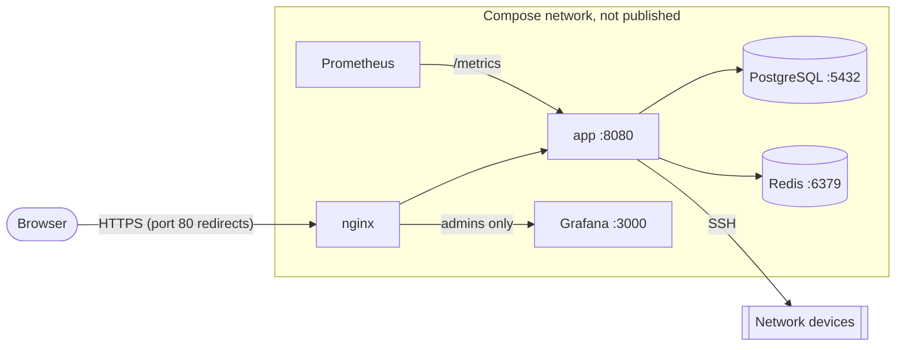

# NetRollout security

This document describes NetRollout's security posture for security reviewers and administrators who must approve it: what it holds, how it protects it, who can do what, what it exposes on the network, and its known limitations. Every statement here is checked against the code; the module named next to a control is where to verify it.

To report a vulnerability, follow [SECURITY.md](../SECURITY.md). Don't open a public issue for one.

> [!NOTE]
> NetRollout is maintained by one person and provided "as is", without warranty, under the terms of the AGPL-3.0 (sections 15 to 17). It is tested on a best-effort basis; not every path or environment is covered. Review it against your own requirements before you give it access to production devices.

## Contents

- [Threat model in brief](#threat-model-in-brief)
- [What NetRollout stores, and why](#what-netrollout-stores-and-why)
- [Credential encryption](#credential-encryption)
- [Secrets on the host and file permissions](#secrets-on-the-host-and-file-permissions)
- [Containers and network exposure](#containers-and-network-exposure)
- [TLS](#tls)
- [Authentication](#authentication)
- [Sessions](#sessions)
- [Authorization](#authorization)
- [Web application protections](#web-application-protections)
- [Monitoring access (Grafana)](#monitoring-access-grafana)
- [Audit log](#audit-log)
- [Logs and redaction](#logs-and-redaction)
- [Backups](#backups)
- [Updates and supply chain](#updates-and-supply-chain)
- [Source availability (AGPL section 13)](#source-availability-agpl-section-13)
- [Known limitations](#known-limitations)

## Threat model in brief

**Who uses it.** Network engineers (operators) and administrators inside an organisation, through a browser on the internal network. NetRollout is built to run inside your network: apart from downloading its images and updates (which can also come from an [internal mirror](admin-guide.md#updating-from-an-internal-mirror)), it needs no internet access, and it is meant to be reached from inside the network, not published to the internet.

**What it holds that an attacker would want.** SSH credentials for network devices (security profiles), and the ability to push configuration to those devices. Secondary: an LDAP bind password, users' TOTP secrets, device inventory and configuration snapshots, and the audit trail.

**What it defends against:**

- Theft of the database or a backup without the encryption key: stored credentials are encrypted.
- An unauthenticated user on the network: every page except sign-in and the health check requires a session; sign-in is rate limited and local accounts need a second factor.
- One user reading or acting on another user's devices, profiles or jobs: ownership rules in the domain services, with admins as the only exception.
- A compromised or misbehaving browser session doing more than its role allows: CSRF protection, role checks on every admin route, session lifetime limits.
- The web app taking over the host: it runs unprivileged and has no access to Docker.

**What it does not defend against:** an attacker with administrator rights on the host (they can read `.env`, which holds the encryption key), a NetRollout administrator acting in bad faith (admins see everything by design), or a compromised network device returning malicious output (device output is escaped in the pages but otherwise trusted).

## What NetRollout stores, and why

NetRollout keeps what it needs to run rollouts and to show what happened, and deletes the history after a configurable period.

| Data | Where | Why | Kept |
|---|---|---|---|
| Device inventory (address, port, platform, label, property values) | PostgreSQL `inventory`, `device_attributes` | To know where to push | Until deleted |
| Device credentials (username in clear; password and enable secret encrypted) | PostgreSQL `security_profiles` | To log in to devices | Until deleted |
| Accounts (username, email, full name, role, password hash, encrypted TOTP secret) | PostgreSQL `users` | Sign-in and permissions | Until deleted |
| LDAP server settings (bind password encrypted) and group mappings | PostgreSQL `ldap_servers`, `ldap_groups` | Directory sign-in | Until deleted |
| Per-device results (status, counts, what needs action) | PostgreSQL `device_results` | Results page, analytics, rollback | 30 days by default (*Job records*) |
| The commands as typed and a comment, per job | PostgreSQL `job_metadata` | Results, rollback | With the job's results |
| Running-configuration snapshots, only for devices where some commands didn't verify | PostgreSQL `device_results.fetched_config` | Verify Diff | 7 days by default (*Config snapshots*) |
| Audit log | PostgreSQL `audit_log` | Accountability | 90 days by default (minimum 7) |
| Rollout log files (redacted) | `logs/` | Troubleshooting, Download Log | 60 days by default (*Log files*) |
| Sessions, job queue, live job state, live logs, reachability cache | Redis | Short-lived state | Cleared at every app start |

Retention is set in System Settings and applied by the nightly clean-up (`src/db/retention.py`) and the daily log pruner. Deleting a user deletes their devices, profiles, mappings, properties, attribute values, results and job metadata; their audit rows stay, with the username copied in.

The CLI (`netrollout-cli.exe`) stores nothing except its redacted log file. It reads device credentials in clear from the CSV file you give it, so protect that file.

## Credential encryption

`src/encryption.py`

- **What is encrypted**: security profile passwords and enable secrets, the LDAP bind password, and users' TOTP secrets. They are encrypted with **Fernet** (AES-128-CBC with HMAC-SHA256, from the `cryptography` package) under one key.
- **Where the key lives**: `NETROLLOUT_ENCRYPTION_KEY`, generated at install into the install's `.env` and passed to the app container by compose. In a container the key is required and never generated or defaulted; a development run without the variable uses `~/.netrollout/encryption.key`, generated (mode 600) only on a fresh database with no encrypted data.
- **Fail fast**: at every start the key is test-decrypted against one stored value. The app refuses to start if the key is malformed, missing while encrypted data exists, missing while the database is unreachable (so it can't tell), or doesn't match the stored data. A new key is never generated over existing encrypted data, so a wrong key can't silently orphan the stored credentials.
- **Decrypted only to be used, in memory**: device credentials are decrypted when a rollout builds its devices (`Device.from_inventory()` in `src/rollout/engine.py`, held for that job only), when a security profile's Test connects to a device, and when a CSV import compares the importer's own profiles with the file's credentials. The LDAP bind password is decrypted to bind, a TOTP secret to check a code. Decrypted values never reach Redis or the logs, and the pages never show a stored secret.
- **Backups carry the key**: a backup zip contains `encryption.key`, so a restore on another host can decrypt the data. Treat a backup as being as secret as `.env`.

## Secrets on the host and file permissions

The install's `.env` holds every secret: the PostgreSQL superuser, app and Grafana-reader passwords, the Redis password, `SECRET_KEY` (signs session cookies), `NETROLLOUT_ENCRYPTION_KEY`, and Grafana's admin password. The setup core generates them at install (`src/setup/env.py`, Python's `secrets` module and `Fernet.generate_key()`); there is no default password for any service.

| Host | Protection |
|---|---|
| Windows | `.env` is hidden, and `manage.ps1` restricts the whole install folder with `icacls` to Administrators, SYSTEM and the installing account, at install and at every start. |
| Linux | `.env` is owned by root with mode 600. `config/`, `certs/`, `logs/` and `backups/` have mode 700 and are owned by the app container's user (uid 10001), reset at every start. |

`config/runtime.env` (connection settings an admin chose for an external database or Redis) is written atomically and owner-only. The certificate's private key is in `certs/privkey.pem`, mounted read-only into nginx.

## Containers and network exposure

- **Only nginx publishes ports**: the HTTPS port (443 by default) and, while port 80 is free on the host (checked at every start), port 80, which only redirects to HTTPS (`compose.http.yaml`). PostgreSQL, Redis, the app's own port, Grafana, Prometheus and Loki are reachable only on the compose network. (The development stack publishes PostgreSQL and Redis on 127.0.0.1; installs don't.)
- **No Docker socket** is mounted into any container. Everything that needs Docker (a new HTTPS port, an update, a restore) is done on the host by the scripts.
- **The app runs unprivileged**: user `netrollout`, uid 10001, in a `python:3.12-slim-bookworm` image; its code is precompiled and read-only at run time. It is added to group 0 (`group_add: ["0"]`) only so it can read Grafana's database file for backups, which is mounted read-only. One step of a restore runs a one-off app container as root (`--user 0`) to write files back with their original owners.
- **Database logins**: the app uses the `netrollout` login, which owns its database and schema but is not a superuser. Grafana uses `grafana_reader`, granted `SELECT` on exactly `device_results`, `job_metadata` and `audit_log` (`src/db/install.py`, `GRAFANA_TABLES`), re-applied at every start.
- **Redis** requires a password (`--requirepass`).
- **Outbound connections**: the app connects to your devices over SSH (the port you give each device) and, if configured, to your LDAP server. The host scripts and NetRollout Manager contact GitHub (releases) and Docker Hub (images) for updates. The browser loads Bootstrap, Bootstrap Icons, jQuery, jQuery QueryBuilder and the fonts from public CDNs (jsDelivr, code.jquery.com, Google Fonts) and the vendor logos from Simple Icons and jsDelivr.
- **Public endpoints**: `/_netrollout/health` (PostgreSQL and Redis up, running and queued rollout counts, draining or maintenance state, and the version) and `/_netrollout/instance` (a random per-run token) answer without a session. `/metrics` answers 404 through nginx; Prometheus scrapes it on the compose network.

## TLS

nginx terminates TLS (`deploy/nginx/site.conf.template`):

- TLS 1.2 and 1.3 only, ciphers `HIGH:!aNULL:!MD5`, HTTP/2.
- Response headers: `Strict-Transport-Security: max-age=31536000`, `X-Frame-Options: SAMEORIGIN`, `X-Content-Type-Options: nosniff`; `server_tokens off`.
- Requests for another hostname are redirected to the configured one (IP addresses and `localhost` are served as they are).

Two kinds of certificate (`src/access/certs.py`):

- **Self-signed** (the default): generated inside the app image, ECDSA P-256, valid 825 days, for the hostname plus the server's IP addresses. Browsers warn until you trust it. When the hostname changes, it is reissued, keeping the previous names for 7 days.
- **Your organisation's**: uploaded in Server Management → TLS Certificate (or placed in `certs/` at install). It is validated before use: the key matches the certificate, the key is not encrypted, the dates are valid, the names cover the configured hostname, and the chain is in order. Any problem refuses it. NetRollout never reissues it; a hostname it doesn't cover is refused.

nginx tests every change with `nginx -t` before applying it, and keeps the last good configuration otherwise. Certificate uploads and generation are audited; the private key never is.

**NetRollout's own outgoing TLS (LDAPS)** (`src/accounts/ldap.py`, `VerifiedTls`): every TLS connection to an LDAP server verifies the server's certificate and its name, always, with no per-server opt-out. The certificate must chain to a CA the operating system trusts (the app image's CA bundle) or to one of the **trusted CA certificates** added in Server Management → TLS Certificate → Trusted CA certificates, and must name the host as configured for the server (a DNS name or an IP address in its subject alternative names). The trusted CA certificates (`certs.TrustedCAs`) are one PEM bundle, `certs/trusted-ca.pem`, included in backups. An upload is refused when it isn't PEM certificates, contains a private key, or holds an expired certificate. A lab server's own self-signed certificate may be added as its trust anchor. Additions and removals are audited (`server.ca_added`, `server.ca_removed`). When verification fails, the LDAP tools in Server Management say why: the certificate isn't trusted, doesn't name the host, has expired, or isn't valid yet.

## Authentication

`src/webapp/blueprints/auth.py`, `src/accounts/users.py`, `src/accounts/ldap.py`

- **Local accounts**: passwords are hashed with Werkzeug's `generate_password_hash` (scrypt, its default). The password rule (`password_problem()`) is at least 8 characters, at least 2 of letters / digits / special characters, ASCII only, not containing the username; a change must differ from the current password. The same rule covers registration, password changes and generated temporary passwords.
- **Getting an account**: Request access creates an operator account that can't sign in until an admin approves it. An admin can add an account directly; it gets a temporary password, shown once, that must be changed at first sign-in. An admin password reset does the same and signs the user out everywhere.
- **The factory account** `admin` / `admin` is created when missing. Its first sign-in forces a new password before anything else can be done. It is the break-glass account: it can't be deleted, demoted or have its password reset from the web app, and it is never disabled by wrong passwords (see Account lockout). Admins can disable it in User Management, for example once directory or personal admin accounts exist. That is refused when it would leave no administrator who can sign in.
- **Two-factor authentication** (TOTP, RFC 6238, through pyotp; one 30-second step of clock drift accepted) is required for every local account except the factory `admin`. A user without an authenticator enrols at their first sign-in. Five wrong codes in a row drop the half-done sign-in, and the password must be given again. These code failures are not counted towards the account lockout. Admins can reset a user's 2FA.
- **The factory admin's 2FA is optional**: off by default, so the account stays usable for recovery. It can turn 2FA on for itself on My Account (`auth.2fa_enabled`); its sign-in then asks for the code like everyone's. Turning it off again requires the password and a current code (`auth.2fa_disabled`). Another admin's Reset 2FA, or `netrollout reset-admin` on the server, also turns it off. One rule (`needs_second_factor()`) decides whether a sign-in asks for a code.
- **Account lockout** (`Accounts.password_failed`): wrong passwords in a row on a local account are counted in the database (`users.failed_sign_ins`). Only approved, active accounts are counted, and only wrong passwords, not 2FA codes. The 5th wrong password in a row locks the account for 15 minutes (`users.locked_until`, `auth.account_lock_timed`); during the lock no password is checked. Once it has run out the count goes on, and the 10th wrong password in a row disables the account (`auth.account_locked`); an admin's Enable brings it back. The factory `admin` is never disabled: every 5th wrong password in a row locks it for 15 minutes again. The count and any lock are cleared by a right password and by an admin's Enable, Approve, Promote or Reset Password. Directory accounts are not counted: the directory's own lockout policy applies.
  - **What the sign-in page says** comes from a separate count, per typed username (`SignInThrottle`, in Redis), which treats every name alike: a local account, a directory account, or a name with no account at all. Each failure before the password is proven counts for that name. The 5th in a row stops the name for 15 minutes: the page says "Too many failed sign-ins. Try again in N minutes.", and while the stop lasts nothing is looked up or checked, the directory included. So a person who is locked out is told so, with the time left, but the message can't tell anyone whether the username exists, because a made-up name gets exactly the same answer at the same moment. The account's own lock and count above are silent; they apply on top. A right password, and an admin's Enable, Approve, Promote or Reset Password (and `netrollout reset-admin`), clear the name's count and stop as well. The names are kept only as a SHA-256 hash, so a password typed into the username field by mistake is never stored. If Redis can't be reached, the stop is skipped and the accounts' own locks still hold.
  - **Known limitation**: anyone who knows or guesses a username can stop it for 15 minutes with 5 wrong passwords (a directory account's name too), and disable a local account with 10 (5, then 5 more after the stop). The per-address rate limit slows this, and the audit log records both steps. `admin` can be stopped but never disabled, and `netrollout reset-admin` on the server always gets it back.
- **Host recovery**: `netrollout reset-admin` (Windows `manage.ps1 reset-admin [-NewPassword]`, Linux `netrollout.sh reset-admin [--new-password]`) runs `python -m src.accounts reset-admin` in the app's container. It needs access to the host, not to the web app. It enables the factory admin, turns its 2FA off, clears its wrong-password count and lock, and signs it out everywhere. With the flag, it also sets a temporary password, printed once, that must be changed at the next sign-in. It is audited as `user.reset_admin`, with the actor "netrollout reset-admin (on the server)". NetRollout Manager has no button for it.
- **Directory accounts (LDAP / Active Directory)** sign in by binding to the directory as the user, and do not use NetRollout's 2FA: apply your directory's own policies. An unknown username that is a direct member of a mapped group gets an account at first sign-in. Where the server has a service account and an active group rule, the directory decides the role at every sign-in (`directory_sets_role`, `ldap.highest_role`): admin if any active rule the user matches grants admin, else operator. Promote / Demote are refused for those users, and the import applies the same rule. A demotion that would leave no administrator who can sign in is not made (audited `user.role_from_directory`, failed, `kept: last_admin`), and a group lookup that fails after the bind refuses the sign-in. Usernames are matched case-insensitively against existing directory accounts, so a disabled account can't be bypassed by changing the case.
- **Rate limits** (Flask-Limiter): 10 attempts per minute per client address on sign-in, on both 2FA pages, on the factory admin's 2FA set-up and turn-off pages, and on the password change. The counters are in memory, per app process, and reset at a restart. The account lockout above is separate from them and kept in the database.
- **Error messages** don't reveal whether an account exists: until the right password is proven, every failure gets "Invalid credentials", whatever the account (none, local, from a directory). That includes the wrong passwords that lock or disable an account, and a directory account whose LDAP server is deactivated, removed or unreachable (the password can't be proven then). The one other message before a proven password, "Too many failed sign-ins. Try again in N minutes.", comes from the per-name count described above and appears for any name, real or not, at its 5th failure. The audit row keeps the real reason (`ldap_server_inactive`, `ldap_server_missing`, `ldap_unavailable` with the directory's error, which is also printed to the app's log; `too_many_attempts` while a name is stopped). Account state (pending approval, disabled) is shown only after a correct password. Response times are not equalised: a name with no account, or a directory that isn't asked, answers faster than a password check.
- **The redirect after sign-in** (`?next=`) accepts only local paths.
- **Reserved name**: `netrollout-grafana-admin` can't be used for any NetRollout account, local or directory, because Grafana trusts the username nginx gives it (see [Monitoring access](#monitoring-access-grafana)).

## Sessions

- Sessions are stored server-side in Redis; the browser holds only a signed session id. The cookie is `Secure`, `HttpOnly` and `SameSite=Lax`, signed with `SECRET_KEY`.
- A new session id is issued at every sign-in, so an id known before it is worthless after it.
- A session ends after the *Sign out after inactivity* period (System Settings, default 15 minutes, 5 to 480) and after 12 hours however active. Background requests (a page polling by itself) don't count as activity. Pages warn a minute before the idle limit and notice within 30 s that a session was ended elsewhere.
- A password change signs the user out of their other sessions; an admin's password reset or Terminate Session signs them out everywhere.
- **Every start of the app signs everyone out.** A restart, update or reboot always starts clean.
- Session expiry is audited (`auth.session_expired`).

## Authorization

Two roles, `operator` and `admin` (`users.role`).

| Data | Operator | Admin |
|---|---|---|
| Devices | Their own, plus global devices (use only, with their own profile, mappings and custom attribute values) | Their own, plus global devices, which only admins edit or delete. Another user's private device is private for admins too |
| Security profiles, variable mappings, properties | Their own | Their own |
| Rollouts and results | Their own jobs | Every job (Results can be scoped to a user) |
| Admin panel: users, sessions, LDAP, System Settings, Server Management, backups, audit log, admin analytics, Grafana | No | Yes |

- The rules live in the domain services, not the routes: `InventoryView` (device visibility and edit rights, `src/inventory.py`), `SecurityProfiles`, and `JobResults` (the owner-or-admin rule for jobs, `src/results.py`).
- A record a user may not see is answered exactly as one that doesn't exist (404), so its existence isn't revealed. This includes another user's live log stream.
- Every `/admin` route requires the admin role, and every route except the public ones requires a session. `tests/integration/test_route_matrix.py` checks this for every registered route, so a new route without the right decorator fails the tests.
- A rollback targets what the job configured: the job owner's devices, and their mappings and values for the tokens. It logs in with the credentials of the person who starts it, never the owner's (see below).

### Personal credentials by design

NetRollout logs in to a device only with the security profile of the person who launched the rollout. No one's device credentials are ever used on someone else's behalf, and no credential is shared between users.

- **Profiles are private** (`security_profiles.user_id`): only their owner sees, uses or edits them.
- **A device's login is per user** (`device_credentials`: device, user, profile). A global device is shared, but each user links one of their own profiles to it. A composite foreign key to the profile's (`id`, `user_id`) makes a link to another user's profile impossible in the database itself, whatever the code does.
- **Rollouts and rollbacks** read only the launching user's links (`InventoryView.profiles`). A device without one is refused before the job is queued, naming it. A rollback asks the user to pick one of their own profiles for such devices; on another user's private device (an admin rolling back that user's job) the pick is used for that rollback only and never stored.
- **Why**: a change on a device is attributable to a person in the device's own AAA logs (TACACS / RADIUS) as well as in NetRollout's audit log; teams keep their own rights on a device (read-only, full); no account is loaned. This follows the expectation of personal accounts in PCI DSS, NIST SP 800-53 and ISO 27001.
- **Deleting a user** removes their profiles and, with them, their links. Global devices stay for everyone; their creator is cleared.
- **Not offered: shared service credentials.** If an organisation ever needs one, it would come as an explicit, admin-only, audited feature, never the default.

## Web application protections

- **CSRF**: Flask-WTF's `CSRFProtect` on every state-changing request; page scripts send the token in `X-CSRFToken`. The sign-in form is the one exemption: it checks that the `Origin` (or `Referer`) host matches the server instead, so it keeps working after a restart cleared the sessions.
- **Output escaping**: Jinja autoescaping in templates; in page scripts, every value a person can influence (labels, usernames, comments, commands, device output, error messages) goes through `nrEscape()` or `textContent` before it reaches the DOM, and values in `<script>` use `|tojson`. The server also refuses unsafe usernames, property names and icons.
- **SQL**: application queries go through SQLAlchemy with bound parameters. The few statements that must name an identifier (grants, row counts, a database move's `CREATE ROLE` / `CREATE DATABASE`) interpolate only table names from the models, a schema name validated against `^[a-z_][a-z0-9_]{0,62}$`, or names quoted as identifiers; a password in a move's preparation is quoted as a string literal (`src/db/move.py`), and the administrator login used for it is never stored. The Analytics query builder compiles its rules against an allow-list of fields and operators (`compile_query_rules`).
- **Uploads**: nginx limits request bodies to 10 MB (CSV imports, certificates). Backup downloads and deletions accept only names matching the backup pattern inside the backups folder.
- **Proxy headers**: the app trusts exactly one proxy hop (`ProxyFix(x_for=1, x_proto=1, x_host=1)`), which is nginx; the client address in the audit log and the rate limiter is the real client's.

## Monitoring access (Grafana)

The optional monitoring profile adds Grafana, served by nginx at `/grafana/` to **signed-in NetRollout administrators only**:

- For every `/grafana/` request, nginx asks the app (`auth_request` to `/_netrollout/grafana-auth`). The app answers 204 with the username for an admin, 401 for no session (nginx sends the browser to sign in), or 403 for anyone else, including an admin who still has to change their password.
- Grafana runs in proxy-authentication mode and trusts the `X-WEBAUTH-USER` header. nginx always sets that header from the app's answer, replacing anything the browser sent, and drops the `Authorization` header. Grafana's login form and sign-out are disabled, and it has no port of its own.
- Every Grafana user is an Editor. Grafana's own administrator account (`netrollout-grafana-admin`, used only by the `grafana-setup` service) is a name NetRollout refuses for its own accounts; `grafana-setup` also removes server-admin rights from any other Grafana user every 5 minutes.
- Operators are excluded on purpose: in the free edition of Grafana, any signed-in user can query every data source through its API, which would bypass NetRollout's rule that operators see only their own jobs.
- Grafana's database data source uses the read-only `grafana_reader` login (three tables, `SELECT` only).

## Audit log

`src/audit.py`, table `audit_log`

- **What is recorded**: sign-in (success and failure, with the reason), sign-out, password changes, registration, session expiry, account lockouts (`auth.account_locked`, `auth.account_lock_timed`), the factory admin turning its 2FA on or off, `netrollout reset-admin`; every user-management action (create, approve, enable, disable, promote, demote, delete, reset password, terminate session, bulk actions); LDAP configuration changes and imports; inventory, security profile, mapping and property changes; rollout start, cancel and rollback; System Settings changes (one row per change); server restart, Redis switch, certificate upload and generation, trusted CA certificates added and removed; backups (created, downloaded, deleted, failed, restored); database preparation and moves (started, done, failed, cancelled).
- **Each row** has the time, the actor (user id and username, copied so the row survives the user's deletion; "the server itself" for scheduled work), the action, the object (type, id and label), success or failure, the client's IP address, and machine-readable detail (for example the reason a sign-in failed). Passwords and keys are never written to it.
- **Integrity**: `AuditTrail` is the only code that writes rows, and only the nightly retention job deletes them (after the *Audit log* period, default 90 days, minimum 7). The table is in the app's own database, owned by the app's login; it is not tamper-proof against someone with database or host access. Forward it to your SIEM if you need that (Grafana's Audit & Security dashboard reads it; the PostgreSQL login `grafana_reader` can serve as a read-only source).
- While maintenance mode blocks writes (during a database move), audit rows are printed to the app's log instead.

## Logs and redaction

Rollout logs are designed to be shareable, for example attached to a bug report. Every log line (the log file, Download Log, the live log in the browser, the CLI's console) and every stored ACTION NEEDED text passes `redact()` (`src/rollout/log.py`): the value after a secret-bearing keyword becomes `<redacted>`. The keywords cover the supported platforms' syntaxes, among them `password`, `secret`, `community`, `pre-shared-key`, `psksecret`, `key-string`, `authentication-key`, `encrypted-password`, `phash` and `password-hash` (and `key`, `auth`, `priv` when followed by an encryption type or a quoted value). The keyword and the encryption type stay, which helps debugging.

**Not redacted**, by design:

- **The commands as typed** (`job_metadata.commands`): shown on the Results page to the job's owner and admins, and needed for a rollback. If a command contains a secret, that job's record contains it.
- **Configuration snapshots** (`device_results.fetched_config`): the device's own running configuration, kept for Verify Diff only for devices where some commands didn't verify, and cleared after the *Config snapshots* period (default 7 days). Devices usually show secrets hashed or encrypted, but this depends on the platform and its configuration.

NetRollout never writes stored device credentials to its logs.

## Backups

- A backup (`src/backup/archive.py`) contains NetRollout's tables, Grafana's database, the certificates (including the private key), the rollout logs, and the encryption key. It is written owner-only into `backups/`.
- Backups are listed, downloaded and deleted only by admins in the web app; each action is audited. Restoring is possible only from the host (`netrollout restore`), with NetRollout stopped.
- A restore refuses a backup from a newer version or an incomplete zip, checks that the backup's key decrypts a stored credential before committing, runs in one transaction, and first takes a safety backup of the current state (unless you opt out).
- Store copies of backups somewhere as protected as the host itself.

## Updates and supply chain

- **Python dependencies**: `requirements.in` holds the ranges; `requirements.txt` holds the exact pins (with who needs each), compiled by pip-tools. The image and CI install the exact pins. Dependabot proposes updates weekly (and security fixes as they are published) for the Python packages, the app and nginx base images, and the GitHub Actions; CI runs the full test suite on each.
- **Images**: the app image is built from `python:3.12-slim-bookworm`, nginx's from `nginx:1.30-alpine`. Third-party service images (PostgreSQL, Redis, Grafana, Prometheus, Loki, Alloy) are pinned by version tag in `compose.yaml`, not by digest.
- **Releases** are built and published by the release workflow (`.github/workflows/release.yml`) from a version tag: the tests run on the tagged commit, both images are built and checked end to end, a real Linux install from the release zip must come up healthy, and only then are the images pushed to Docker Hub and the files published on GitHub with a `SHA256SUMS` file.
- **Download verification**: NetRollout Manager (Windows) and `netrollout.sh update` (Linux) download the release over HTTPS and check it against the release's `SHA256SUMS`; a file that doesn't match is deleted and nothing is run. An update refuses to go to the same or an older version, and takes a backup first. The checksums protect against a corrupted or swapped asset, not against a compromised release account.
- **Unsigned executables**: `NetRollout-Setup-<version>.exe` and `netrollout-cli.exe` are not code-signed. Windows SmartScreen or Defender may warn about them. Verify them against `SHA256SUMS` from the GitHub release page.

## Source availability (AGPL section 13)

NetRollout is licensed under the AGPL-3.0. Every page's footer shows the running version and links to the source of exactly that version: the release's tag on GitHub (`runtime.source_url()`; a development build links the repository). This is how users interacting with NetRollout over a network are offered the source, as section 13 requires. If you modify NetRollout and offer it to users over a network, your version must do the same for your source.

## Known limitations

| Limitation | Effect | Mitigation |
|---|---|---|
| Device SSH host keys are not verified (Netmiko's defaults: no strict host-key checking, no known-hosts file) | A machine impersonating a device on the path could capture the credentials sent to it | Run NetRollout on a trusted management network |
| The factory `admin` account's 2FA is off unless it turns it on | By default its password is its only factor | Give it a strong password at first sign-in, turn its 2FA on (My Account), or disable it once personal or directory admin accounts exist; use personal admin accounts day to day |
| Directory accounts don't use NetRollout's 2FA | Sign-in strength is the directory's | Apply your directory's own policies |
| Rate limits are per process and in memory | A restart resets the per-address counters (the account lockout's count is kept in the database) | Keep NetRollout off untrusted networks; watch failed sign-ins and lockouts in the audit log |
| An attacker who knows a username can stop it for 15 minutes with 5 wrong passwords, and disable that local account with 10 | Denial of service for that account until the stop runs out, or until an admin enables it (the factory `admin` is only ever stopped for 15 minutes) | Watch `auth.account_lock_timed` and `auth.account_locked` in the audit log; keep NetRollout off untrusted networks |
| The pages load CSS, JavaScript and fonts from public CDNs without Subresource Integrity, and send no Content-Security-Policy header | The browser needs internet access to those CDNs and trusts them | Allow only those CDNs at your proxy |
| `/_netrollout/health` is public and reports the version and rollout counts | The version is visible to anyone who can reach the site | Restrict who can reach the HTTPS port |
| The audit log is in the app's own database | Not tamper-proof against database or host administrators | Export it to a SIEM if you need that |
| Commands as typed and configuration snapshots are not redacted | A secret typed into a command stays in that job's record (30 days by default) | Prefer tokens and hashed secrets in commands; shorten retention if needed |
| Third-party images pinned by tag, not digest; executables unsigned | Integrity rests on the registries' and GitHub's | Check `SHA256SUMS`; mirror images internally if your policy requires |
| The encryption key is in `.env` on the same host as the database | Host administrators can decrypt stored credentials | Restrict host access; protect backups, which also carry the key |
