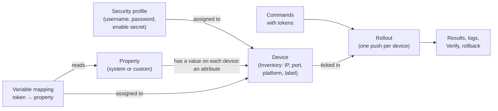
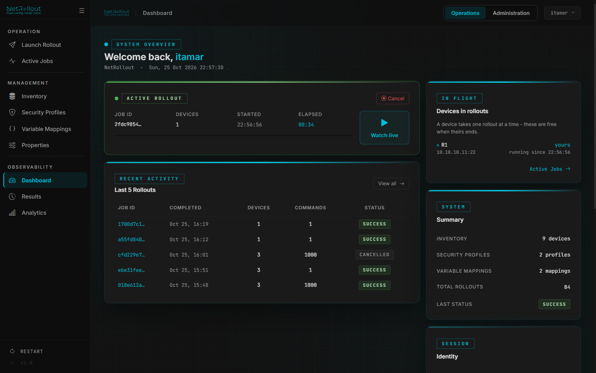
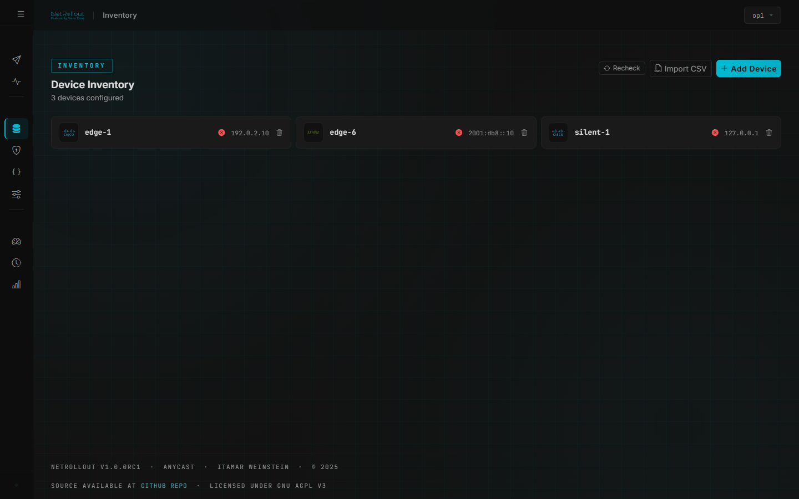
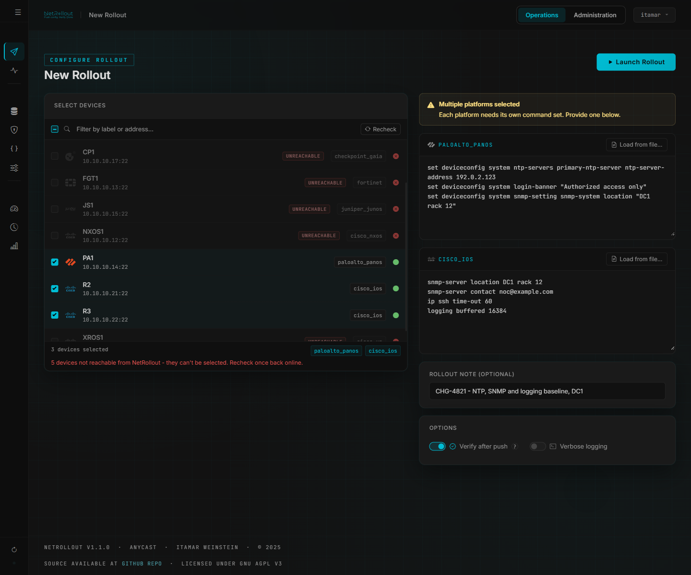
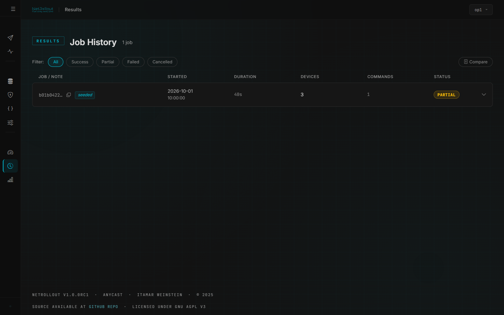

# NetRollout user guide

This guide is for the network engineers who use NetRollout's web app day to day. It covers signing in, building your inventory, storing credentials, per-device variables, running a rollout, and reading the results. Administrators have their own [admin guide](admin-guide.md). For headless one-off rollouts without the web app, see the [CLI guide](cli.md).

## Contents

- [How it fits together](#how-it-fits-together)
- [Signing in](#signing-in)
- [Finding your way around](#finding-your-way-around)
- [The dashboard](#the-dashboard)
- [Inventory](#inventory)
- [Importing devices from a CSV](#importing-devices-from-a-csv)
- [Security profiles](#security-profiles)
- [Properties and variable mappings](#properties-and-variable-mappings)
- [Running a rollout](#running-a-rollout)
- [Active Jobs and the live log](#active-jobs-and-the-live-log)
- [Results](#results)
- [Rolling back](#rolling-back)
- [Analytics](#analytics)
- [Your account](#your-account)
- [Supported platforms](#supported-platforms)

## How it fits together

A rollout is built from a few blocks. Each one is a page in the sidebar, and each is explained in depth below.



1. **A device** (Inventory) is a target: IP address, SSH port, platform and a label.
2. **A security profile** holds the credentials a device logs in with. One profile serves many devices. A device without one can't be rolled out to.
3. **A property** is a kind of per-device value, such as `hostname` or `loopback_ip`. Its value on one device is an **attribute** of that device.
4. **A variable mapping** binds a token, such as `$$LOOPBACK$$`, to a property, and is assigned to the devices it applies to.
5. **A rollout** sends your commands to the devices you tick. On each device, every `$$TOKEN$$` is replaced by that device's value, through your mapping. If a token can't be filled in on a device, the rollout won't start until you fix it.
6. **Results** keep each device's outcome, the log, what Verify found, and a way to roll back.

Commands without tokens need only devices and security profiles. Properties and mappings matter only when the same commands must carry different values per device.

### Who sees and edits what

| Item | Whose is it | Who sees it | Who edits it |
|---|---|---|---|
| Your own device | Yours | You | You |
| Global device | Shared by an administrator | Everyone | Administrators |
| Security profile | Yours | You | You |
| System property (`hostname`, `vrfs`, ...) | Built in | Everyone | Nobody (built in) |
| A system property's value on a device | The device's | Everyone who sees the device | Whoever may edit the device |
| Custom property, and its values | Yours | You | You, on any device you see, global devices included |
| Variable mapping | Yours | You | You |
| Rollout and its results | Yours | You and administrators | Administrators can also cancel it or roll it back |

A global device always has a security profile chosen by an administrator. You use it as it is: you can't assign your own profile to it.

## Signing in

Open NetRollout's address in your browser. Your administrator gives it to you, for example `https://netrollout.corp.local`.

### Getting an account

An account comes one of three ways:

- **Your administrator adds you.** You get a username and a temporary password. At the first sign-in you choose your own password.
- **You ask for one.** On the sign-in page, choose **Request access** and fill in **Username**, **Email**, **Full Name**, an optional **Position** and a password. Then select **Request Access**. An administrator must approve your request before you can sign in. Until then, signing in fails with a message that your account is pending approval.
- **Your organisation's directory (LDAP / Active Directory).** If your administrator has set this up, sign in with your directory username and password. An account is created for you the first time.

### The password rule

A local account's password must:

- be at least 8 characters long
- use at least 2 of: letters, digits, special characters
- use ASCII characters only
- not contain your username

The page tells you what's wrong as soon as you leave the field. A directory (LDAP) account's password is managed by the directory, not by NetRollout.

### Two-factor sign-in

Local accounts sign in with a password and a 6-digit code from an authenticator app, such as Google Authenticator or Authy. Directory (LDAP) accounts sign in with the password only.

The first time you sign in, NetRollout shows **Authenticator Enrollment**:

1. Scan the QR code with your authenticator app.
2. Enter the 6-digit code the app shows.
3. Select **Confirm Enrollment**.

From then on, after your password you'll see **Two-Factor Auth**. Enter the current code and select **Verify**. After 5 wrong codes in a row, you start again from the password.

If you lose your phone, ask an administrator to reset your two-factor sign-in. At your next sign-in you enrol again with a new QR code.

### Changing your password

Open the user menu (your username, top right), choose **My Account**, then **Change password**. Enter your current password and the new one twice.

When you sign in with a temporary password (a new account, or after an administrator reset), NetRollout asks you to set your own password before you can do anything else.

Changing your password signs you out everywhere else. The current browser stays signed in.

### Session timeout

You're signed out after a period without activity: 15 minutes unless your administrator changed it. A minute before, a **Still there?** box counts down. Select **Stay signed in** to continue, or **Sign out**. Activity in another tab of NetRollout counts too. Automatic refreshes and an open live log don't count as activity.

However active you are, you sign in again after 12 hours. When NetRollout restarts or is updated, everyone is signed out.

## Finding your way around

The sidebar on the left holds every page:

| Section | Pages |
|---|---|
| **Operation** | **Launch Rollout**, **Active Jobs** |
| **Management** | **Inventory**, **Security Profiles**, **Variable Mappings**, **Properties** |
| **Observability** | **Dashboard**, **Results**, **Analytics** |

The user menu (your username, top right) has **My Account** and **Logout**. Administrators also see **Admin Panel**.

## The dashboard

The dashboard is the first page after you sign in.



It shows:

- **Active rollout**: your rollout that is running or queued, with **Cancel**. If none is running, **Launch Rollout** starts one.
- **Recent activity**: your last 5 rollouts and their status. A job with a problem that needs a person is marked **Action needed — open the job**. **View all** opens Results.
- **Summary**: how many devices, security profiles and variable mappings you have, your total rollouts and the last status.
- **Your 30-day numbers**: success rate, device pushes, commands pushed, and the device with the most failures.
- **Quick actions**: **Manage Inventory**, **View All Results**.

## Inventory

**Inventory** lists the devices you can roll out to.



### Your devices and global devices

There are two kinds of device:

- **Your own devices.** Only you see them, and only you can edit or remove them.
- **Global devices**, marked **GLOBAL**. An administrator creates them and shares them with everyone. Only an administrator can edit them. A global device always has a security profile set by the administrator.

You can still use a global device in your own rollouts, bind your own variable mappings to it, and set your own values for your custom properties. Select the device to open it.

### Adding a device

1. Select **Add Device**.
2. Fill in:
   - **LABEL** (required): a name, such as `Core-SW-01`.
   - **IP ADDRESS**: IPv4 or IPv6, such as `192.168.1.1` or `2001:db8::1`.
   - **Port**: the SSH port, 1 to 65535.
   - **DEVICE TYPE**: the platform. See [Supported platforms](#supported-platforms).
   - **SECURITY PROFILE** (optional): the credentials to log in with. You can pick one or select **Create New Profile**. A device without a profile can't be used in a rollout.
3. Optionally, select **Test Connection** to check that NetRollout can log in.
4. Save.

Administrators also see a **Global device** switch, which shares the device with all users.

To change a device, select its card. The **Edit Device** window also has the device's **VARIABLE MAPPINGS** and **VARIABLE ATTRIBUTES** (see [Properties and variable mappings](#properties-and-variable-mappings)). To delete it, use **Remove device** and confirm.

Two devices can share an IP address if their ports differ, for example behind NAT. NetRollout identifies a device by `ip:port`.

### Reachability

Each card shows whether NetRollout's server can reach the device's `ip:port` over TCP. This is checked from the server, not from your computer, because that's where the push comes from. Results are reused for a short time (60 seconds unless your administrator changed it). Select **Recheck** to probe every device again now.

## Importing devices from a CSV

Select **Import CSV** to add many devices at once. The file is the same devices CSV the [CLI](cli.md#the-devices-csv) uses.

| Column | Required | Description |
|---|---|---|
| `ip` | Yes | IPv4 or IPv6 address |
| `device_type` | Yes | A supported Netmiko device type, such as `cisco_ios` |
| `port` | Yes | SSH port, 1 to 65535 |
| `label` | No | The device's name. Defaults to the IP address. |
| `username`, `password`, `secret` | No | Credentials. See **Create security profiles** below. |
| *a property's name or label* | No | An attribute value, for example `hostname`, `site` or `vrfs`. List values are comma-separated inside one quoted cell. |

Example:

```csv
ip,device_type,port,label,username,password,secret,hostname,site,vrfs
10.1.0.1,cisco_ios,22,BR1-RTR,netops,S3cret!pass,S3cretEnable,br1-rtr-01,Branch 1,"MGMT,VOICE"
10.1.0.2,cisco_ios,22,BR2-RTR,netops,S3cret!pass,S3cretEnable,br2-rtr-01,Branch 2,MGMT
2001:db8::10,arista_eos,22,DC-LEAF-01,netops,S3cret!pass,,dc-leaf-01,DC,
```

The import form has:

- **CSV FILE**: the file to import.
- **LABEL** (optional): a label for every imported device. It takes precedence over the file's `label` column.
- **Create security profiles from credential columns** (on by default). Rows with the same credentials share one new profile. An existing profile of yours with exactly the same credentials is reused. Existing profiles are never changed. A row needs both `username` and `password` for a profile; a row with only one of them is imported without a profile, and NetRollout names it. When this option is off, the credential columns are ignored and the devices are imported without a profile.

After the import, NetRollout shows what was added and lists each row it couldn't import and why. Columns that aren't a property are listed as **Ignored columns**, so a misspelt property name doesn't go unnoticed. To import such a column, create the property under **Properties** first, then import again. A system property's value is stored on the device. A custom property's value is stored as yours (see below). The import doesn't check reachability; the Inventory page shows it once the devices are in.

> [!WARNING]
> A CSV with credentials holds passwords in plain text. Delete it after the import. Once imported, NetRollout stores them encrypted.

## Security profiles

A security profile is a set of login credentials: **USERNAME**, **PASSWORD** and an optional **ENABLE SECRET**. Assign one profile to many devices, and change the password in one place.

On **Security Profiles**:

- **Add Profile** creates one. The **LABEL** is optional, for example `Core Switches`.
- **Edit profile** changes it. Leave the password blank to keep the current one. **Clear enable secret** removes the secret.
- **Test connection** picks one of your devices and tries a full SSH login with the profile.
- **View attached devices** shows which devices use the profile. Drag devices between **Assigned** and **Available**, or click one to move it. Nothing changes until you select **Save**.
- **Delete profile** works only when no device uses the profile. Reassign or remove those devices first.

Profiles are yours. Other users don't see them. Passwords and secrets are encrypted in the database and are never shown again after you save them.

## Properties and variable mappings

Variables let one command set carry per-device values. You write a token such as `$$LOOPBACK$$` in your commands, and each device gets its own value at push time.

Three pieces work together:

1. A **property** is a kind of value, such as a hostname or a loopback address.
2. An **attribute** is a property's value on one device.
3. A **variable mapping** binds a token to a property, and is assigned to devices.

### Properties

**Properties** lists them. NetRollout ships these system properties, which can't be changed:

| Name | Label | Kind |
|---|---|---|
| `hostname` | Hostname | single value |
| `loopback_ip` | Loopback IP | single value |
| `asn` | ASN | single value |
| `mgmt_vrf` | Management VRF | single value |
| `mgmt_interface` | Management Interface | single value |
| `site` | Site | single value |
| `domain` | Domain | single value |
| `timezone` | Timezone | single value |
| `vrfs` | VRFs | list |

Select **Add Property** to define a custom property. Give it a **LABEL**, such as `BGP Peer IP`. The **NAME** is generated from the label (`bgp_peer_ip`) and can't be changed after you create the property. Choose an **ICON** if you like. Tick **List property** for a comma-separated list of values that commands can index, like `vrfs`.

Custom properties are yours: other users don't see them or their values.

### Attributes

You set a device's values in its **Edit Device** window, under **VARIABLE ATTRIBUTES**, and they can come from the CSV import too.

- A **system property's** value belongs to the device. Everyone who sees the device sees it, and whoever may edit the device can change it.
- A **custom property's** value belongs to you. You can set it on any device you see, global devices included, under **My attributes** (**Save Mine**). Only your mappings use it.

### Variable mappings

On **Variable Mappings**, select **Add Mapping**:

- **TOKEN**: letters, digits and underscores, up to 64 characters, without the `$$`. For example `LOOPBACK`, used in commands as `$$LOOPBACK$$`.
- **ATTRIBUTE**: the property it reads. You can create a new one from here.
- **LIST INDEX**: for a list property, the 0-based position. For example, `vrfs` with index `1` is the second VRF.
- **LABEL** (optional): a description.

Then assign the mapping to devices: select **View assigned devices** and move devices between **Assigned** and **Eligible**. Only devices that have a value for the property are eligible. You can also bind mappings to a device from its **Edit Device** window.

Mappings are yours. Two users can use the same token name for different things.

### How tokens are filled in

At push time, each `$$TOKEN$$` in a device's commands is replaced by that device's value, as you see it. For example:

```text
interface Loopback0
 ip address $$LOOPBACK$$ 255.255.255.255
```

A token can't be filled in on a device if no mapping for it is assigned to that device, or if the device has no value (or the list is too short for the index). NetRollout checks this before it starts:

- On **Launch Rollout**, each device with a problem is marked, and **Launch Rollout** stays disabled until you fix the commands or the device, or untick it.
- If a value disappears while a rollout is queued, that device is skipped at push time and counted as failed. The other devices still run.

## Running a rollout

Open **Launch Rollout**.



1. **Select Devices.** Tick the devices, or use **Select all**. **Filter by label or IP** narrows the list. A device without a security profile can't be ticked; assign one in Inventory. **Recheck** probes reachability again.
2. **Commands.** Give the commands for the devices you ticked, one per line, as you would type them in configuration mode. Choose **Paste** to type them, or **File** to load a `.txt` file. Don't add `configure terminal`, `write memory` or `commit`: NetRollout enters configuration mode and saves or commits the way each platform needs. If you tick devices of more than one platform, you see **Multiple platforms selected**, and you give one command set per platform.
3. **Rollout Note** (optional): up to 255 characters, such as a change or ticket number. It's shown in Results.
4. **Options:**
   - **Verify after push** (on by default): after the push, NetRollout reads each device's configuration and checks every command. See [Verify](#verify).
   - **Verbose logging**: more detail in the job's log.
5. Select **Launch Rollout**.

**Launch Rollout** stays disabled while no device is ticked, the same `ip:port` is ticked twice, or a token can't be filled in. When you launch, NetRollout also checks that every ticked device is reachable from the server. If any isn't, the rollout is refused and the message names the devices; select **Recheck** once they're back.

### What happens on each device

1. NetRollout connects over SSH and enters configuration mode.
2. It sends the commands in order. If the device refuses a command, the reply is logged and the remaining commands are still sent.
3. It finishes the change the way the platform needs: it saves the configuration, commits, or does nothing on platforms where changes are live. See [Supported platforms](#supported-platforms).
4. With Verify on, it reads the configuration back and checks each command.

A rollout configures several devices in parallel: 10 at a time unless your administrator changed it.

### The queue

NetRollout runs a limited number of rollouts at once: 4 unless your administrator changed it. A rollout launched while all slots are busy waits in a queue and shows **Queued — waiting for a free slot** until one frees up.

### Verify

With **Verify after push**, NetRollout checks the change on each device after the push has finished (and been saved or committed):

1. It reads the device's configuration back over SSH, with the platform's own command (for example `show configuration | display set` on JunOS).
2. It places each command you typed in its section. A command typed under `interface GigabitEthernet0/1` is looked for under that interface, not anywhere in the file.
3. It checks each command:
   - A configuration command must be present.
   - A removal (`no`, `undo`, `delete`, `unset`) must be gone.
   - Navigation and operational commands, such as `exit`, `write memory` and `commit`, are marked not verifiable and don't count against the device.

Each device is checked against its own commands, with its tokens filled in. Only devices the push applied to are verified. If you cancel the rollout, nothing is verified. If a device's configuration can't be read, its status comes from the push alone, and it's marked **ACTION NEEDED**: the change was applied but not verified, so check it on the device.

How the result shows:

- The device's **Verified** count in Results is the number of commands confirmed (commands that can't be checked are counted as accounted for).
- Every checkable command confirmed, and none refused: `success`.
- None confirmed: `failed`.
- Some confirmed: `partial`.
- Where something didn't verify, NetRollout keeps the configuration it read, and **Verify Diff** in Results shows it with the verdict for each command. The rollout log lists each command not found too.

Without Verify, the status comes only from what the device said while the commands were sent: no refusals is `success`, every configuring command refused is `failed`, anything between is `partial`.

Verify compares text, so it can be wrong in two ways:

- It can report a command as **not configured** although it is. This happens with typed abbreviations (`int gi1`), values the device rewrites (hashed secrets, normalised values) and defaults the device doesn't show.
- It can report a command as **verified** because it was already there before the rollout.

### Cancelling

Select **Cancel** on the dashboard or on Active Jobs:

- A queued rollout ends at once and is recorded as cancelled ("Cancelled before it started").
- A running rollout stops starting new devices. Devices being configured finish, and devices not reached yet are skipped and recorded as `cancelled`.

## Active Jobs and the live log

When you select **Launch Rollout**, NetRollout takes you to **Active Jobs**, with your new job highlighted.

**Active Jobs** lists the rollouts running or queued, with **Running**, **Queued** and **Devices in flight** counts. The page refreshes itself every 15 seconds while jobs are active (not while a log is open). Administrators also see other users' jobs, under **Other Users**.

For each job:

- **Log** opens the live log under the job's row. It streams the job's log lines as they happen: each device connecting, each command refused, the save or commit, Verify's findings, any **ACTION NEEDED** line and the final summary. Opening it later shows the lines so far first. A queued job's log starts with "Queued — waiting for a free slot" and waits for it to start.
- **Cancel** cancels it (see [Cancelling](#cancelling)).
- **Rollback** is greyed while the rollout runs.

When the rollout ends with its log open, a card shows the outcome: the job's status, the count per status, any **Action needed** devices with what to do, **Rollback** (when at least one device succeeded) and **View in Results**.

The **dashboard** also shows your running or queued rollout, with its elapsed time and **Cancel**, but not its log.

The live log is a convenience. If it drops ("Stream ended."), the job carries on, and the full log is kept: see [Logs](#logs).

### Logs

Every rollout writes a log file on the server, whether or not you watch it live.

- **Download Log**, on the job in Results, downloads it. It's the same text as the live log: every device's connection, the commands refused and the device's replies, the save or commit, Verify's verdict on each command that didn't verify, the **ACTION NEEDED** lines and the summary. **Verbose logging** adds more detail.
- Secrets are redacted. The value after words such as `password`, `secret`, `community`, `key-string` or `psksecret` is written as `<redacted>`, in the file and in the live log, so a log is safe to attach to a ticket.
- You can download the logs of your own jobs; administrators can download any job's.
- Log files are kept 60 days by default. Administrators find them in the server's `logs` folder; see [Logs](admin-guide.md#logs) in the admin guide.

## Results

**Results** lists your finished rollouts, newest first.



Each row shows the job, its note, when it started, how long it took, the number of devices and commands, and the status. Filter by status with the buttons at the top, and choose how many jobs to show per page. Administrators can switch to **All Users**.

Open a job to see each device: IP and port, platform, commands **Sent**, commands **Verified** and the device's **Status**.

### Statuses

Each device gets one of these:

| Status | Meaning |
|---|---|
| `success` | Every command was accepted. With Verify, every checkable command was also confirmed in the configuration. |
| `partial` | Some commands were refused or not confirmed, or the device stopped answering partway through. Some of the change took effect. |
| `failed` | Nothing took effect: no connection, a failed commit, or every configuring command refused. With Verify, none were confirmed. |
| `cancelled` | The rollout was cancelled before this device was started. |

A job's status comes from its devices:

- `cancelled` if any device was cancelled
- otherwise `failed` if every device failed
- otherwise `partial` if any device failed or was partial
- otherwise `success`

### ACTION NEEDED

Some problems can only be fixed by a person on the device. NetRollout marks these **Action needed** in Results and on the dashboard, and writes them in the log as `ACTION NEEDED — <ip:port>: <what to do>`. The job lists each affected device with the action, for example:

- The change is live but **not saved**: save it on the device, or it's lost at the next reboot.
- A commit didn't finish in time: check on the device whether it went through.
- A failed change may still be in the **candidate configuration**: discard it on the device.
- Configuration mode was refused, usually because another session has uncommitted changes in the shared configuration: commit or discard them, then run the rollout again.
- The device stopped answering partway through: the log says which commands it received.
- The account logs in to the wrong shell (for example Check Point's expert shell) and nothing was sent.

### Job actions

- **See Commands**: the commands as you typed them, before token substitution.
- **Download Log**: the job's full log as a file. Secrets are redacted: the value after words such as `password`, `secret`, `community` or `psksecret` is written as `<redacted>`, so the log is safe to share. The commands you typed and configuration snapshots are not redacted.
- **Verify Diff**: for devices where something didn't verify, the device's configuration as NetRollout read it, with the verdict for each command. Commands with tokens are shown as typed; the log has their verdict per device. Snapshots are kept for 7 days unless your administrator changed it. After that the button shows **Verify Diff expired**.
- **Rollback**: see [Rolling back](#rolling-back).
- **Compare**: tick two jobs, then select **Diff** to see their commands side by side.

Job records are kept for 30 days unless your administrator changed it.

## Rolling back

NetRollout doesn't guess how to undo a change, and it doesn't restore a saved configuration. A rollback is a new rollout of **compensatory commands that you write**, sent to the devices the original job configured **successfully**.

1. Select **Rollback** on the job in Results, or on the completion card in Active Jobs. It's offered only when at least one device ended `success`.
2. Enter the compensatory commands, one per line. For a job that added `ntp server 192.0.2.123`, that's `no ntp server 192.0.2.123`. You can use tokens.
3. Choose **Verify after push** and **Verbose**, as for any rollout.
4. Select **Execute Rollback**.

What it does exactly:

- **Which devices**: those that ended `success` in the original job, matched by `ip:port` among the devices the job's owner can see today (their own entry preferred over a global one with the same address). Devices that ended `partial`, `failed` or `cancelled` are left out: check and fix them by hand, or with a new rollout. A device deleted since the job is left out.
- **Which commands**: the same commands to every one of those devices, whatever their platform.
- **Whose view**: the job owner's. Their credentials (the devices' security profiles) log in, and their mappings and values fill in the tokens. Values are read when you start the rollback, not taken from the original job, so check they still reflect the network.
- **Checks first**: as for any rollout, every device must be reachable, have a security profile, and resolve every token, or the rollback is refused with the reason.
- **Whose job**: the rollback is a new job of yours, shown in Active Jobs and Results. The audit log records it against the original job.

You can roll back your own jobs. Administrators can roll back anyone's.

## Analytics

**Analytics** shows your last 30 days: success rate, device pushes, commands pushed, the device with the most failures, and your top platforms.

The **Device Results Explorer** queries your rollout history. Build filters on **Started At**, **Platform**, **Status**, **Commands Sent**, **Device IP** and **Device Port**, then select **Run Query**. **Export CSV** downloads the results.

Administrators can choose **VIEW AS** to see another user's numbers.

## Your account

**My Account** (in the user menu) shows your details (full name, email, position, member since), whether two-factor sign-in is enrolled, and your all-time numbers: total rollouts, devices configured, commands pushed, success rate and top platform. **Change password** is here too. A directory (LDAP) account's password is managed by the directory.

## Supported platforms

| Device type | Platform | How NetRollout finishes the change |
|---|---|---|
| `cisco_ios` | Cisco IOS | Saves the configuration |
| `cisco_xe` | Cisco IOS XE | Saves the configuration |
| `cisco_nxos` | Cisco NX-OS | Saves the configuration |
| `cisco_xr` | Cisco IOS-XR | Commits. A failed commit leaves the running configuration unchanged. |
| `arista_eos` | Arista EOS | Saves the configuration |
| `aruba_aoscx` | Aruba AOS-CX | Saves the configuration |
| `hp_procurve` | HP ProCurve | Saves the configuration |
| `hp_comware` | HP Comware | Saves the configuration |
| `juniper_junos` | Juniper JunOS | Commits, in `configure private` |
| `paloalto_panos` | Palo Alto PAN-OS | Commits |
| `checkpoint_gaia` | Check Point Gaia | Runs `save config` (in clish) |
| `fortinet` | Fortinet FortiOS | Nothing to save: changes are live. NetRollout closes any `config` block left open. |

Not every platform has been tested on real devices yet. The [README](../README.md) shows which have been confirmed. Try a new command set on a lab device first.
